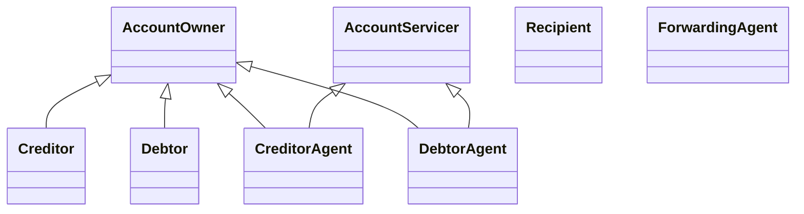

# Bank-to-customer roles and contextual generalisations

## Source evidence

[src-000004](../../../../../../../../evidence/omitted/52f543e2b58f688bc16fa140.md); BusinessRoles and Participants; direct-body paragraph P93; word/media/image1.png. [Unchanged original figure](../../../../../../../../evidence/omitted/e0a95fd60cfa0df790fd0b16.md).

[Complete source figure](../../../../../../../../evidence/omitted/e0a95fd60cfa0df790fd0b16.md)

## Mermaid reconstruction

## Roles, activities and alternatives

All eight source actors carry the BusinessActor stereotype. Six hollow-triangle connectors terminate at AccountOwner or AccountServicer: Creditor and Debtor connect to AccountOwner; each agent connects to both functional roles. Recipient and ForwardingAgent have no connector in the artwork. Class generalisation syntax preserves these arrowheads while replacing actor icons with boxes. T8 is a separate mapping: Creditor, Debtor and System Member map to Account Owner; Creditor Agent, Debtor Agent and Market Infrastructure map to Account Servicer. Its narrower entries do not erase the diagram or assert that one institution always plays the same role. T6 defines Recipient by authorisation and Forwarding Agent by routing responsibility.

| Source-scoped role | Canonical reference |
| --- | --- |
| account owner | [account owner](../../../../../../../../shared/reference/participants/participant-src-000004-account-owner.md) |
| account servicer | [account servicer](../../../../../../../../shared/reference/participants/participant-src-000004-account-servicer.md) |
| creditor | [creditor](../../../../../../../../shared/reference/participants/participant-src-000004-creditor.md) |
| debtor | [debtor](../../../../../../../../shared/reference/participants/participant-src-000004-debtor.md) |
| creditor agent | [creditor agent](../../../../../../../../shared/reference/participants/participant-src-000004-creditor-agent.md) |
| debtor agent | [debtor agent](../../../../../../../../shared/reference/participants/participant-src-000004-debtor-agent.md) |
| recipient | [recipient](../../../../../../../../shared/reference/participants/participant-src-000004-recipient.md) |
| forwarding agent | [forwarding agent](../../../../../../../../shared/reference/participants/participant-src-000004-forwarding-agent.md) |
| market infrastructure | [market infrastructure](../../../../../../../../shared/reference/participants/participant-src-000004-market-infrastructure.md) |
| system member | [system member](../../../../../../../../shared/reference/participants/participant-src-000004-system-member.md) |

Complete source responsibilities/conditions: [T6](../../documents/src-000004/tables/tbl-0006.md), [T7](../../documents/src-000004/tables/tbl-0007.md), [T8](../../documents/src-000004/tables/tbl-0008.md).

## Review evidence

All source actor/role labels, process nodes, source boundaries, plain/generalisation arrows, fork bar, send directions, ordering and alternative annotations compared2026-11-09. [Compared Mermaid12.3.0 rendering](../../../../../../../../evidence/omitted/e3e6678de2284abf79013e0a.md). Source [Word9](../../../../../../../../evidence/omitted/6fc207f60ea6b2be0869bb06.md). The two source role-label/responsibility conflicts remain needs-review despite faithful visible reconstruction.
