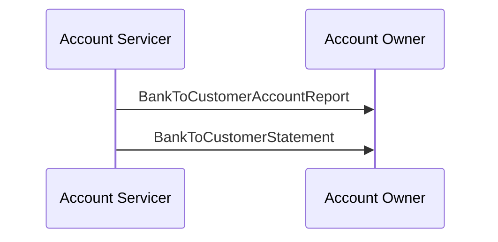

# Reporting scenario 1: intraday report then end-of-day statement

## Source evidence

[src-000004](../../../../../../../../evidence/omitted/52f543e2b58f688bc16fa140.md); BusinessTransactions / Reporting / Scenario 1; direct-body paragraph P133; word/media/image11.png. [Unchanged original figure](../../../../../../../../evidence/omitted/387a7af11024e7e050e523dd.md).

[Complete source figure](../../../../../../../../evidence/omitted/387a7af11024e7e050e523dd.md)

## Mermaid reconstruction

## Roles, activities and alternatives

Under the agreed service, one or more intraday reports provide booked and pending movements; at end of business day the statement summarises all booked entries and provides booked and available balances. Both arrows run Account Servicer to Account Owner. Source names are resolved to the four exact definitions listed in this edition and companion Part2; no version comparison is inferred.

| Source-scoped role | Canonical reference |
| --- | --- |
| account owner | [account owner](../../../../../../../../shared/reference/participants/participant-src-000004-account-owner.md) |
| account servicer | [account servicer](../../../../../../../../shared/reference/participants/participant-src-000004-account-servicer.md) |

## Exact message evidence

| Source family | Exact supplied definition | Companion MDR Part2 locator |
| --- | --- | --- |
| camt.052 | [camt.052.001.14](../../../../../messages/camt.052.001.14/index.md) | src-000005; 2 camt.052.001.14 BankToCustomerAccountReportV14; file pages4-262 |
| camt.053 | [camt.053.001.14](../../../../../messages/camt.053.001.14/index.md) | src-000005; 3 camt.053.001.14 BankToCustomerStatementV14; file pages263-522 |

Reusable flows: [Scenario 1](../../flows/flow-src-000004-p131-scenario-1.md).

## Review evidence

All source actor/role labels, process nodes, source boundaries, plain/generalisation arrows, fork bar, send directions, ordering and alternative annotations compared2026-11-09. [Compared Mermaid12.3.0 rendering](../../../../../../../../evidence/omitted/b61bdb3bab78d66820bb6941.md). Source [Word19](../../../../../../../../evidence/omitted/5a13803dcefa7aac529fb358.md). The two source role-label/responsibility conflicts remain needs-review despite faithful visible reconstruction.
