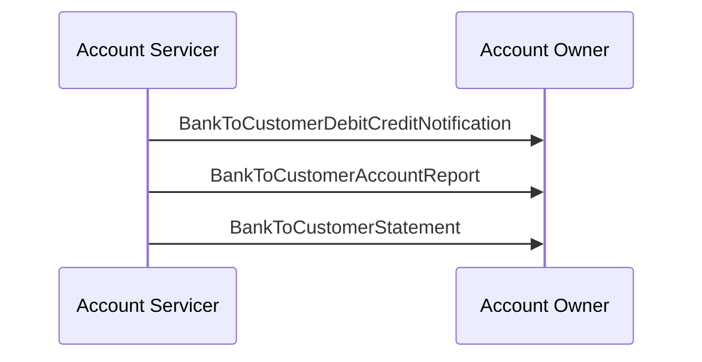

# Reporting scenario 2: credit threshold, intraday report and statement

## Source evidence

[src-000004](../../../../../../../../evidence/omitted/52f543e2b58f688bc16fa140.md); BusinessTransactions / Reporting / Scenario 2; direct-body paragraph P136; word/media/image12.png. [Unchanged original figure](../../../../../../../../evidence/omitted/741dd2c73ae3abe9569d2200.md).

[Complete source figure](../../../../../../../../evidence/omitted/741dd2c73ae3abe9569d2200.md)

## Mermaid reconstruction

## Roles, activities and alternatives

The agreed service sends notifications for incoming credits above a threshold, an intraday report at a pre-agreed time with all booked/pending movements since business-day start and booked/expected balances, then an end-of-day statement of booked entries with booked/available balances. The threshold is not supplied numerically and is not invented.

| Source-scoped role | Canonical reference |
| --- | --- |
| account owner | [account owner](../../../../../../../../shared/reference/participants/participant-src-000004-account-owner.md) |
| account servicer | [account servicer](../../../../../../../../shared/reference/participants/participant-src-000004-account-servicer.md) |

## Exact message evidence

| Source family | Exact supplied definition | Companion MDR Part2 locator |
| --- | --- | --- |
| camt.052 | [camt.052.001.14](../../../../../messages/camt.052.001.14/index.md) | src-000005; 2 camt.052.001.14 BankToCustomerAccountReportV14; file pages4-262 |
| camt.053 | [camt.053.001.14](../../../../../messages/camt.053.001.14/index.md) | src-000005; 3 camt.053.001.14 BankToCustomerStatementV14; file pages263-522 |
| camt.054 | [camt.054.001.14](../../../../../messages/camt.054.001.14/index.md) | src-000005; 4 camt.054.001.14 BankToCustomerDebitCreditNotificationV14; file pages523-780 |

Reusable flows: [Scenario 2](../../flows/flow-src-000004-p134-scenario-2.md).

## Review evidence

All source actor/role labels, process nodes, source boundaries, plain/generalisation arrows, fork bar, send directions, ordering and alternative annotations compared2026-11-09. [Compared Mermaid12.3.0 rendering](../../../../../../../../evidence/omitted/10738ed1e6117c2fc829886b.md). Source [Word20](../../../../../../../../evidence/omitted/c3c5639e2b5cb55f4f5a3c00.md). The two source role-label/responsibility conflicts remain needs-review despite faithful visible reconstruction.
