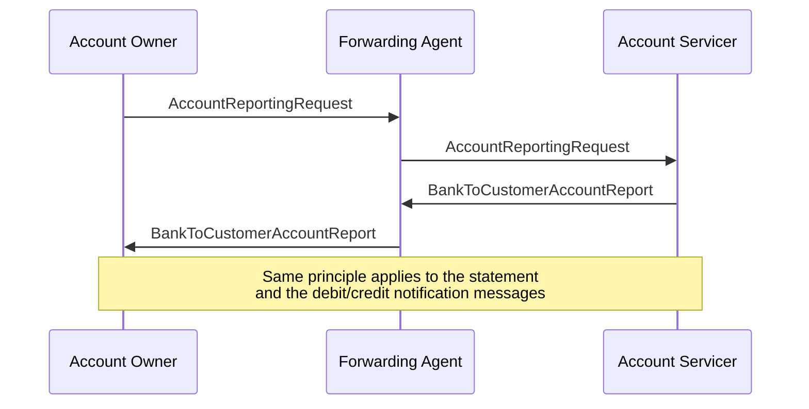

# Relay reporting request and response

## Source evidence

[src-000004](../../../../../../../../evidence/omitted/52f543e2b58f688bc16fa140.md); BusinessTransactions / Reporting Request to Account Servicer / Relay Scenario; direct-body paragraph P154; word/media/image16.png. [Unchanged original figure](../../../../../../../../evidence/omitted/da59a307da1a823c41ff4822.md).

[Complete source figure](../../../../../../../../evidence/omitted/da59a307da1a823c41ff4822.md)

## Mermaid reconstruction

## Roles, activities and alternatives

The owner communicates with the servicer through a Forwarding Agent. P151 permits the owner either to send an AccountReportingRequest to that agent or request the agent to issue one; the latter request is not assigned an invented XML format. The forwarded request reaches the servicer, which responds through the agent. The same principle applies to statements and debit/credit notifications, as the source note states.

| Source-scoped role | Canonical reference |
| --- | --- |
| account owner | [account owner](../../../../../../../../shared/reference/participants/participant-src-000004-account-owner.md) |
| account servicer | [account servicer](../../../../../../../../shared/reference/participants/participant-src-000004-account-servicer.md) |
| forwarding agent | [forwarding agent](../../../../../../../../shared/reference/participants/participant-src-000004-forwarding-agent.md) |

## Exact message evidence

| Source family | Exact supplied definition | Companion MDR Part2 locator |
| --- | --- | --- |
| camt.052 | [camt.052.001.14](../../../../../messages/camt.052.001.14/index.md) | src-000005; 2 camt.052.001.14 BankToCustomerAccountReportV14; file pages4-262 |
| camt.053 | [camt.053.001.14](../../../../../messages/camt.053.001.14/index.md) | src-000005; 3 camt.053.001.14 BankToCustomerStatementV14; file pages263-522 |
| camt.054 | [camt.054.001.14](../../../../../messages/camt.054.001.14/index.md) | src-000005; 4 camt.054.001.14 BankToCustomerDebitCreditNotificationV14; file pages523-780 |
| camt.060 | [camt.060.001.07](../../../../../messages/camt.060.001.07/index.md) | src-000005; 5 camt.060.001.07 AccountReportingRequestV07; file pages781-795 |

Reusable flows: [Relay Scenario](../../flows/flow-src-000004-p149-relay-scenario.md).

## Review evidence

All source actor/role labels, process nodes, source boundaries, plain/generalisation arrows, fork bar, send directions, ordering and alternative annotations compared2026-11-09. [Compared Mermaid12.3.0 rendering](../../../../../../../../evidence/omitted/d8f17fbec8dc4a913c0e3aed.md). Source [Word22](../../../../../../../../evidence/omitted/1c22d0da22b5bc18dc75bb43.md). The two source role-label/responsibility conflicts remain needs-review despite faithful visible reconstruction.
