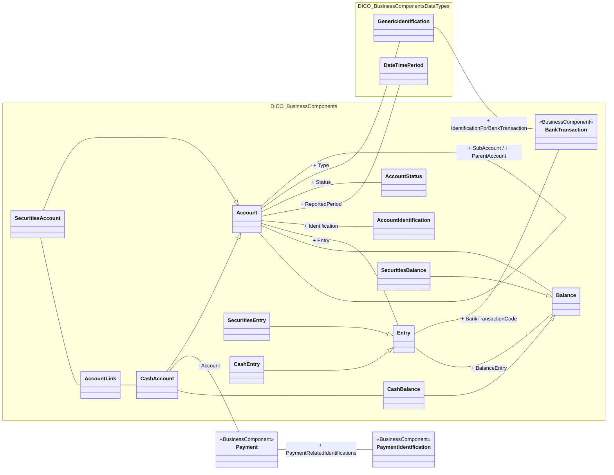

# Bank-to-customer accounts, balances and entries

[src-000006](../../../../../../../../../evidence/omitted/5e0f6b7d43fcbbe816624756.md), AccountBalanceEntry!A1:AA37; xl/drawings/drawing3.xml; anchor 1. Original image SHA-256: 865748b24c4b326a237d91eefea7f2a8fc06c9c1c9e5b7fdf5534a46a1472852.

[Original complete figure](../../../../../../../../../evidence/omitted/12e3d3cfe1bc05344a368c96.md) · [Rendered Mermaid SVG](../../../../../../../../../evidence/omitted/f0fb7443493c7e7865bcc2ab.md) · [Rendered Mermaid PNG](../../../../../../../../../evidence/omitted/f42983e718e7e2c61d4b3d01.md)

## Source reconstruction

## Entities and relationships

Account, Entry and Balance each have cash and securities specializations. AccountLink connects SecuritiesAccount and CashAccount. Account types and bank transactions link to GenericIdentification; Entry connects BankTransaction through the printed BankTransactionCode end label. The general Account–Balance and specific CashAccount–CashBalance lines are both retained. Most source boxes omit stereotypes; only the printed BusinessComponent stereotypes are reconstructed.

All 17 visible node occurrences and 21 relationship lines are retained. No numeric multiplicities are printed in this source view; none are inferred. Namespaces group only printed from-package labels for readability; the source does not draw those enclosing boxes. Nodes with no printed package remain outside these groups. No package membership is inferred from the component name. Association labels retain literal +/− prefixes and combined end names. Their re-layout position is not additional navigability evidence. The native class inheritance marker is reserved for the source’s hollow-triangle generalizations. Source editor/navigation icons are omitted as interface decoration; no business entity or relationship is excluded.

## Complete relationship register

| From node | To node | Source relationship kind | Visible source label(s) | From-end multiplicity | To-end multiplicity |
| --- | --- | --- | --- | --- | --- |
| Account | Account | association | + SubAccount / + ParentAccount | not printed | not printed |
| CashAccount | Account | generalization: subtype to supertype | (unlabelled in source) | not printed | not printed |
| SecuritiesAccount | Account | generalization: subtype to supertype | (unlabelled in source) | not printed | not printed |
| SecuritiesAccount | AccountLink | association | (unlabelled in source) | not printed | not printed |
| AccountLink | CashAccount | association | (unlabelled in source) | not printed | not printed |
| Account | GenericIdentification | association | + Type | not printed | not printed |
| GenericIdentification | BankTransaction | association | + IdentificationForBankTransaction | not printed | not printed |
| Account | AccountStatus | association | + Status | not printed | not printed |
| Account | DateTimePeriod | association | + ReportedPeriod | not printed | not printed |
| Account | AccountIdentification | association | + Identification | not printed | not printed |
| Account | Entry | association | + Entry | not printed | not printed |
| Entry | BankTransaction | association | + BankTransactionCode | not printed | not printed |
| SecuritiesEntry | Entry | generalization: subtype to supertype | (unlabelled in source) | not printed | not printed |
| CashEntry | Entry | generalization: subtype to supertype | (unlabelled in source) | not printed | not printed |
| Account | Balance | association | (unlabelled in source) | not printed | not printed |
| Entry | Balance | association | + BalanceEntry | not printed | not printed |
| CashBalance | Balance | generalization: subtype to supertype | (unlabelled in source) | not printed | not printed |
| SecuritiesBalance | Balance | generalization: subtype to supertype | (unlabelled in source) | not printed | not printed |
| CashAccount | Payment | association | - Account | not printed | not printed |
| CashAccount | CashBalance | association | (unlabelled in source) | not printed | not printed |
| Payment | PaymentIdentification | association | + PaymentRelatedIdentifications | not printed | not printed |

## Entity definitions and precise workbook locators

| Visible label | Source package / stereotype | Definition evidence |
| --- | --- | --- |
| GenericIdentification | DICO_BusinessComponentsDataTypes / (stereotype not printed) | [FullBusinessModel!A1976:D1976](../sheets/02-fullbusinessmodel/tbl-0011.md) — Information related to a non-standardised identification, such as a proprietary party identification or account identification. |
| AccountStatus | DICO_BusinessComponents / (stereotype not printed) | [FullBusinessModel!A110:D110](../sheets/02-fullbusinessmodel/tbl-0002.md) — Specifies the status of an account or the status of the processing of the actions linked to the management of an account. |
| DateTimePeriod | DICO_BusinessComponentsDataTypes / (stereotype not printed) | [FullBusinessModel!A1363:D1363](../sheets/02-fullbusinessmodel/tbl-0008.md) — Time span defined by a start date and time, and an end date and time. |
| AccountIdentification | DICO_BusinessComponents / (stereotype not printed) | [FullBusinessModel!A71:D71](../sheets/02-fullbusinessmodel/tbl-0002.md) — Unique identifier of an account, as assigned by the account servicer. |
| Account | DICO_BusinessComponents / (stereotype not printed) | [FullBusinessModel!A24:D24](../sheets/02-fullbusinessmodel/tbl-0002.md) — Record of transactions in specific types of assets, maintained by a servicing party on behalf of one or more owning parties. Business relationship between an account servicer and one or more account owners. |
| SecuritiesAccount | DICO_BusinessComponents / (stereotype not printed) | [FullBusinessModel!A3889:D3889](../sheets/02-fullbusinessmodel/tbl-0021.md) — Account to or from which a securities entry is made. |
| AccountLink | DICO_BusinessComponents / (stereotype not printed) | [FullBusinessModel!A81:D81](../sheets/02-fullbusinessmodel/tbl-0002.md) — Defines the link between the accounts held with a market infrastructure. |
| CashAccount | DICO_BusinessComponents / (stereotype not printed) | [FullBusinessModel!A562:D562](../sheets/02-fullbusinessmodel/tbl-0004.md) — Account to or from which a cash entry is made. |
| Entry | DICO_BusinessComponents / (stereotype not printed) | [FullBusinessModel!A1814:D1814](../sheets/02-fullbusinessmodel/tbl-0011.md) — Posting to an account that results in an increase or decrease to a balance. |
| SecuritiesEntry | DICO_BusinessComponents / (stereotype not printed) | [FullBusinessModel!A4023:D4023](../sheets/02-fullbusinessmodel/tbl-0022.md) — Posting to a securities account as a result of a securities creation, deletion or transfer in the context of a securities transaction. |
| CashEntry | DICO_BusinessComponents / (stereotype not printed) | [FullBusinessModel!A680:D680](../sheets/02-fullbusinessmodel/tbl-0005.md) — Posting of an item to a cash account, in the context of a cash transaction, that results in an increase or decrease to the balance of the account. |
| Balance | DICO_BusinessComponents / (stereotype not printed) | [FullBusinessModel!A356:D356](../sheets/02-fullbusinessmodel/tbl-0003.md) — Numerical representation of the net increases and decreases in an account at a specific point in time. |
| CashBalance | DICO_BusinessComponents / (stereotype not printed) | [FullBusinessModel!A617:D617](../sheets/02-fullbusinessmodel/tbl-0005.md) — Numerical representation of the net increases and decreases in an account at a specific point in time. A cash balance is calculated from a sum of cash credits minus a sum of cash debits. |
| SecuritiesBalance | DICO_BusinessComponents / (stereotype not printed) | [FullBusinessModel!A3921:D3921](../sheets/02-fullbusinessmodel/tbl-0021.md) — Net position of a segregated holding, in a single security, within the overall position held in a securities account. A securities balance is calculated from the sum of securities' receipts minus the sum of securities' deliveries. |
| BankTransaction | DICO_BusinessComponents / BusinessComponent | [FullBusinessModel!A372:D372](../sheets/02-fullbusinessmodel/tbl-0003.md) — Code of the underlying bank transaction. |
| Payment | (package not printed) / BusinessComponent | [FullBusinessModel!A3055:D3055](../sheets/02-fullbusinessmodel/tbl-0017.md) — Payment information and processes required to transfer cash end to end from the debtor to the creditor. |
| PaymentIdentification | (package not printed) / BusinessComponent | [FullBusinessModel!A3122:D3122](../sheets/02-fullbusinessmodel/tbl-0017.md) — Specifies the different identifications associated with a payment transaction. |

## Participant and flow navigation

This is a conceptual entity model, not a message exchange diagram. A business component or relationship label is not automatically a functional participant or institution. [Message-set participant references](../../../participants.md) and [Message-set business flows](../../../flows/index.md) provide the independently sourced actor/process context. These references are navigational; source figure associations do not establish message direction.

## Rendering and visual review

2026-11-09: Mermaid 12.3.0 parsed and rendered successfully with Mermaid browser API + Chromium 156.0.8078.81. Direct comparison of each complete source image and rendered PNG; checked all 17 visible node occurrences, 21 relationship lines, literal endpoint labels, inheritance direction, package labels and printed/omitted stereotypes. No multiplicities are printed or inferred. The src-000164 displaced label is resolved from FullBusinessModel A2990:F2990 and A635:F635; original source retained. [Renderer evidence](../../../../../../../../../work/payment-workbook-models/render-report.json).

