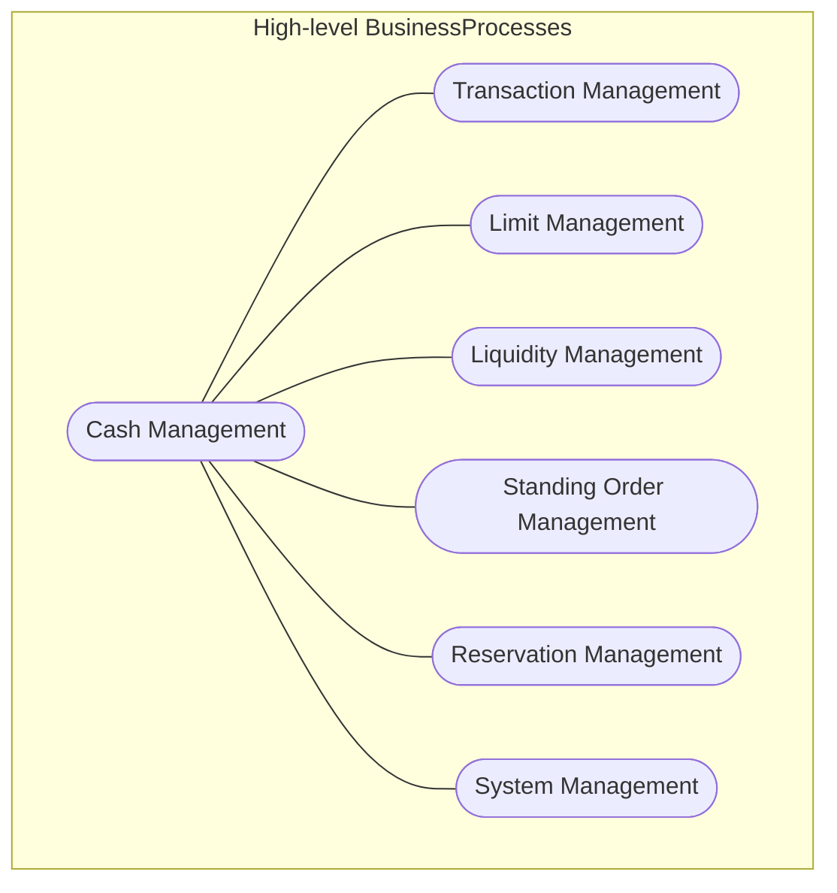

# Cash Management process overview

[src-000014](../../../../../../../../evidence/omitted/335a400e27e5efca9fdafbb5.md); direct-body paragraph P107; Word file page12.

[Complete Word page](../../../../../../../../evidence/omitted/af6a959e91613a56f0abab63.md) · [Original artwork](../../../../../../../../evidence/omitted/6bca6d7766739853ad5282a9.md)

## Entities and relationships

| Source | Destination | Label or relationship |
| --- | --- | --- |
| Cash Management | Transaction Management | Unlabelled undirected scope link |
| Cash Management | Limit Management | Unlabelled undirected scope link |
| Cash Management | Liquidity Management | Unlabelled undirected scope link |
| Cash Management | Standing Order Management | Unlabelled undirected scope link |
| Cash Management | Reservation Management | Unlabelled undirected scope link |
| Cash Management | System Management | Unlabelled undirected scope link |

## Participants

## Qualifications

- P106 calls this a high-level BusinessProcess diagram. Oval scope nodes have unlabelled lines without arrowheads, actors, include/extend or execution order; a flowchart preserves these semantics without inventing use-case dependencies. Account and Member groups appear separately in T4/T7 and their flows although this overview has six children.

## Rendering and visual review

The complete Word-composed source and final Mermaid12.3.0 reconstruction were directly compared on 2026-11-09. Actor labels, message labels, directions, order, associations, overview boundaries and execution-delay bars match. Source icons and layout are retained in the original image; the reconstruction uses text actors. Figures7/11 were corrected and re-rendered so the delay bar reaches the Return response. All38 Word pages were inventoried. Source discrepancies remain open where listed.

[Rendered PNG](../../../../../../../../evidence/omitted/e2bb256b098958494507e8b7.md) · [Rendered SVG](../../../../../../../../evidence/omitted/9212e27c2473e6893121efbb.md) · [Hash-bound review evidence](../../../../../../../../tracking/reviews/operational-cash.json)
