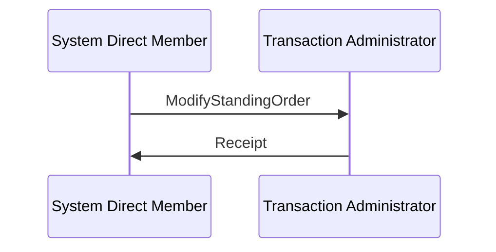

# Modify Standing Order Scenario

[src-000014](../../../../../../../../evidence/omitted/335a400e27e5efca9fdafbb5.md); direct-body paragraph P361; Word file page36.

[Complete Word page](../../../../../../../../evidence/omitted/6c3b8eb60f99e9465b489a13.md) · [Original artwork](../../../../../../../../evidence/omitted/c8a26a7d0b56b4df08dbd160.md)

## Entities and relationships

| Source | Destination | Label or relationship |
| --- | --- | --- |
| System Direct Member | Transaction Administrator | ModifyStandingOrder |
| Transaction Administrator | System Direct Member | Receipt |

## Participants

- [System Direct Member](../../../../../../../../shared/reference/participants/participant-src-000014-system-direct-member.md)
- [System / Transaction Administrator](../../../../../../../../shared/reference/participants/participant-src-000014-system-transaction-administrator.md)

## Qualifications

- The picture shows only the System Direct Member and Transaction Administrator. Account owner/servicing institution are narrative relationship roles (P75–78), not extra lifelines.
- Solid source exchange lines and ordering are retained. No timeout, condition, response code or mandatory Receipt is inferred solely from the picture.

[Flow, alternatives and source narrative](../../flows/flow-src-000014-p357-modify-standing-order-scenario.md)

## Rendering and visual review

The complete Word-composed source and final Mermaid12.3.0 reconstruction were directly compared on 2026-11-09. Actor labels, message labels, directions, order, associations, overview boundaries and execution-delay bars match. Source icons and layout are retained in the original image; the reconstruction uses text actors. Figures7/11 were corrected and re-rendered so the delay bar reaches the Return response. All38 Word pages were inventoried. Source discrepancies remain open where listed.

[Rendered PNG](../../../../../../../../evidence/omitted/ac416f65b2109a8e45ebeed1.md) · [Rendered SVG](../../../../../../../../evidence/omitted/865dd505d28eaad40e2ad20f.md) · [Hash-bound review evidence](../../../../../../../../tracking/reviews/operational-cash.json)
