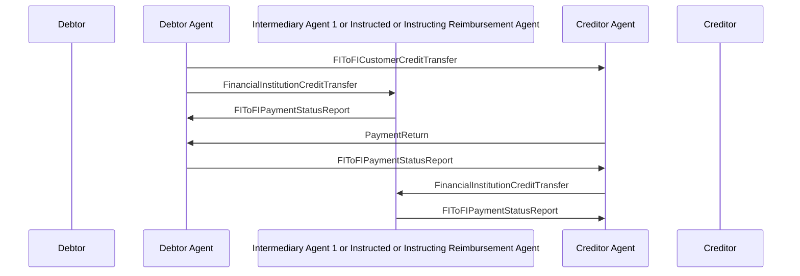

# Credit Transfer / PaymentReturn with FIToFICustomerCreditTransfer  / Debtor Agent and Creditor Agent are not Correspondents - 2  — figure 20

[src-000162](../../../../../../../../evidence/omitted/530a772f5cf631826741f05d.md); direct-body paragraph P279; Word file/printed page 32.

[Original figure](../../../../../../../../evidence/omitted/002766a080bf1ebccac28fd4.md) · [Complete Word-rendered page](../../../../../../../../evidence/omitted/4275007908ddd0171a049119.md) · [Reusable flow](../../flows/flow-src-000162-p277-debtor-agent-and-creditor-agent-are-not-correspondents-2.md)

## Source reconstruction

## Participants and roles

| Occurrence | Literal label | Scoped roles |
| --- | --- | --- |
| D | Debtor | [debtor](../../../../../../../../shared/reference/participants/participant-src-000162-debtor.md) |
| DA | Debtor Agent | [debtor-agent](../../../../../../../../shared/reference/participants/participant-src-000162-debtor-agent.md) |
| M | Intermediary Agent 1 or Instructed or Instructing Reimbursement Agent | [instructed-reimbursement-agent](../../../../../../../../shared/reference/participants/participant-src-000162-instructed-reimbursement-agent.md) |
| CA | Creditor Agent | [creditor-agent](../../../../../../../../shared/reference/participants/participant-src-000162-creditor-agent.md) |
| C | Creditor | [creditor](../../../../../../../../shared/reference/participants/participant-src-000162-creditor.md) |

## Relationships and activities

| Order | From | To | Literal connection |
| --- | --- | --- | --- |
| 1 | DA | CA | FIToFICustomerCreditTransfer |
| 2 | DA | M | FinancialInstitutionCreditTransfer |
| 3 | M | DA | FIToFIPaymentStatusReport |
| 4 | CA | DA | PaymentReturn |
| 5 | DA | CA | FIToFIPaymentStatusReport |
| 6 | CA | M | FinancialInstitutionCreditTransfer |
| 7 | M | CA | FIToFIPaymentStatusReport |

## Source qualifications

- P285: this PaymentReturn exceptionally informs about movement rather than moving funds; actual returned funds move via creditor-agent FinancialInstitutionCreditTransfer to reimbursement agent. P289 covers initially unknown settlement and later funding return.
- Source participant icons/labels denote contextual roles; they do not fix an institution to one role. Unused lifelines remain visible.
- Source message names establish family-level flow context; supplied exact schema versions are separately identified.
- Mermaid preserves connections and order; original retains precise geometry, pictograms and line style. Whole-page Word rendering checked for composite context.

## Rendering and visual review

Mermaid 12.3.0 parsed/rendered on 2026-11-09 with Mermaid browser API + Chromium 156.0.8078.81. [Rendered SVG](../../../../../../../../evidence/omitted/f462dd993f744473711f0d33.md) · [Rendered PNG](../../../../../../../../evidence/omitted/6fc9ce8e35b6253447e8101e.md).

Original picture labels, endpoints, order/decision paths and complete Word-rendered source page compared with rendered Mermaid. Native use-case models include dashed source connectors without invented include/extend semantics.

Bounded reconstruction passed its actual comparison.
