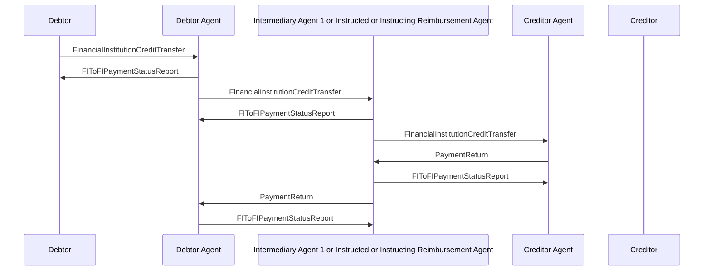

# Credit Transfer / PaymentReturn with FinancialInstitutionCreditTransfer  / Debtor Agent and Creditor Agent are Not Correspondents  — figure 35

[src-000162](../../../../../../../../evidence/omitted/530a772f5cf631826741f05d.md); direct-body paragraph P447; Word file/printed page 46.

[Original figure](../../../../../../../../evidence/omitted/cbbe2931d5d6e50160ec0596.md) · [Complete Word-rendered page](../../../../../../../../evidence/omitted/f51fbc0ecdd213ef5dc5906b.md) · [Reusable flow](../../flows/flow-src-000162-p445-debtor-agent-and-creditor-agent-are-not-correspondents.md)

## Source reconstruction

## Participants and roles

| Occurrence | Literal label | Scoped roles |
| --- | --- | --- |
| D | Debtor | [debtor](../../../../../../../../shared/reference/participants/participant-src-000162-debtor.md) |
| DA | Debtor Agent | [debtor-agent](../../../../../../../../shared/reference/participants/participant-src-000162-debtor-agent.md) |
| M | Intermediary Agent 1 or Instructed or Instructing Reimbursement Agent | [intermediary-agent](../../../../../../../../shared/reference/participants/participant-src-000162-intermediary-agent.md) |
| CA | Creditor Agent | [creditor-agent](../../../../../../../../shared/reference/participants/participant-src-000162-creditor-agent.md) |
| C | Creditor | [creditor](../../../../../../../../shared/reference/participants/participant-src-000162-creditor.md) |

## Relationships and activities

| Order | From | To | Literal connection |
| --- | --- | --- | --- |
| 1 | D | DA | FinancialInstitutionCreditTransfer |
| 2 | DA | D | FIToFIPaymentStatusReport |
| 3 | DA | M | FinancialInstitutionCreditTransfer |
| 4 | M | DA | FIToFIPaymentStatusReport |
| 5 | M | CA | FinancialInstitutionCreditTransfer |
| 6 | CA | M | PaymentReturn |
| 7 | M | CA | FIToFIPaymentStatusReport |
| 8 | M | DA | PaymentReturn |
| 9 | DA | M | FIToFIPaymentStatusReport |

## Source qualifications

- P446 after settlement; P449 intermediary services creditor-agent account or clearing link. P456/P459 optional repair; P457/P460 optional acknowledgements.
- Source participant icons/labels denote contextual roles; they do not fix an institution to one role. Unused lifelines remain visible.
- Source message names establish family-level flow context; supplied exact schema versions are separately identified.
- Mermaid preserves connections and order; original retains precise geometry, pictograms and line style. Whole-page Word rendering checked for composite context.

## Rendering and visual review

Mermaid 12.3.0 parsed/rendered on 2026-11-09 with Mermaid browser API + Chromium 156.0.8078.81. [Rendered SVG](../../../../../../../../evidence/omitted/d94f3506d72f4ed201a017b6.md) · [Rendered PNG](../../../../../../../../evidence/omitted/0321e58d34865c577762a9b3.md).

Original picture labels, endpoints, order/decision paths and complete Word-rendered source page compared with rendered Mermaid. Native use-case models include dashed source connectors without invented include/extend semantics.

Bounded reconstruction passed its actual comparison.
