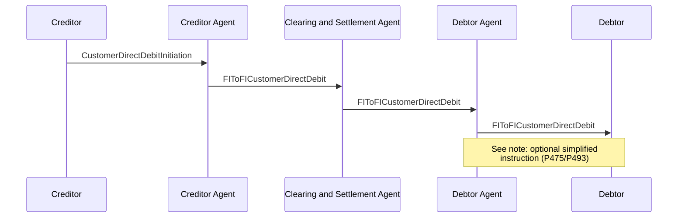

# Direct Debit / FIToFICustomerDirectDebit — figure 37

[src-000162](../../../../../../../../evidence/omitted/530a772f5cf631826741f05d.md); direct-body paragraph P474; Word file/printed page 48.

[Original figure](../../../../../../../../evidence/omitted/9bfd2b68e5c97be7e4419cc5.md) · [Complete Word-rendered page](../../../../../../../../evidence/omitted/21dcce204faf08320939fbc1.md) · [Reusable flow](../../flows/flow-src-000162-p468-fito-ficustomer-direct-debit.md)

## Source reconstruction

## Participants and roles

| Occurrence | Literal label | Scoped roles |
| --- | --- | --- |
| C | Creditor | [creditor](../../../../../../../../shared/reference/participants/participant-src-000162-creditor.md); [initiating-party](../../../../../../../../shared/reference/participants/participant-src-000162-initiating-party.md) |
| CA | Creditor Agent | [creditor-agent](../../../../../../../../shared/reference/participants/participant-src-000162-creditor-agent.md) |
| CS | Clearing and Settlement Agent | [clearing-and-settlement-agent](../../../../../../../../shared/reference/participants/participant-src-000162-clearing-and-settlement-agent.md) |
| DA | Debtor Agent | [debtor-agent](../../../../../../../../shared/reference/participants/participant-src-000162-debtor-agent.md) |
| D | Debtor | [debtor](../../../../../../../../shared/reference/participants/participant-src-000162-debtor.md) |

## Relationships and activities

| Order | From | To | Literal connection |
| --- | --- | --- | --- |
| 1 | C | CA | CustomerDirectDebitInitiation |
| 2 | CA | CS | FIToFICustomerDirectDebit |
| 3 | CS | DA | FIToFICustomerDirectDebit |
| 4 | DA | D | FIToFICustomerDirectDebit |

## Source qualifications

- Last arrow carries source (See note): P475/P493 describe optional simplified customer advice. Mandate/management omitted from picture but P477–486 define consent, MRI, pre-notification and debtor reconciliation.
- Source participant icons/labels denote contextual roles; they do not fix an institution to one role. Unused lifelines remain visible.
- Source message names establish family-level flow context; supplied exact schema versions are separately identified.
- Mermaid preserves connections and order; original retains precise geometry, pictograms and line style. Whole-page Word rendering checked for composite context.

## Rendering and visual review

Mermaid 12.3.0 parsed/rendered on 2026-11-09 with Mermaid browser API + Chromium 156.0.8078.81. [Rendered SVG](../../../../../../../../evidence/omitted/eb927fa3d1a39c688864865c.md) · [Rendered PNG](../../../../../../../../evidence/omitted/e6b8c4f0be74bf658c7e0d61.md).

Original picture labels, endpoints, order/decision paths and complete Word-rendered source page compared with rendered Mermaid. Native use-case models include dashed source connectors without invented include/extend semantics.

Bounded reconstruction passed its actual comparison.
