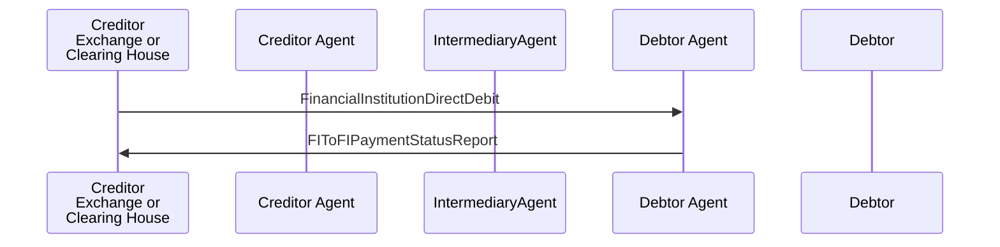

# Direct Debit / FinancialInstitutionDirectDebit / Creditor and Debtor Agent are correspondents — figure 44

[src-000162](../../../../../../../../evidence/omitted/530a772f5cf631826741f05d.md); direct-body paragraph P587; Word file/printed page 58.

[Original figure](../../../../../../../../evidence/omitted/8d63d4c872a441153ac14e0a.md) · [Complete Word-rendered page](../../../../../../../../evidence/omitted/1813f6838486c18ab21c4956.md) · [Reusable flow](../../flows/flow-src-000162-p585-creditor-and-debtor-agent-are-correspondents.md)

## Source reconstruction

## Participants and roles

| Occurrence | Literal label | Scoped roles |
| --- | --- | --- |
| C | Creditor Exchange or Clearing House | [creditor](../../../../../../../../shared/reference/participants/participant-src-000162-creditor.md); [exchange](../../../../../../../../shared/reference/participants/participant-src-000162-exchange.md); [clearing-house](../../../../../../../../shared/reference/participants/participant-src-000162-clearing-house.md) |
| CA | Creditor Agent | [creditor-agent](../../../../../../../../shared/reference/participants/participant-src-000162-creditor-agent.md) |
| M | IntermediaryAgent | [intermediary-agent](../../../../../../../../shared/reference/participants/participant-src-000162-intermediary-agent.md) |
| DA | Debtor Agent | [debtor-agent](../../../../../../../../shared/reference/participants/participant-src-000162-debtor-agent.md) |
| D | Debtor | [debtor](../../../../../../../../shared/reference/participants/participant-src-000162-debtor.md) |

## Relationships and activities

| Order | From | To | Literal connection |
| --- | --- | --- | --- |
| 1 | C | DA | FinancialInstitutionDirectDebit |
| 2 | DA | C | FIToFIPaymentStatusReport |

## Source qualifications

- Creditor picture label includes Exchange or Clearing House as examples, not universal aliases. P586 debtor agent services creditor and debtor accounts; one debtor shown for simplicity. P594 unprocessable instruction is rejected before settlement; mandates/reporting not drawn.
- Source participant icons/labels denote contextual roles; they do not fix an institution to one role. Unused lifelines remain visible.
- Source message names establish family-level flow context; supplied exact schema versions are separately identified.
- Mermaid preserves connections and order; original retains precise geometry, pictograms and line style. Whole-page Word rendering checked for composite context.

## Rendering and visual review

Mermaid 12.3.0 parsed/rendered on 2026-11-09 with Mermaid browser API + Chromium 156.0.8078.81. [Rendered SVG](../../../../../../../../evidence/omitted/d42903cd5be7cec6d23ed387.md) · [Rendered PNG](../../../../../../../../evidence/omitted/d60164a6da2f0bc9703e1ff4.md).

Original picture labels, endpoints, order/decision paths and complete Word-rendered source page compared with rendered Mermaid. Native use-case models include dashed source connectors without invented include/extend semantics.

Bounded reconstruction passed its actual comparison.
