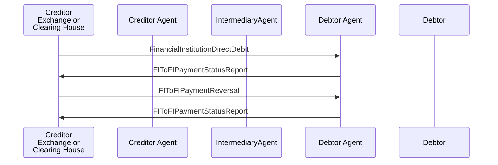

# Direct Debit / FinancialInstitutionDirectDebit / FIToFIPaymentReversal with Direct Debit — figure 48

[src-000162](../../../../../../../../evidence/omitted/530a772f5cf631826741f05d.md); direct-body paragraph P642; Word file/printed page 62.

[Original figure](../../../../../../../../evidence/omitted/e104f521240d11066ab90cf8.md) · [Complete Word-rendered page](../../../../../../../../evidence/omitted/da2c882e12219d842a7df55d.md) · [Reusable flow](../../flows/flow-src-000162-p640-fito-fipayment-reversal-with-direct-debit.md)

## Source reconstruction

## Participants and roles

| Occurrence | Literal label | Scoped roles |
| --- | --- | --- |
| C | Creditor Exchange or Clearing House | [creditor](../../../../../../../../shared/reference/participants/participant-src-000162-creditor.md); [exchange](../../../../../../../../shared/reference/participants/participant-src-000162-exchange.md); [clearing-house](../../../../../../../../shared/reference/participants/participant-src-000162-clearing-house.md) |
| CA | Creditor Agent | [creditor-agent](../../../../../../../../shared/reference/participants/participant-src-000162-creditor-agent.md) |
| M | IntermediaryAgent | [intermediary-agent](../../../../../../../../shared/reference/participants/participant-src-000162-intermediary-agent.md) |
| DA | Debtor Agent | [debtor-agent](../../../../../../../../shared/reference/participants/participant-src-000162-debtor-agent.md) |
| D | Debtor | [debtor](../../../../../../../../shared/reference/participants/participant-src-000162-debtor.md) |

## Relationships and activities

| Order | From | To | Literal connection |
| --- | --- | --- | --- |
| 1 | C | DA | FinancialInstitutionDirectDebit |
| 2 | DA | C | FIToFIPaymentStatusReport |
| 3 | C | DA | FIToFIPaymentReversal |
| 4 | DA | C | FIToFIPaymentStatusReport |

## Source qualifications

- P641 duplicate original example; P643 reversal after settlement; P644 positive confirmation. All parties in this FI direct-debit scope are financial institutions; this does not redefine Debtor/Creditor across other flows.
- Source participant icons/labels denote contextual roles; they do not fix an institution to one role. Unused lifelines remain visible.
- Source message names establish family-level flow context; supplied exact schema versions are separately identified.
- Mermaid preserves connections and order; original retains precise geometry, pictograms and line style. Whole-page Word rendering checked for composite context.

## Rendering and visual review

Mermaid 12.3.0 parsed/rendered on 2026-11-09 with Mermaid browser API + Chromium 156.0.8078.81. [Rendered SVG](../../../../../../../../evidence/omitted/fea557ade2c7c7b530254547.md) · [Rendered PNG](../../../../../../../../evidence/omitted/067f5f3717ab4b03f45ac741.md).

Original picture labels, endpoints, order/decision paths and complete Word-rendered source page compared with rendered Mermaid. Native use-case models include dashed source connectors without invented include/extend semantics.

Bounded reconstruction passed its actual comparison.
