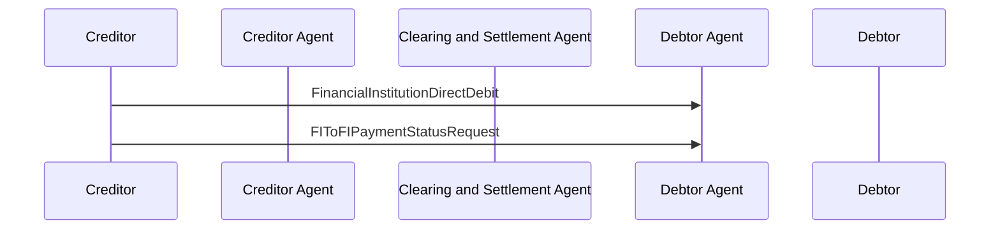

# Direct Debit / FinancialInstitutionDirectDebit / Creditor sends FIToFIPaymentStatusRequest — figure 49

[src-000162](../../../../../../../../evidence/omitted/530a772f5cf631826741f05d.md); direct-body paragraph P647; Word file/printed page 63.

[Original figure](../../../../../../../../evidence/omitted/c6951f498536daa9f3cdd953.md) · [Complete Word-rendered page](../../../../../../../../evidence/omitted/b563d15a59103c4dc60cad75.md) · [Reusable flow](../../flows/flow-src-000162-p645-creditor-sends-fito-fipayment-status-request.md)

## Source reconstruction

## Participants and roles

| Occurrence | Literal label | Scoped roles |
| --- | --- | --- |
| C | Creditor | [creditor](../../../../../../../../shared/reference/participants/participant-src-000162-creditor.md) |
| CA | Creditor Agent | [creditor-agent](../../../../../../../../shared/reference/participants/participant-src-000162-creditor-agent.md) |
| CS | Clearing and Settlement Agent | [clearing-and-settlement-agent](../../../../../../../../shared/reference/participants/participant-src-000162-clearing-and-settlement-agent.md) |
| DA | Debtor Agent | [debtor-agent](../../../../../../../../shared/reference/participants/participant-src-000162-debtor-agent.md) |
| D | Debtor | [debtor](../../../../../../../../shared/reference/participants/participant-src-000162-debtor.md) |

## Relationships and activities

| Order | From | To | Literal connection |
| --- | --- | --- | --- |
| 1 | C | DA | FinancialInstitutionDirectDebit |
| 2 | C | DA | FIToFIPaymentStatusRequest |

## Source qualifications

- Literal middle lifeline is Clearing and Settlement Agent, unlike intermediary in figures44–48, and remains unused. P646 requires status response but no reply arrow drawn. P648 names FinancialInstitutionCreditTransfer and repeats section6.2.7.2 despite FI direct-debit context (issue-000054).
- Source participant icons/labels denote contextual roles; they do not fix an institution to one role. Unused lifelines remain visible.
- Source message names establish family-level flow context; supplied exact schema versions are separately identified.
- Mermaid preserves connections and order; original retains precise geometry, pictograms and line style. Whole-page Word rendering checked for composite context.

## Rendering and visual review

Mermaid 12.3.0 parsed/rendered on 2026-11-09 with Mermaid browser API + Chromium 156.0.8078.81. [Rendered SVG](../../../../../../../../evidence/omitted/c239781bf3ea0f9b74d371c6.md) · [Rendered PNG](../../../../../../../../evidence/omitted/d362b6d6076a6d1587f69f35.md).

Original picture labels, endpoints, order/decision paths and complete Word-rendered source page compared with rendered Mermaid. Native use-case models include dashed source connectors without invented include/extend semantics.

Source disagreement remains issue-000054.
