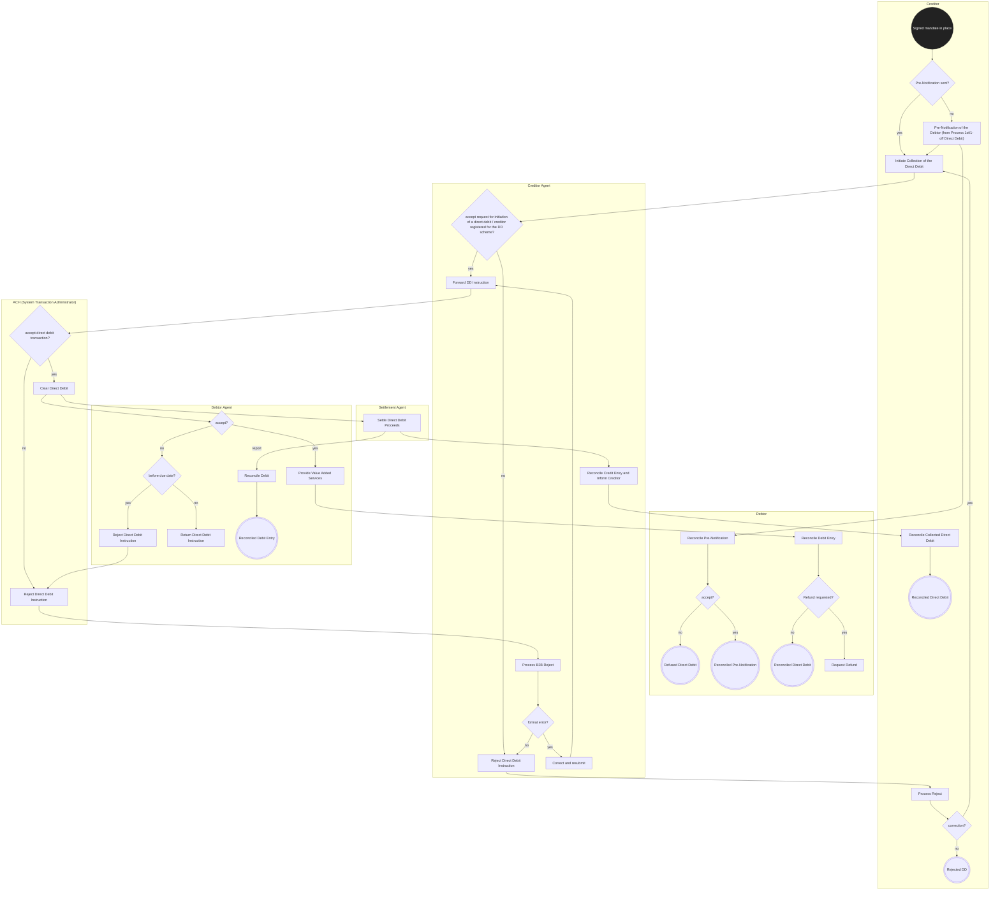

# Customer-to-bank Direct Debit — figure 10

[src-000173](../../../../../../../../evidence/omitted/baf7abf3460122a33db6052d.md); direct-body paragraph P148; Word file/printed page 22.

[Original figure](../../../../../../../../evidence/omitted/9c6e5cef0f7405916566cd1d.md) · [Complete Word-rendered page](../../../../../../../../evidence/omitted/b6ac379dd5a4af7c789bade4.md) · [Reusable flow](../../flows/flow-src-000173-p147-customer-to-bank-direct-debit.md)

## Source reconstruction

## Participants and roles

| Occurrence | Literal label | Scoped roles |
| --- | --- | --- |
| C | Creditor | [creditor](../../../../../../../../shared/reference/participants/participant-src-000173-creditor.md) |
| D | Debtor | [debtor](../../../../../../../../shared/reference/participants/participant-src-000173-debtor.md) |
| CA | Creditor Agent | [creditor-agent](../../../../../../../../shared/reference/participants/participant-src-000173-creditor-agent.md) |
| ACH | ACH (System Transaction Administrator) | [ach-system-transaction-administrator](../../../../../../../../shared/reference/participants/participant-src-000173-ach-system-transaction-administrator.md) |
| S | Settlement Agent | [settlement-agent](../../../../../../../../shared/reference/participants/participant-src-000173-settlement-agent.md) |
| DA | Debtor Agent | [debtor-agent](../../../../../../../../shared/reference/participants/participant-src-000173-debtor-agent.md) |

## Relationships and activities

| Order | From | To | Literal label / direction |
| --- | --- | --- | --- |
| 1 | Signed mandate in place | Pre-Notification sent? | directed |
| 2 | Pre-Notification sent? | Pre-Notification of the Debtor (from Process 1st/1-off Direct Debit) | directed no |
| 3 | Pre-Notification sent? | Initiate Collection of the Direct Debit | directed yes |
| 4 | Pre-Notification of the Debtor (from Process 1st/1-off Direct Debit) | Initiate Collection of the Direct Debit | directed |
| 5 | Pre-Notification of the Debtor (from Process 1st/1-off Direct Debit) | Reconcile Pre-Notification | directed |
| 6 | Reconcile Pre-Notification | accept? | directed |
| 7 | accept? | Refused Direct Debit | directed no |
| 8 | accept? | Reconciled Pre-Notification | directed yes |
| 9 | Initiate Collection of the Direct Debit | accept request for initiation of a direct debit / creditor registered for the DD scheme? | directed |
| 10 | accept request for initiation of a direct debit / creditor registered for the DD scheme? | Reject Direct Debit Instruction | directed no |
| 11 | accept request for initiation of a direct debit / creditor registered for the DD scheme? | Forward DD Instruction | directed yes |
| 12 | Forward DD Instruction | accept direct debit transaction? | directed |
| 13 | accept direct debit transaction? | Reject Direct Debit Instruction | directed no |
| 14 | accept direct debit transaction? | Clear Direct Debit | directed yes |
| 15 | Reject Direct Debit Instruction | Process B2B Reject | directed |
| 16 | Process B2B Reject | format error? | directed |
| 17 | format error? | Correct and resubmit | directed yes |
| 18 | format error? | Reject Direct Debit Instruction | directed no |
| 19 | Correct and resubmit | Forward DD Instruction | directed |
| 20 | Reject Direct Debit Instruction | Process Reject | directed |
| 21 | Process Reject | correction? | directed |
| 22 | correction? | Rejected DD | directed no |
| 23 | correction? | Initiate Collection of the Direct Debit | directed yes |
| 24 | Clear Direct Debit | Settle Direct Debit Proceeds | directed |
| 25 | Clear Direct Debit | accept? | directed |
| 26 | accept? | before due date? | directed no |
| 27 | before due date? | Reject Direct Debit Instruction | directed yes |
| 28 | before due date? | Return Direct Debit Instruction | directed no |
| 29 | Reject Direct Debit Instruction | Reject Direct Debit Instruction | directed |
| 30 | accept? | Provide Value Added Services | directed yes |
| 31 | Provide Value Added Services | Reconcile Debit Entry | directed |
| 32 | Reconcile Debit Entry | Refund requested? | directed |
| 33 | Refund requested? | Reconciled Direct Debit | directed no |
| 34 | Refund requested? | Request Refund | directed yes |
| 35 | Settle Direct Debit Proceeds | Reconcile Debit | directed report |
| 36 | Reconcile Debit | Reconciled Debit Entry | directed |
| 37 | Settle Direct Debit Proceeds | Reconcile Credit Entry and Inform Creditor | directed |
| 38 | Reconcile Credit Entry and Inform Creditor | Reconcile Collected Direct Debit | directed |
| 39 | Reconcile Collected Direct Debit | Reconciled Direct Debit | directed |

## Source qualifications

- Lane containers denote source responsibility columns, not new business institutions. Source rounded action boxes are rendered as rectangles; source final bullseye is a concentric Mermaid node with the central fill documented here. Colour and exact line routing remain in original.
- Purple activity-reference notes link Return Direct Debit Instruction to figure11 and Request Refund to figure12; they are not extra process activities.
- Source initial state includes Signed mandate in place. Separate debtor pre-notification acceptance/refusal does not have a connector back to creditor collection. No such connector is invented.
- Actor pictograms identify roles in this context, not a fixed institutional identity. Source narrative may describe participants/steps omitted from this bounded figure.
- Part1 message labels alone do not establish exact supplied schema versions. Original figures and their complete rendered page remain the evidence for geometry and line styling.

## Rendering and visual review

Mermaid 12.3.0 parsed and rendered on 2026-11-09 using Mermaid browser API + Chromium 156.0.8078.81. [Rendered SVG](../../../../../../../../evidence/omitted/eeb64ee04606d1c51fc89ad2.md) · [Rendered PNG](../../../../../../../../evidence/omitted/e5ee0e6a647b2fec1dbc9eee.md).

Compared every source actor label, message/action label, connector endpoint/direction, decision branch, initial/final state and source annotation against original image/EMF preview, then checked rendered Mermaid and full Word source page context. Native use-case models1–2 retain ordinary arrows and unconnected participant icons with explicit placement tables; model2 unconnected mandate use case retained. Final-state geometry, lane layout and source colours are documented limitations.

This bounded source reconstruction passed its recorded comparison.
