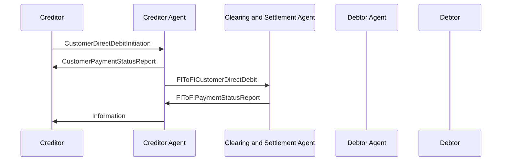

# Negative Customer and FIToFIPaymentStatusReport with Direct Debit / Negative CustomerPaymentStatusReport - Clearing And Settlement Agent — figure 21

[src-000173](../../../../../../../../evidence/omitted/baf7abf3460122a33db6052d.md); direct-body paragraph P241; Word file/printed page 33.

[Original figure](../../../../../../../../evidence/omitted/7e68ea5116779c12e3883ba1.md) · [Complete Word-rendered page](../../../../../../../../evidence/omitted/3885c257a70c42a129f94a31.md) · [Reusable flow](../../flows/flow-src-000173-p239-negative-customer-payment-status-report-clearing-and-settlement-agent.md)

## Source reconstruction

## Participants and roles

| Occurrence | Literal label | Scoped roles |
| --- | --- | --- |
| C | Creditor | [creditor](../../../../../../../../shared/reference/participants/participant-src-000173-creditor.md); [initiating-party](../../../../../../../../shared/reference/participants/participant-src-000173-initiating-party.md) |
| CA | Creditor Agent | [creditor-agent](../../../../../../../../shared/reference/participants/participant-src-000173-creditor-agent.md) |
| CS | Clearing and Settlement Agent | [clearing-and-settlement-agent](../../../../../../../../shared/reference/participants/participant-src-000173-clearing-and-settlement-agent.md) |
| DA | Debtor Agent | [debtor-agent](../../../../../../../../shared/reference/participants/participant-src-000173-debtor-agent.md) |
| D | Debtor | [debtor](../../../../../../../../shared/reference/participants/participant-src-000173-debtor.md) |

## Relationships and activities

| Order | From | To | Literal label / direction |
| --- | --- | --- | --- |
| 1 | C | CA | CustomerDirectDebitInitiation |
| 2 | CA | C | CustomerPaymentStatusReport |
| 3 | CA | CS | FIToFICustomerDirectDebit |
| 4 | CS | CA | FIToFIPaymentStatusReport |
| 5 | CA | C | Information |

## Source qualifications

- P240: clearing/settlement negative FIToFIPaymentStatusReport rejects the instruction before settlement. P242/P248 prefer correcting and resubmitting without involving creditor where possible. P243/P247 identify alternatives for the generic Information arrow based on booking/agreement.
- Actor pictograms identify roles in this context, not a fixed institutional identity. Source narrative may describe participants/steps omitted from this bounded figure.
- Part1 message labels alone do not establish exact supplied schema versions. Original figures and their complete rendered page remain the evidence for geometry and line styling.

## Rendering and visual review

Mermaid 12.3.0 parsed and rendered on 2026-11-09 using Mermaid browser API + Chromium 156.0.8078.81. [Rendered SVG](../../../../../../../../evidence/omitted/7b4b6c76ff7eff8ee4de88b6.md) · [Rendered PNG](../../../../../../../../evidence/omitted/c9c46af9bb9325d7fd4c8c36.md).

Compared every source actor label, message/action label, connector endpoint/direction, decision branch, initial/final state and source annotation against original image/EMF preview, then checked rendered Mermaid and full Word source page context. Native use-case models1–2 retain ordinary arrows and unconnected participant icons with explicit placement tables; model2 unconnected mandate use case retained. Final-state geometry, lane layout and source colours are documented limitations.

This bounded source reconstruction passed its recorded comparison.
