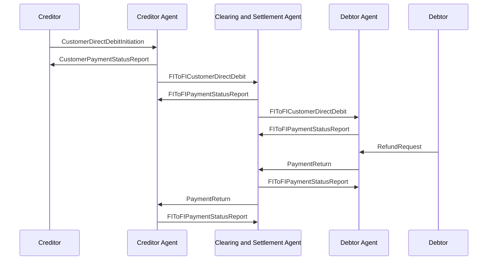

# PaymentReturn with Direct Debit / PaymentReturn Initiated by Debtor Agent — figure 24

[src-000173](../../../../../../../../evidence/omitted/baf7abf3460122a33db6052d.md); direct-body paragraph P282; Word file/printed page 37.

[Original figure](../../../../../../../../evidence/omitted/0e69d486d34129b06bbff544.md) · [Complete Word-rendered page](../../../../../../../../evidence/omitted/6652a91799353aefc435c578.md) · [Reusable flow](../../flows/flow-src-000173-p280-payment-return-initiated-by-debtor-agent.md)

## Source reconstruction

## Participants and roles

| Occurrence | Literal label | Scoped roles |
| --- | --- | --- |
| C | Creditor | [creditor](../../../../../../../../shared/reference/participants/participant-src-000173-creditor.md); [initiating-party](../../../../../../../../shared/reference/participants/participant-src-000173-initiating-party.md) |
| CA | Creditor Agent | [creditor-agent](../../../../../../../../shared/reference/participants/participant-src-000173-creditor-agent.md) |
| CS | Clearing and Settlement Agent | [clearing-and-settlement-agent](../../../../../../../../shared/reference/participants/participant-src-000173-clearing-and-settlement-agent.md) |
| DA | Debtor Agent | [debtor-agent](../../../../../../../../shared/reference/participants/participant-src-000173-debtor-agent.md) |
| D | Debtor | [debtor](../../../../../../../../shared/reference/participants/participant-src-000173-debtor.md) |

## Relationships and activities

| Order | From | To | Literal label / direction |
| --- | --- | --- | --- |
| 1 | C | CA | CustomerDirectDebitInitiation |
| 2 | CA | C | CustomerPaymentStatusReport |
| 3 | CA | CS | FIToFICustomerDirectDebit |
| 4 | CS | CA | FIToFIPaymentStatusReport |
| 5 | CS | DA | FIToFICustomerDirectDebit |
| 6 | DA | CS | FIToFIPaymentStatusReport |
| 7 | D | DA | RefundRequest |
| 8 | DA | CS | PaymentReturn |
| 9 | CS | DA | FIToFIPaymentStatusReport |
| 10 | CS | CA | PaymentReturn |
| 11 | CA | CS | FIToFIPaymentStatusReport |

## Source qualifications

- P279/P283/P297: return may be initiated by debtor agent or triggered by debtor refund request; refund request is assumed non-automated and outside message scope. Source picture includes RefundRequest despite heading debtor-agent-initiated return. P294 separate settlement and P295 customer information are narrative-only.
- Actor pictograms identify roles in this context, not a fixed institutional identity. Source narrative may describe participants/steps omitted from this bounded figure.
- Part1 message labels alone do not establish exact supplied schema versions. Original figures and their complete rendered page remain the evidence for geometry and line styling.

## Rendering and visual review

Mermaid 12.3.0 parsed and rendered on 2026-11-09 using Mermaid browser API + Chromium 156.0.8078.81. [Rendered SVG](../../../../../../../../evidence/omitted/ad0406ab6ebc4abc9e6f6ccb.md) · [Rendered PNG](../../../../../../../../evidence/omitted/1b4b0853649015987adb3c14.md).

Compared every source actor label, message/action label, connector endpoint/direction, decision branch, initial/final state and source annotation against original image/EMF preview, then checked rendered Mermaid and full Word source page context. Native use-case models1–2 retain ordinary arrows and unconnected participant icons with explicit placement tables; model2 unconnected mandate use case retained. Final-state geometry, lane layout and source colours are documented limitations.

This bounded source reconstruction passed its recorded comparison.
