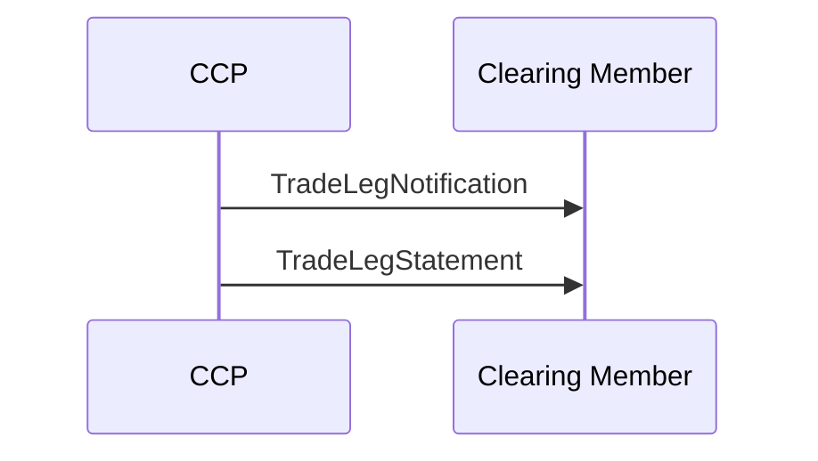

# Trade Leg Notification business transaction

## Source evidence

[src-000052](../../../../../../../../evidence/omitted/b45c53bac2be08dee677b607.md); P220 / Trade Leg Notification. [Unchanged source figure](../../../../../../../../evidence/omitted/a283cb1ca42b6d9a73935878.md).

[Original](../../../../../../../../evidence/omitted/a283cb1ca42b6d9a73935878.md)

## Mermaid reconstruction

## Participants, messages and conditions

The CCP reports the executed trade after novation and then reports a summary for a period during or at the end of the day. P218 describes both trade sides from the clearing member perspective; P219 makes reporting timing dependent on CCP processes.

| Source order | Message label | Sender | Receiver | Source line semantics | Exact supplied definition |
| --- | --- | --- | --- | --- | --- |
| 1 | TradeLegNotification | CCP | CM | Mandatory (solid) | [secl.001.001.05](../../../../../messages/secl.001.001.05/index.md) |
| 2 | TradeLegStatement | CCP | CM | Mandatory (solid) | [secl.003.001.05](../../../../../messages/secl.003.001.05/index.md) |

P214 defines solid lines as mandatory messages and P215 defines dotted lines as optional/potential. The reconstruction preserves this distinction. Building symbols represent the two source participant endpoints; they do not identify named institutions.

Part1 tables T4/T5/T9 contain stale V03 message-name suffixes beside .05/.04 identifiers; exact bindings above use the corresponding source053 definition heading, preserving the naming conflict under issue-000030.

[Reusable flow and complete narrative](../../flows/flow-src-000052-p217-trade-leg-notification-business-transaction.md); [Related source process, trigger and conditions](../../flows/flow-src-000052-p113-trade-management-process.md).

## Review evidence

Opened the full source image and Mermaid render; compared both participant labels, all 2 ordered message labels and directions, 0 dotted optional/potential path(s), and 0 clearing-member-to-CCP arrow(s). P214-P215 line semantics and relevant narrative conditions are retained. Building silhouettes are replaced by labeled participant boxes; they do not identify named institutions. Visual comparison passes; page remains needs-review because Part1 message-name suffix conflict is recorded under issue-000030. Parsed/rendered with Mermaid 12.3.0 and Chromium 156.0.8078.81; visual review on 2026-11-09 Europe/Warsaw, rendering report UTC date 2026-11-08.

[Compared reconstruction](../../../../../../../../evidence/omitted/f8dcaf149bebe852df8ba7c9.md).
