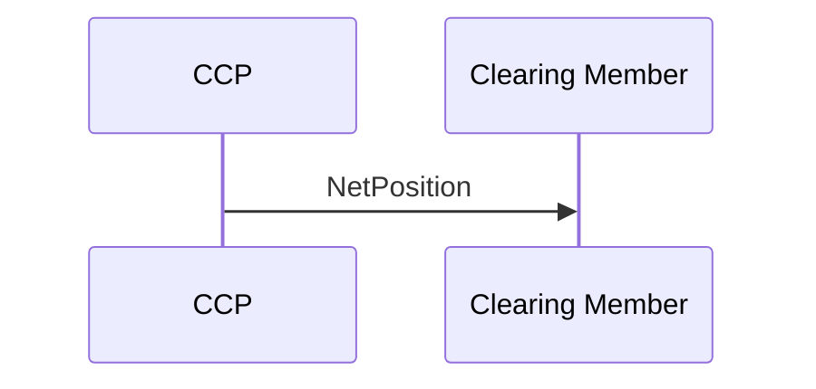

# Position Netting business transaction

## Source evidence

[src-000052](../../../../../../../../evidence/omitted/b45c53bac2be08dee677b607.md); P228 / Position Netting. [Unchanged source figure](../../../../../../../../evidence/omitted/eb6984174ea2fe02b79edd32.md).

[Original](../../../../../../../../evidence/omitted/eb6984174ea2fe02b79edd32.md)

## Mermaid reconstruction

## Participants, messages and conditions

The CCP reports the net position of all trade legs reported during the day (P226). T13 says the clearing member reconciles its calculation with CCP results using the netting parameters.

| Source order | Message label | Sender | Receiver | Source line semantics | Exact supplied definition |
| --- | --- | --- | --- | --- | --- |
| 1 | NetPosition | CCP | CM | Mandatory (solid) | [secl.004.001.04](../../../../../messages/secl.004.001.04/index.md) |

P214 defines solid lines as mandatory messages and P215 defines dotted lines as optional/potential. The reconstruction preserves this distinction. Building symbols represent the two source participant endpoints; they do not identify named institutions.

Part1 tables T4/T5/T9 contain stale V03 message-name suffixes beside .05/.04 identifiers; exact bindings above use the corresponding source053 definition heading, preserving the naming conflict under issue-000030.

[Reusable flow and complete narrative](../../flows/flow-src-000052-p225-position-netting-business-transaction.md); [Related source process, trigger and conditions](../../flows/flow-src-000052-p125-netting-process.md).

## Review evidence

Opened the full source image and Mermaid render; compared both participant labels, all 1 ordered message labels and directions, 0 dotted optional/potential path(s), and 0 clearing-member-to-CCP arrow(s). P214-P215 line semantics and relevant narrative conditions are retained. Building silhouettes are replaced by labeled participant boxes; they do not identify named institutions. Visual comparison passes; page remains needs-review because Part1 message-name suffix conflict is recorded under issue-000030. Parsed/rendered with Mermaid 12.3.0 and Chromium 156.0.8078.81; visual review on 2026-11-09 Europe/Warsaw, rendering report UTC date 2026-11-08.

[Compared reconstruction](../../../../../../../../evidence/omitted/9822adbb30c91a7f2a37afb7.md).
