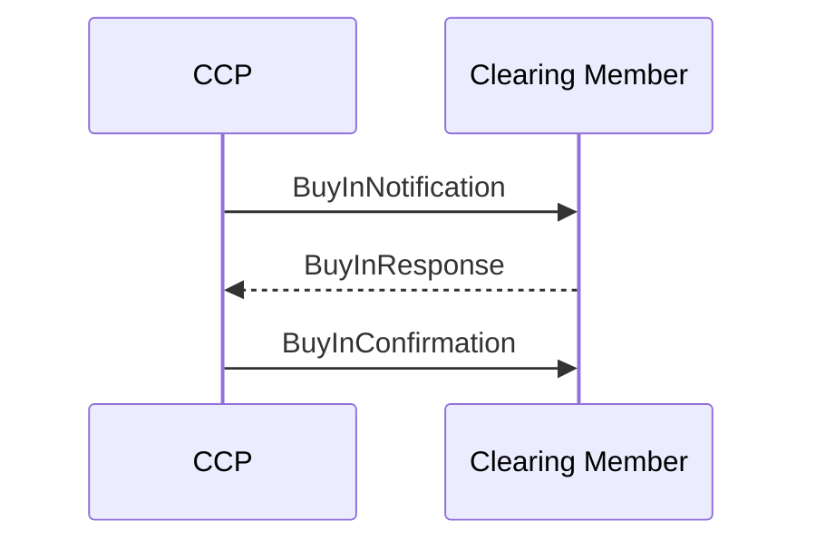

# Buy-in business transaction

## Source evidence

[src-000052](../../../../../../../../evidence/omitted/b45c53bac2be08dee677b607.md); P255 / Buy-in. [Unchanged source figure](../../../../../../../../evidence/omitted/c66eb80c71bd5c9d52b54703.md).

[Original](../../../../../../../../evidence/omitted/c66eb80c71bd5c9d52b54703.md)

## Mermaid reconstruction

## Participants, messages and conditions

The CCP buys stock to cover failed transactions. Notification may warn some days before the actual start (P252); response is optional under each CCP rules (P253). Confirmation reports the resulting transaction details (P254). T17 adds a possible delay request, telephone acknowledgment, obtaining securities via auction or preferred brokers, cancellation/replacement of settlement instructions, and out-of-scope payment of penalties/buy-in fees.

| Source order | Message label | Sender | Receiver | Source line semantics | Exact supplied definition |
| --- | --- | --- | --- | --- | --- |
| 1 | BuyInNotification | CCP | CM | Mandatory (solid) | [secl.007.001.03](../../../../../messages/secl.007.001.03/index.md) |
| 2 | BuyInResponse | CM | CCP | Optional/potential (dotted) | [secl.008.001.03](../../../../../messages/secl.008.001.03/index.md) |
| 3 | BuyInConfirmation | CCP | CM | Mandatory (solid) | [secl.009.001.03](../../../../../messages/secl.009.001.03/index.md) |

P214 defines solid lines as mandatory messages and P215 defines dotted lines as optional/potential. The reconstruction preserves this distinction. Building symbols represent the two source participant endpoints; they do not identify named institutions.

[Reusable flow and complete narrative](../../flows/flow-src-000052-p250-buy-in-business-transaction.md); [Related source process, trigger and conditions](../../flows/flow-src-000052-p161-buy-in-process.md).

## Review evidence

Opened the full source image and Mermaid render; compared both participant labels, all 3 ordered message labels and directions, 1 dotted optional/potential path(s), and 1 clearing-member-to-CCP arrow(s). P214-P215 line semantics and relevant narrative conditions are retained. Building silhouettes are replaced by labeled participant boxes; they do not identify named institutions. Parsed/rendered with Mermaid 12.3.0 and Chromium 156.0.8078.81; visual review on 2026-11-09 Europe/Warsaw, rendering report UTC date 2026-11-08.

[Compared reconstruction](../../../../../../../../evidence/omitted/81d2968b3062ad56dc97e26d.md).
