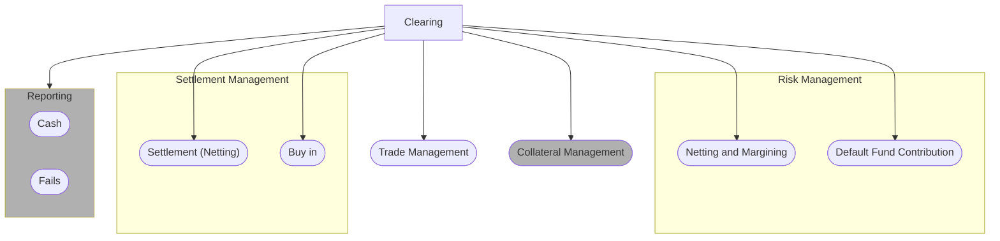

# Clearing business-process scope

## Source evidence

[src-000052](../../../../../../../../evidence/omitted/b45c53bac2be08dee677b607.md); P111. [Unchanged original image](../../../../../../../../evidence/omitted/95426465493ac51bd4ca1dcc.md); [Viewable source rendering](../../../../../../../../evidence/omitted/6a58195b1ef40ca15dda2c90.md).

[Source diagram](../../../../../../../../evidence/omitted/6a58195b1ef40ca15dda2c90.md)

## Mermaid reconstruction

## Actors, activities and relationships

The seven outward arrows from Clearing identify high-level scope relationships, not temporal message exchanges or UML include/extend semantics. Risk Management contains Netting and Margining plus Default Fund Contribution; Settlement Management contains Settlement (Netting) and Buy in; Reporting contains Cash and Fails. Reporting and Collateral Management are shaded out-of-scope context. P109 expressly says the diagram is non-exhaustive and shows those two processes only for completeness.

[Reusable process and full source narrative](../../flows/flow-src-000052-p108-business-process-diagram.md).

## Review evidence

Opened the full source PNG or full EMF rendering and the Mermaid render; compared all seven directed scope arrows, three grouping boundaries, all nine process/subprocess labels, and Reporting/Collateral out-of-scope shading. Source direction, labels, boundaries, responsibility and qualifiers were checked against the artwork and adjacent narrative/table. Layout differs; Start/End text and thick bar glyphs explain the original markers. Parser/render passed with Mermaid 12.3.0 and Chromium 156.0.8078.81. Visual comparison on 2026-11-09 Europe/Warsaw; render report UTC date 2026-11-08.

[Compared reconstruction](../../../../../../../../evidence/omitted/2d9ef3e6e503e26a04e9daa3.md).
