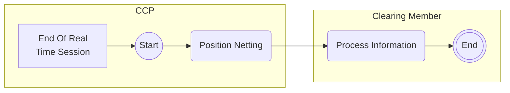

# Risk Management: Netting activities

## Source evidence

[src-000052](../../../../../../../../evidence/omitted/b45c53bac2be08dee677b607.md); P195. [Unchanged original image](../../../../../../../../evidence/omitted/6caf7f820140cb8c7f368200.md); [Viewable source rendering](../../../../../../../../evidence/omitted/b9198ab71625a1427ebac217.md).

[Source diagram](../../../../../../../../evidence/omitted/b9198ab71625a1427ebac217.md)

## Mermaid reconstruction

## Actors, activities and relationships

The end-of-real-time-session milestone leads to position netting by the CCP and information processing by the clearing member. T13 additionally describes a business-session status message, house/client margin-account netting, reconciliation using netting parameters, and possible intraday margin on provisional net positions. The milestone box is source context, not an ISO message name.

[Complete activity responsibility table T13](../../documents/src-000052/tables/tbl-0013.md).

[Reusable process and full source narrative](../../flows/flow-src-000052-p194-business-process-risk-management-netting-process.md).

## Review evidence

Opened the full source PNG or full EMF rendering and the Mermaid render; compared end-of-real-time-session milestone, CCP netting, member information processing and final marker. Source direction, labels, boundaries, responsibility and qualifiers were checked against the artwork and adjacent narrative/table. Layout differs; Start/End text and thick bar glyphs explain the original markers. Parser/render passed with Mermaid 12.3.0 and Chromium 156.0.8078.81. Visual comparison on 2026-11-09 Europe/Warsaw; render report UTC date 2026-11-08.

[Compared reconstruction](../../../../../../../../evidence/omitted/5d295ed9b53d71b7ba1e1380.md).
