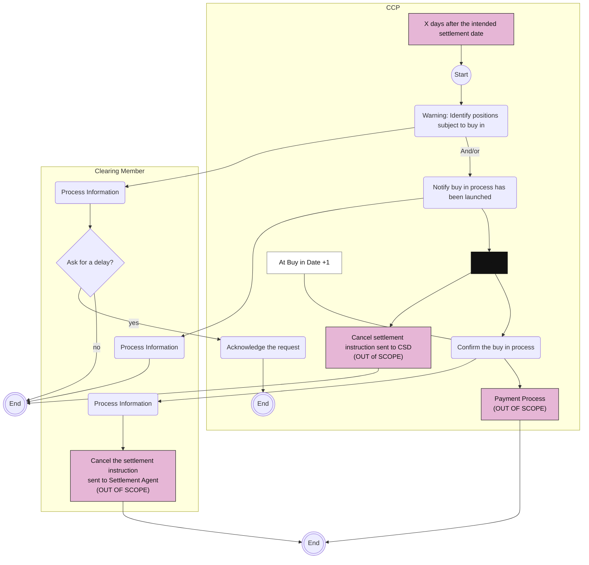

# Settlement Management: Buy-In activities

## Source evidence

[src-000052](../../../../../../../../evidence/omitted/b45c53bac2be08dee677b607.md); P205. [Unchanged original image](../../../../../../../../evidence/omitted/5fb71fc3f025a4224b27e3b0.md); [Viewable source rendering](../../../../../../../../evidence/omitted/1da9dc6c3ae85cd1596a5e33.md).

[Source diagram](../../../../../../../../evidence/omitted/1da9dc6c3ae85cd1596a5e33.md)

## Mermaid reconstruction

## Actors, activities and relationships

The warning starts X days after intended settlement date. A clearing member may request delay; the CCP acknowledges and that response path ends. The source also has a thin curved warning-to-launch connector annotated And/or; it is preserved as a directed And/or relationship without imposing an exclusive decision. Launch notification reaches a source parallel bar feeding CCP settlement-instruction cancellation and later buy-in confirmation. Confirmation is annotated Buy in Date +1 and leads to out-of-scope payment and member cancellation of its settlement-agent instruction. T17 says acknowledgment is by telephone, delay is valid only for continuous netting systems, and confirmation is one business day after buy-in. Source labels are retained; no fixed number of days is invented.

[Complete activity responsibility table T17](../../documents/src-000052/tables/tbl-0017.md).

[Reusable process and full source narrative](../../flows/flow-src-000052-p204-settlement-management-buy-in-process.md).

The Date +1 text is a note on Confirm the buy in process, not a separate activity. The three end markers remain separate; bar branches and all cancellation/payment paths are retained.

## Review evidence

Opened the full source PNG or full EMF rendering and the Mermaid render; compared warning, delay request/acknowledgment paths, And/or launch connection, parallel bar, both settlement cancellations, confirmation/date note, payment and three distinct end markers. Source direction, labels, boundaries, responsibility and qualifiers were checked against the artwork and adjacent narrative/table. Layout differs; Start/End text and thick bar glyphs explain the original markers. The Date +1 annotation was explicitly attached to confirmation after the first render; the updated output was reopened and checked. Parser/render passed with Mermaid 12.3.0 and Chromium 156.0.8078.81. Visual comparison on 2026-11-09 Europe/Warsaw; render report UTC date 2026-11-08.

[Compared reconstruction](../../../../../../../../evidence/omitted/8c569e25e981e9727990d7e6.md).
