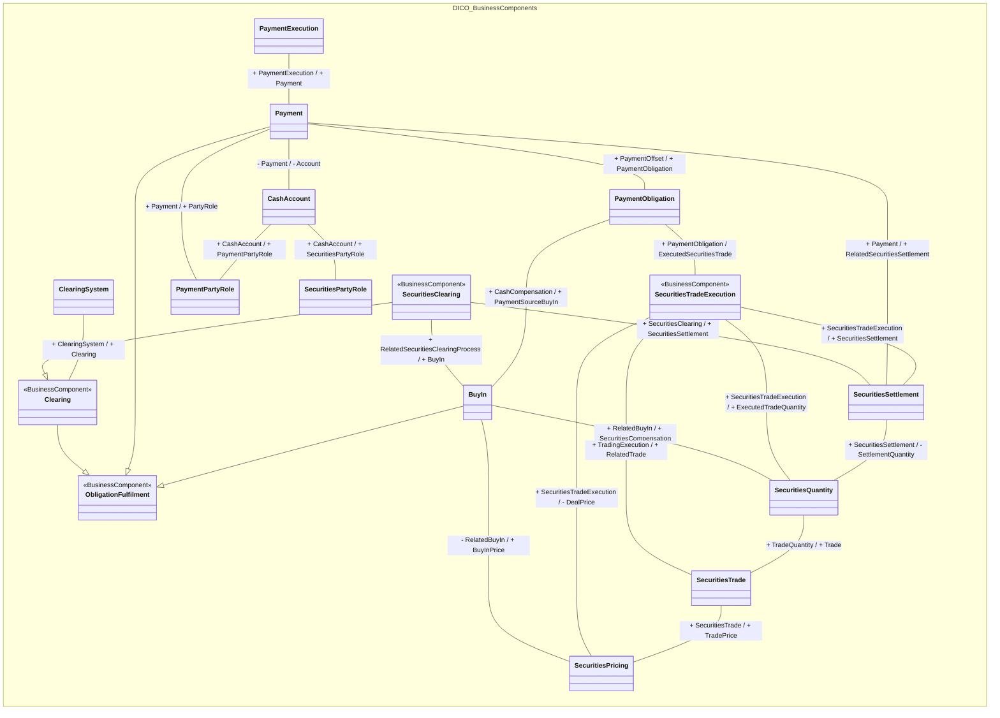

# Clearing, obligations, buy-in and settlement

[src-000054](../../../../../../../../../evidence/omitted/ea96e6afbf1f8819d68ca6f6.md), Clearing!A1:AC46; xl/drawings/drawing2.xml; anchor 1. Original image SHA-256: 348bf5de853df70f5ea35f56c941963c77b4e339357bfd1c4a4bfdae60b5e1eb.

[Original complete figure](../../../../../../../../../evidence/omitted/67477ea0e66a12f7207b95ff.md) · [Rendered Mermaid SVG](../../../../../../../../../evidence/omitted/01842259c4913c5debfe77eb.md) · [Rendered Mermaid PNG](../../../../../../../../../evidence/omitted/548328f598e38a4a18020e6b.md)

## Source reconstruction

## Entities and relationships

Clearing, Payment and BuyIn specialize ObligationFulfilment; SecuritiesClearing specializes Clearing. The model links clearing system and clearing process to buy-in, cash compensation, securities compensation, buy-in price and settlement. Payment is linked independently to payment execution, cash account, payment party role, related securities settlement and payment obligation. Securities trading, execution, settlement, price and quantity associations retain their separately named ends. The outer long lines from SecuritiesClearing to SecuritiesSettlement and from BuyIn to SecuritiesPricing are separate complete associations. Most boxes omit a printed stereotype; those omissions are preserved rather than supplied from other boxes.

All 16 visible node occurrences and 25 relationship lines are retained. No numeric multiplicity is shown in this source view, so none is inferred. Namespaces group the source’s printed “from” package labels for readability; the source did not draw those enclosing package boxes. Association labels retain literal +/− prefixes and combined end names. Their re-layout position is not additional navigability evidence. The native class inheritance marker is reserved for the source’s hollow-triangle generalizations. Source editor/navigation icons are omitted as interface decoration; no business entity or relationship is excluded.

## Complete relationship register

| From node | To node | Source relationship kind | Visible source label(s) | From-end multiplicity | To-end multiplicity |
| --- | --- | --- | --- | --- | --- |
| Clearing | ObligationFulfilment | generalization: subtype to supertype | (unlabelled in source) | not printed | not printed |
| Payment | ObligationFulfilment | generalization: subtype to supertype | (unlabelled in source) | not printed | not printed |
| BuyIn | ObligationFulfilment | generalization: subtype to supertype | (unlabelled in source) | not printed | not printed |
| SecuritiesClearing | Clearing | generalization: subtype to supertype | (unlabelled in source) | not printed | not printed |
| ClearingSystem | Clearing | association | + ClearingSystem / + Clearing | not printed | not printed |
| SecuritiesClearing | BuyIn | association | + RelatedSecuritiesClearingProcess / + BuyIn | not printed | not printed |
| SecuritiesClearing | SecuritiesSettlement | association | + SecuritiesClearing / + SecuritiesSettlement | not printed | not printed |
| PaymentExecution | Payment | association | + PaymentExecution / + Payment | not printed | not printed |
| Payment | CashAccount | association | - Payment / - Account | not printed | not printed |
| Payment | PaymentPartyRole | association | + Payment / + PartyRole | not printed | not printed |
| CashAccount | SecuritiesPartyRole | association | + CashAccount / + SecuritiesPartyRole | not printed | not printed |
| CashAccount | PaymentPartyRole | association | + CashAccount / + PaymentPartyRole | not printed | not printed |
| Payment | SecuritiesSettlement | association | + Payment / + RelatedSecuritiesSettlement | not printed | not printed |
| Payment | PaymentObligation | association | + PaymentOffset / + PaymentObligation | not printed | not printed |
| PaymentObligation | BuyIn | association | + CashCompensation / + PaymentSourceBuyIn | not printed | not printed |
| BuyIn | SecuritiesQuantity | association | + RelatedBuyIn / + SecuritiesCompensation | not printed | not printed |
| BuyIn | SecuritiesPricing | association | - RelatedBuyIn / + BuyInPrice | not printed | not printed |
| PaymentObligation | SecuritiesTradeExecution | association | + PaymentObligation / ExecutedSecuritiesTrade | not printed | not printed |
| SecuritiesTradeExecution | SecuritiesSettlement | association | + SecuritiesTradeExecution / + SecuritiesSettlement | not printed | not printed |
| SecuritiesTradeExecution | SecuritiesQuantity | association | + SecuritiesTradeExecution / + ExecutedTradeQuantity | not printed | not printed |
| SecuritiesTradeExecution | SecuritiesTrade | association | + TradingExecution / + RelatedTrade | not printed | not printed |
| SecuritiesTradeExecution | SecuritiesPricing | association | + SecuritiesTradeExecution / - DealPrice | not printed | not printed |
| SecuritiesSettlement | SecuritiesQuantity | association | + SecuritiesSettlement / - SettlementQuantity | not printed | not printed |
| SecuritiesQuantity | SecuritiesTrade | association | + TradeQuantity / + Trade | not printed | not printed |
| SecuritiesTrade | SecuritiesPricing | association | + SecuritiesTrade / + TradePrice | not printed | not printed |

## Entity definitions and precise workbook locators

| Visible label | Source package / stereotype | Definition evidence |
| --- | --- | --- |
| ObligationFulfilment | DICO_BusinessComponents / BusinessComponent | [FullBusinessModel!A2915:D2915](../sheets/02-fullbusinessmodel/tbl-0016.md) — Processes by which an obligation is extinguished fully or partially. |
| Clearing | DICO_BusinessComponents / BusinessComponent | [FullBusinessModel!A805:D805](../sheets/02-fullbusinessmodel/tbl-0006.md) — Mechanism allowing financial institutions that are members of a clearing house to pay and to receive the amounts linked to the transactions that they have executed on the market. The addition of all the positions per product results in one net position (due or to receive) with the clearing house or the central clearing counterparty. |
| ClearingSystem | DICO_BusinessComponents / (stereotype not printed) | [FullBusinessModel!A828:D828](../sheets/02-fullbusinessmodel/tbl-0006.md) — Specifies the system which plays a role in the clearing process. |
| SecuritiesClearing | DICO_BusinessComponents / BusinessComponent | [FullBusinessModel!A3952:D3952](../sheets/02-fullbusinessmodel/tbl-0021.md) — Process of settling securities through a central system. |
| BuyIn | DICO_BusinessComponents / (stereotype not printed) | [FullBusinessModel!A442:D442](../sheets/02-fullbusinessmodel/tbl-0004.md) — Process in which the buyer/CCP repurchases shares of stock because the seller either failed to deliver the shares or did not deliver them in a timely fashion. The seller has to make up the price difference if the new shares are more expensive than originally agreed to. |
| Payment | DICO_BusinessComponents / (stereotype not printed) | [FullBusinessModel!A3055:D3055](../sheets/02-fullbusinessmodel/tbl-0017.md) — Payment information and processes required to transfer cash end to end from the debtor to the creditor. |
| PaymentObligation | DICO_BusinessComponents / (stereotype not printed) | [FullBusinessModel!A3166:D3166](../sheets/02-fullbusinessmodel/tbl-0017.md) — Obligation for the debtor to pay the creditor an amount of cash. |
| PaymentExecution | DICO_BusinessComponents / (stereotype not printed) | [FullBusinessModel!A3109:D3109](../sheets/02-fullbusinessmodel/tbl-0017.md) — Process required for executing an end to end payment. It consists of a payment initiation which may be followed by a series of instructions. |
| SecuritiesPartyRole | DICO_BusinessComponents / (stereotype not printed) | [FullBusinessModel!A4240:D4240](../sheets/02-fullbusinessmodel/tbl-0023.md) — Specifies roles played by a party that are linked to the handling of securities but not related to a specific process. |
| CashAccount | DICO_BusinessComponents / (stereotype not printed) | [FullBusinessModel!A562:D562](../sheets/02-fullbusinessmodel/tbl-0004.md) — Account to or from which a cash entry is made. |
| PaymentPartyRole | DICO_BusinessComponents / (stereotype not printed) | [FullBusinessModel!A3197:D3197](../sheets/02-fullbusinessmodel/tbl-0017.md) — Role played by a party in the context of a payment. |
| SecuritiesSettlement | DICO_BusinessComponents / (stereotype not printed) | [FullBusinessModel!A4474:D4474](../sheets/02-fullbusinessmodel/tbl-0024.md) — Settlement of the securities in a securities transaction, that is, the instruction to deliver or receive securities, involving the payment of an amount of money or not. |
| SecuritiesTradeExecution | DICO_BusinessComponents / BusinessComponent | [FullBusinessModel!A4578:D4578](../sheets/02-fullbusinessmodel/tbl-0024.md) — Transaction between two counterparties in which they agree to buy and sell a financial instrument. A trade transaction occurs with the matching of the two counterparties orders. There could be several trade transactions necessary to execute the trade. |
| SecuritiesPricing | DICO_BusinessComponents / (stereotype not printed) | [FullBusinessModel!A4260:D4260](../sheets/02-fullbusinessmodel/tbl-0023.md) — Characteristics related to the price of the security. |
| SecuritiesQuantity | DICO_BusinessComponents / (stereotype not printed) | [FullBusinessModel!A4350:D4350](../sheets/02-fullbusinessmodel/tbl-0023.md) — Quantity of a security. |
| SecuritiesTrade | DICO_BusinessComponents / (stereotype not printed) | [FullBusinessModel!A4557:D4557](../sheets/02-fullbusinessmodel/tbl-0024.md) — Specifies trades linked to securities operations such as the exchange of securities, the lending of securities and the transactions related to investment funds. |

## Participant and flow navigation

This is a conceptual entity model, not a message exchange diagram. A business component or relationship label is not automatically a functional participant or institution. [Message-set participant references](../../../participants.md) and [Message-set business flows](../../../flows/index.md) provide the independently sourced actor/process context. These references are navigational; source figure associations do not establish message direction.

## Rendering and visual review

2026-11-09: Mermaid 12.3.0 parsed and rendered successfully with Mermaid browser API + Chromium 156.0.8078.81. Compared every visible entity, package label, printed stereotype, relationship endpoint, literal end label and hollow-triangle inheritance marker against the complete source artwork. Checked the ClearingMemberRole self-loop at rendered full resolution. Long outer associations, parallel account relationships and source-omitted stereotypes are retained. No numerical multiplicities are printed. Re-layout differs; native SVG remains zoomable. [Renderer evidence](../../../../../../../../../work/ccp-workbook-models/render-report.json).

