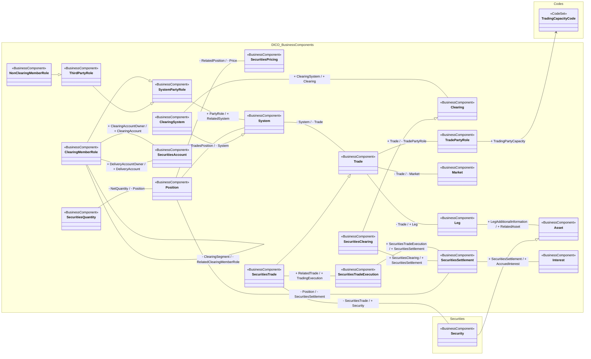

# CCP position, clearing membership and trade context

[src-000054](../../../../../../../../../evidence/omitted/ea96e6afbf1f8819d68ca6f6.md), Position!A1:AA38; xl/drawings/drawing3.xml; anchor 1. Original image SHA-256: c4b5a09200b4d8577c801aab62a84b39ac0210dfd8c10d6d8f643c2811802e9b.

[Original complete figure](../../../../../../../../../evidence/omitted/570dfe5a96a73c2a8b709c50.md) · [Rendered Mermaid SVG](../../../../../../../../../evidence/omitted/20832c394380d9823c417232.md) · [Rendered Mermaid PNG](../../../../../../../../../evidence/omitted/0c3111a6a897a2f943f4e85a.md)

## Source reconstruction

## Entities and relationships

Position links net securities quantity, price, system and securities settlement. SystemPartyRole generalizes ThirdPartyRole and ClearingMemberRole; NonClearingMemberRole specializes ThirdPartyRole. ClearingMemberRole has a self-association for clearing segment and two distinct securities-account associations for delivery account and clearing account. These role classes describe contextual business relationships, not fixed institution identities. The system/clearing hierarchy and trade/securities-trade hierarchy connect settlement, security, leg, asset, interest, market and trade-party trading capacity. The source uses a directed type arrow only for TradingPartyCapacity; the other non-inheritance lines are associations.

All 23 visible node occurrences and 27 relationship lines are retained. No numeric multiplicity is shown in this source view, so none is inferred. Namespaces group the source’s printed “from” package labels for readability; the source did not draw those enclosing package boxes. Association labels retain literal +/− prefixes and combined end names. Their re-layout position is not additional navigability evidence. The native class inheritance marker is reserved for the source’s hollow-triangle generalizations. Source editor/navigation icons are omitted as interface decoration; no business entity or relationship is excluded.

## Complete relationship register

| From node | To node | Source relationship kind | Visible source label(s) | From-end multiplicity | To-end multiplicity |
| --- | --- | --- | --- | --- | --- |
| ThirdPartyRole | SystemPartyRole | generalization: subtype to supertype | (unlabelled in source) | not printed | not printed |
| ClearingMemberRole | SystemPartyRole | generalization: subtype to supertype | (unlabelled in source) | not printed | not printed |
| NonClearingMemberRole | ThirdPartyRole | generalization: subtype to supertype | (unlabelled in source) | not printed | not printed |
| ClearingSystem | System | generalization: subtype to supertype | (unlabelled in source) | not printed | not printed |
| SecuritiesClearing | Clearing | generalization: subtype to supertype | (unlabelled in source) | not printed | not printed |
| SecuritiesTrade | Trade | generalization: subtype to supertype | (unlabelled in source) | not printed | not printed |
| Security | Asset | generalization: subtype to supertype | (unlabelled in source) | not printed | not printed |
| SecuritiesQuantity | Position | association | - NetQuantity / - Position | not printed | not printed |
| Position | SecuritiesPricing | association | - RelatedPosition / - Price | not printed | not printed |
| Position | System | association | - TradesPosition / - System | not printed | not printed |
| Position | SecuritiesSettlement | association | - Position / - SecuritiesSettlement | not printed | not printed |
| SystemPartyRole | System | association | + PartyRole / + RelatedSystem | not printed | not printed |
| ClearingMemberRole | ClearingMemberRole | association | - ClearingSegment / - RelatedClearingMemberRole | not printed | not printed |
| ClearingMemberRole | SecuritiesAccount | association | + DeliveryAccountOwner / + DeliveryAccount | not printed | not printed |
| ClearingMemberRole | SecuritiesAccount | association | + ClearingAccountOwner / + ClearingAccount | not printed | not printed |
| ClearingSystem | Clearing | association | + ClearingSystem / + Clearing | not printed | not printed |
| SecuritiesClearing | SecuritiesSettlement | association | + SecuritiesClearing / + SecuritiesSettlement | not printed | not printed |
| System | Trade | association | - System / - Trade | not printed | not printed |
| Trade | TradePartyRole | association | + Trade / - TradePartyRole | not printed | not printed |
| TradePartyRole | TradingCapacityCode | directed attribute/type association | + TradingPartyCapacity | not printed | not printed |
| Trade | Market | association | - Trade / - Market | not printed | not printed |
| Trade | Leg | association | - Trade / + Leg | not printed | not printed |
| Leg | Asset | association | + LegAdditionalInformation / + RelatedAsset | not printed | not printed |
| SecuritiesTrade | Security | association | - SecuritiesTrade / + Security | not printed | not printed |
| SecuritiesTrade | SecuritiesTradeExecution | association | + RelatedTrade / + TradingExecution | not printed | not printed |
| SecuritiesTradeExecution | SecuritiesSettlement | association | + SecuritiesTradeExecution / + SecuritiesSettlement | not printed | not printed |
| SecuritiesSettlement | Interest | association | + SecuritiesSettlement / + AccruedInterest | not printed | not printed |

## Entity definitions and precise workbook locators

| Visible label | Source package / stereotype | Definition evidence |
| --- | --- | --- |
| SecuritiesQuantity | DICO_BusinessComponents / BusinessComponent | [FullBusinessModel!A4350:D4350](../sheets/02-fullbusinessmodel/tbl-0023.md) — Quantity of a security. |
| Position | DICO_BusinessComponents / BusinessComponent | [FullBusinessModel!A3421:D3421](../sheets/02-fullbusinessmodel/tbl-0019.md) — Specifies the status of trades and their value inside a system. |
| SecuritiesPricing | DICO_BusinessComponents / BusinessComponent | [FullBusinessModel!A4260:D4260](../sheets/02-fullbusinessmodel/tbl-0023.md) — Characteristics related to the price of the security. |
| SystemPartyRole | DICO_BusinessComponents / BusinessComponent | [FullBusinessModel!A4958:D4958](../sheets/02-fullbusinessmodel/tbl-0026.md) — Role played by a party in a system. |
| ThirdPartyRole | DICO_BusinessComponents / BusinessComponent | [FullBusinessModel!A5075:D5075](../sheets/02-fullbusinessmodel/tbl-0027.md) — Party that can use the facilities of a system through one of its members. |
| NonClearingMemberRole | DICO_BusinessComponents / BusinessComponent | [FullBusinessModel!A2884:D2884](../sheets/02-fullbusinessmodel/tbl-0016.md) — Party that is involved in a trade but which must clear the trade through a member of an exchange's clearing corporation. |
| ClearingMemberRole | DICO_BusinessComponents / BusinessComponent | [FullBusinessModel!A817:D817](../sheets/02-fullbusinessmodel/tbl-0006.md) — Member of an exchange's clearing corporation, responsible for executing client trades and involved in the clearing of trades. |
| SecuritiesAccount | DICO_BusinessComponents / BusinessComponent | [FullBusinessModel!A3889:D3889](../sheets/02-fullbusinessmodel/tbl-0021.md) — Account to or from which a securities entry is made. |
| System | DICO_BusinessComponents / BusinessComponent | [FullBusinessModel!A4902:D4902](../sheets/02-fullbusinessmodel/tbl-0026.md) — Set of integrated applications that provides centralised services such as clearing, netting, reconciliation, trading and/or settlement. |
| ClearingSystem | DICO_BusinessComponents / BusinessComponent | [FullBusinessModel!A828:D828](../sheets/02-fullbusinessmodel/tbl-0006.md) — Specifies the system which plays a role in the clearing process. |
| Clearing | DICO_BusinessComponents / BusinessComponent | [FullBusinessModel!A805:D805](../sheets/02-fullbusinessmodel/tbl-0006.md) — Mechanism allowing financial institutions that are members of a clearing house to pay and to receive the amounts linked to the transactions that they have executed on the market. The addition of all the positions per product results in one net position (due or to receive) with the clearing house or the central clearing counterparty. |
| SecuritiesClearing | DICO_BusinessComponents / BusinessComponent | [FullBusinessModel!A3952:D3952](../sheets/02-fullbusinessmodel/tbl-0021.md) — Process of settling securities through a central system. |
| Trade | DICO_BusinessComponents / BusinessComponent | [FullBusinessModel!A5096:D5096](../sheets/02-fullbusinessmodel/tbl-0027.md) — Result of an order between at least two parties. A trade relates to the delivery of goods and services, cash or securities. |
| TradePartyRole | DICO_BusinessComponents / BusinessComponent | [FullBusinessModel!A5139:D5139](../sheets/02-fullbusinessmodel/tbl-0027.md) — Trading party in a commercial, securities, treasury trade. This role may also represent parties which play different intermediary roles in a trade. |
| Market | DICO_BusinessComponents / BusinessComponent | [FullBusinessModel!A2735:D2735](../sheets/02-fullbusinessmodel/tbl-0015.md) — Context or geographic environment in which trading parties execute trades. |
| Leg | DICO_BusinessComponents / BusinessComponent | [FullBusinessModel!A2537:D2537](../sheets/02-fullbusinessmodel/tbl-0014.md) — Separate transactions which combined together form a trade. |
| Asset | DICO_BusinessComponents / BusinessComponent | [FullBusinessModel!A258:D258](../sheets/02-fullbusinessmodel/tbl-0003.md) — Tangible items of value to a business. |
| SecuritiesTrade | DICO_BusinessComponents / BusinessComponent | [FullBusinessModel!A4557:D4557](../sheets/02-fullbusinessmodel/tbl-0024.md) — Specifies trades linked to securities operations such as the exchange of securities, the lending of securities and the transactions related to investment funds. |
| SecuritiesTradeExecution | DICO_BusinessComponents / BusinessComponent | [FullBusinessModel!A4578:D4578](../sheets/02-fullbusinessmodel/tbl-0024.md) — Transaction between two counterparties in which they agree to buy and sell a financial instrument. A trade transaction occurs with the matching of the two counterparties orders. There could be several trade transactions necessary to execute the trade. |
| SecuritiesSettlement | DICO_BusinessComponents / BusinessComponent | [FullBusinessModel!A4474:D4474](../sheets/02-fullbusinessmodel/tbl-0024.md) — Settlement of the securities in a securities transaction, that is, the instruction to deliver or receive securities, involving the payment of an amount of money or not. |
| Interest | DICO_BusinessComponents / BusinessComponent | [FullBusinessModel!A2133:D2133](../sheets/02-fullbusinessmodel/tbl-0012.md) — Consideration, such as amount of money,  paid or received in exchange for an asset that has been invested, loaned or borrowed for a certain period. The interest is expressed as a fixed amount or percentage of the amount upon which the interest is applied. |
| TradingCapacityCode | Codes / CodeSet | Label/type is shown by this figure; no independent component definition is asserted from the FullBusinessModel sheet. |
| Security | Securities / BusinessComponent | [FullBusinessModel!A4659:D4659](../sheets/02-fullbusinessmodel/tbl-0025.md) — Financial instruments representing a sum of rights of the investor vis-a-vis the issuer. |

## Participant and flow navigation

This is a conceptual entity model, not a message exchange diagram. A business component or relationship label is not automatically a functional participant or institution. [Message-set participant references](../../../participants.md) and [Message-set business flows](../../../flows/index.md) provide the independently sourced actor/process context. These references are navigational; source figure associations do not establish message direction.

## Rendering and visual review

2026-11-09: Mermaid 12.3.0 parsed and rendered successfully with Mermaid browser API + Chromium 156.0.8078.81. Compared every visible entity, package label, printed stereotype, relationship endpoint, literal end label and hollow-triangle inheritance marker against the complete source artwork. Checked the ClearingMemberRole self-loop at rendered full resolution. Long outer associations, parallel account relationships and source-omitted stereotypes are retained. No numerical multiplicities are printed. Re-layout differs; native SVG remains zoomable. [Renderer evidence](../../../../../../../../../work/ccp-workbook-models/render-report.json).

