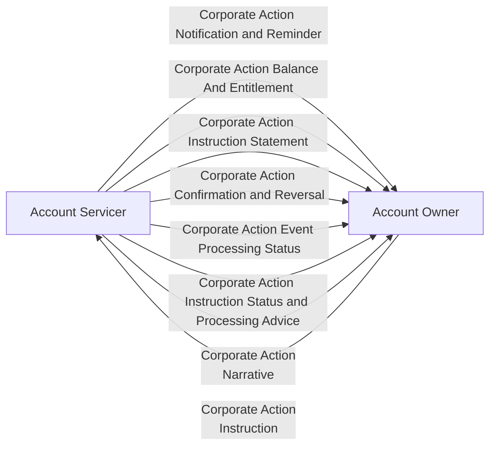

# Corporate Actions high-level information exchanges

[src-000079](../../../../../../../../evidence/omitted/2628a9d179f54e089e8f29f3.md); Scope and Functionality / Scope, P102; word/media/image1.png.

[Original scope figure](../../../../../../../../evidence/omitted/917a2908184ce79d4768a5d7.md)

## Mermaid reconstruction

## Actors and relationships

The source has eight labeled information-category arrows. Corporate Action Instruction goes from Account Owner to Account Servicer; seven other arrows go from Account Servicer to Account Owner. No temporal order, one-to-one exact message mapping, multiplicity, or optionality is stated in this overview. Decorative building icons and dashed actor boxes are represented by labeled functional participants.

The overview shows Narrative in one direction only. The detailed Narrative sequence at P287 explicitly shows both directions; the high-level omission does not prohibit Account Owner to Account Servicer narrative. [Detailed bidirectional narrative diagram](../business-transactions/fig-0032.md).

[Account Servicer](../../../../../../../../shared/reference/participants/participant-src-000079-account-servicer.md); [Account Owner](../../../../../../../../shared/reference/participants/participant-src-000079-account-owner.md).

## Review evidence

Opened unchanged source and rendered PNG. Compared both functional participants and all eight exact information-category labels, with seven arrows to Account Owner and one instruction arrow to Account Servicer. Explicitly disclosed the narrower narrative direction in this overview versus the detailed bidirectional source scenario. Parse/render passed with Mermaid 12.3.0 and Chromium 156.0.8078.81. Visual review date 2026-11-09 Europe/Warsaw; the render report records UTC 2026-11-08. Label wrapping/background styling improves legibility without altering source wording.

[Visually checked reconstruction](../../../../../../../../evidence/omitted/6bc50fecab728886bda0b334.md).
