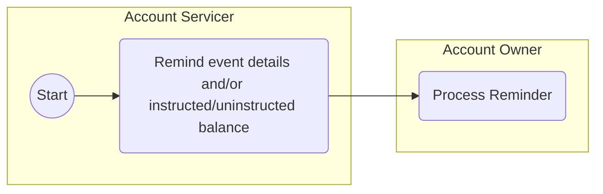

# Reminder activities

## Source evidence

[src-000079](../../../../../../../../evidence/omitted/2628a9d179f54e089e8f29f3.md); Description of BusinessActivities / BusinessActivities  / Reminder Process; direct-body paragraph P186. [Unchanged original EMF](../../../../../../../../evidence/omitted/fd45657872ad048dc2c95713.md); separate GDI+ preview below.

[Reminder activities](../../../../../../../../evidence/omitted/0c94cbf8ec7dac5778545ce6.md)

## Mermaid reconstruction

## Activities and responsibilities

The start point is in the Account Servicer lane. The servicer performs Remind event details and/or instructed/uninstructed balance. The arrow leads to the Account Owner activity Process Reminder. The source arrow has no message name label. No decision, alternative branch or endpoint is shown in this focused activity diagram.

Participant lanes preserve functional responsibilities. The unchanged original remains available for source notation. [Related reusable business flow](../../flows/flow-src-000079-p147-reminder.md) supplies surrounding conditions and message evidence; exact message names are not invented for unlabeled activity arrows.

[Account Servicer](../../../../../../../../shared/reference/participants/participant-src-000079-account-servicer.md); [Account Owner](../../../../../../../../shared/reference/participants/participant-src-000079-account-owner.md).

## Review evidence

Opened full-size unchanged source image or vector preview and rendered PNG. Compared both functional participants, start point, two named activities, source arrow direction and any source note/edge label. Parse/render passed with Mermaid 12.3.0 and Chromium 156.0.8078.81. Visual review date 2026-11-09 Europe/Warsaw; the render report records UTC 2026-11-08. Label wrapping/background styling improves legibility without altering source wording.

[Visually checked reconstruction](../../../../../../../../evidence/omitted/92abead51f670e2a90c1dc6c.md).
