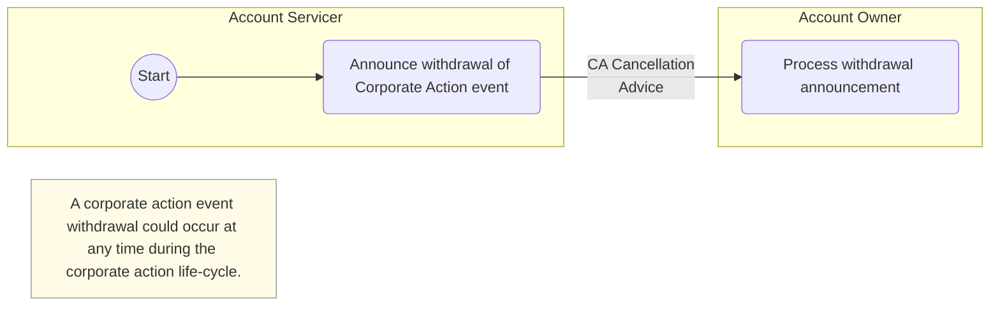

# Event withdrawal activities

## Source evidence

[src-000079](../../../../../../../../evidence/omitted/2628a9d179f54e089e8f29f3.md); Description of BusinessActivities / BusinessActivities  / Corporate Action Event Withdrawal Process; direct-body paragraph P196. [Unchanged original EMF](../../../../../../../../evidence/omitted/39b3ebc7df307b7b1ac819ec.md); separate GDI+ preview below.

[Event withdrawal activities](../../../../../../../../evidence/omitted/1e4182337d6e06d7d3d4f7a3.md)

## Mermaid reconstruction

## Activities and responsibilities

The start point is in the Account Servicer lane. The servicer performs Announce withdrawal of Corporate Action event. The arrow leads to the Account Owner activity Process withdrawal announcement. Its source label is CA Cancellation Advice. The source note states: A corporate action event withdrawal could occur at any time during the corporate action life-cycle.

Participant lanes preserve functional responsibilities. The unchanged original remains available for source notation. [Related reusable business flow](../../flows/flow-src-000079-p145-event-notification.md) supplies surrounding conditions and message evidence; exact message names are not invented for unlabeled activity arrows.

[Account Servicer](../../../../../../../../shared/reference/participants/participant-src-000079-account-servicer.md); [Account Owner](../../../../../../../../shared/reference/participants/participant-src-000079-account-owner.md).

## Review evidence

Opened full-size unchanged source image or vector preview and rendered PNG. Compared both functional participants, start point, two named activities, source arrow direction and any source note/edge label. Parse/render passed with Mermaid 12.3.0 and Chromium 156.0.8078.81. Visual review date 2026-11-09 Europe/Warsaw; the render report records UTC 2026-11-08. Label wrapping/background styling improves legibility without altering source wording.

[Visually checked reconstruction](../../../../../../../../evidence/omitted/e399e447734b3622376ff733.md).
