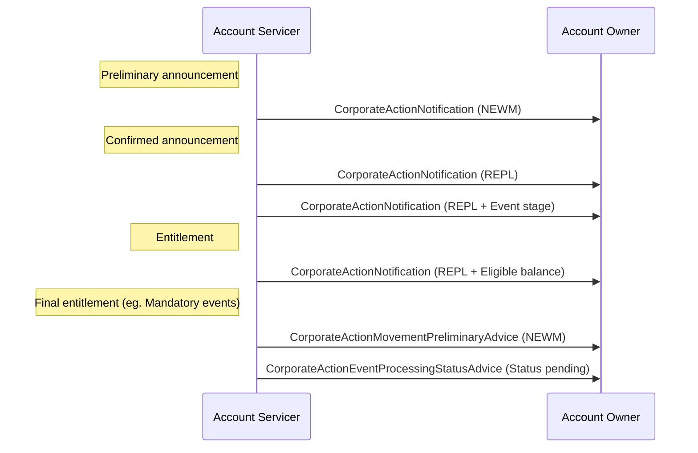

# Announcement

## Source evidence

[src-000079](../../../../../../../../evidence/omitted/2628a9d179f54e089e8f29f3.md); BusinessTransactions / Announcement  / Announcement; direct-body paragraph P210; word/media/image20.png. Narrative: P208-P216.

[Announcement](../../../../../../../../evidence/omitted/707b4c410f6cae68bb653f95.md)

## Mermaid reconstruction

## Actors, messages and conditions

The illustrated messages are conditional on the event and its life cycle, not all mandatory. Updated event details may cause replacements; final entitlement may be the first message for predictable events. Processing status advice may be sent when completion is delayed beyond the payment date. Source P213 contains an apparent recipient/message-name inconsistency; the drawing and adjacent P214 show Account Servicer to Account Owner.

The source narrative P203-P204 intentionally uses Account Servicer and Account Owner as functional roles to keep these flows generic. Intermediaries can act as servicer in one relationship and owner in another. Decorative building icons are represented by labeled participants. No additional actor or exchange is inferred from the omitted chain.

| Step | Sender | Receiver | Source message label | Source phase label |
| --- | --- | --- | --- | --- |
| 1 | Account Servicer | Account Owner | CorporateActionNotification (NEWM) | Preliminary announcement |
| 2 | Account Servicer | Account Owner | CorporateActionNotification (REPL) | Confirmed announcement |
| 3 | Account Servicer | Account Owner | CorporateActionNotification (REPL + Event stage) |  |
| 4 | Account Servicer | Account Owner | CorporateActionNotification (REPL + Eligible balance) | Entitlement |
| 5 | Account Servicer | Account Owner | CorporateActionMovementPreliminaryAdvice (NEWM) | Final entitlement (eg. Mandatory events) |
| 6 | Account Servicer | Account Owner | CorporateActionEventProcessingStatusAdvice (Status pending) |  |

[Reusable flow and complete surrounding source narrative](../../flows/flow-src-000079-p207-announcement.md).

[Account Servicer](../../../../../../../../shared/reference/participants/participant-src-000079-account-servicer.md); [Account Owner](../../../../../../../../shared/reference/participants/participant-src-000079-account-owner.md).

## Review evidence

Opened the unchanged full-size original and rendered PNG. Verified both actor labels, all 6 message arrows and labels, 0 Account Owner-to-Account Servicer arrows, remaining arrows in the reverse direction, and all source phase/qualifier notes. Decorative building icons replaced by labeled participants; no source semantics dropped. Parse/render passed with Mermaid 12.3.0 and Chromium 156.0.8078.81. Visual comparison performed 2026-11-09 Europe/Warsaw; render report UTC date is 2026-11-08.

[Visually checked reconstruction](../../../../../../../../evidence/omitted/fdf375b6c3423a2446390971.md).
