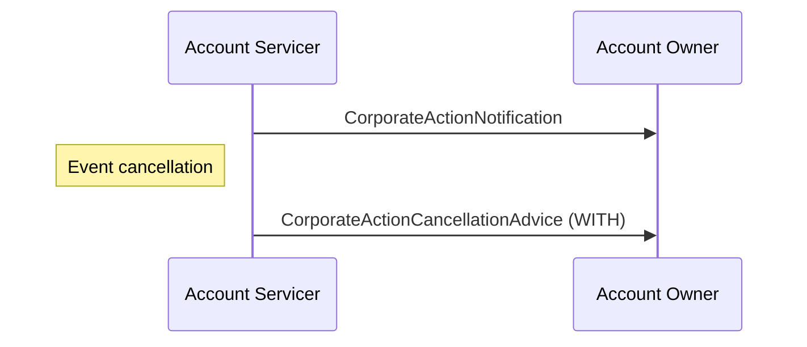

# Announcement and cancellation of event

## Source evidence

[src-000079](../../../../../../../../evidence/omitted/2628a9d179f54e089e8f29f3.md); BusinessTransactions / Announcement  / Announcement and Cancellation of Event; direct-body paragraph P222; word/media/image21.png. Narrative: P218-P221.

[Announcement and cancellation of event](../../../../../../../../evidence/omitted/f45b5e2ae09457e5edfc868a.md)

## Mermaid reconstruction

## Actors, messages and conditions

Trigger: the issuer withdraws a previously announced event. The Account Servicer sends withdrawal advice to the Account Owner. Withdrawal can occur at any point, after replacements, preliminary advice, or election. Issuer and intermediary chain appear in the narrative but are intentionally abstracted out of the two-role artwork.

The source narrative P203-P204 intentionally uses Account Servicer and Account Owner as functional roles to keep these flows generic. Intermediaries can act as servicer in one relationship and owner in another. Decorative building icons are represented by labeled participants. No additional actor or exchange is inferred from the omitted chain.

| Step | Sender | Receiver | Source message label | Source phase label |
| --- | --- | --- | --- | --- |
| 1 | Account Servicer | Account Owner | CorporateActionNotification |  |
| 2 | Account Servicer | Account Owner | CorporateActionCancellationAdvice (WITH) | Event cancellation |

[Reusable flow and complete surrounding source narrative](../../flows/flow-src-000079-p217-announcement-and-cancellation-of-event.md).

[Account Servicer](../../../../../../../../shared/reference/participants/participant-src-000079-account-servicer.md); [Account Owner](../../../../../../../../shared/reference/participants/participant-src-000079-account-owner.md).

## Review evidence

Opened the unchanged full-size original and rendered PNG. Verified both actor labels, all 2 message arrows and labels, 0 Account Owner-to-Account Servicer arrows, remaining arrows in the reverse direction, and all source phase/qualifier notes. Decorative building icons replaced by labeled participants; no source semantics dropped. Parse/render passed with Mermaid 12.3.0 and Chromium 156.0.8078.81. Visual comparison performed 2026-11-09 Europe/Warsaw; render report UTC date is 2026-11-08.

[Visually checked reconstruction](../../../../../../../../evidence/omitted/10317c433d51f7cfc069b7d3.md).
