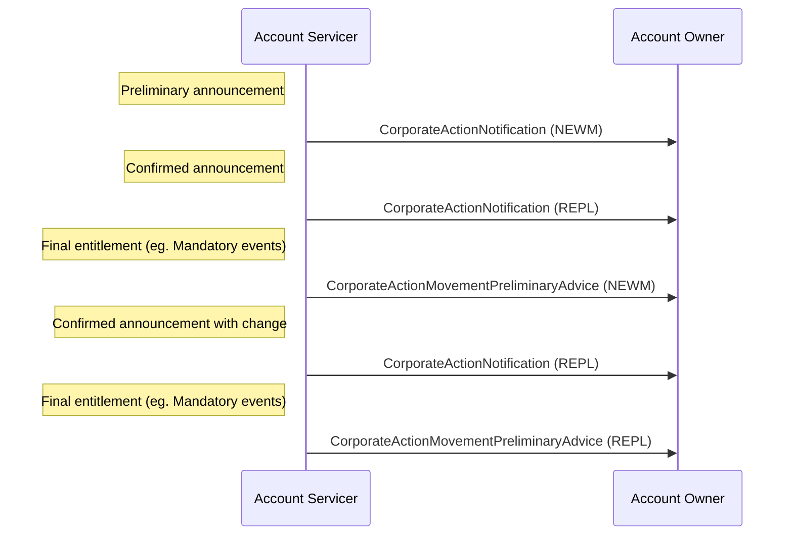

# Final entitlement replacement

## Source evidence

[src-000079](../../../../../../../../evidence/omitted/2628a9d179f54e089e8f29f3.md); BusinessTransactions / Announcement  / Final Entitlement Replacement Scenario; direct-body paragraph P232; word/media/image23.png. Narrative: P230-P234.

[Final entitlement replacement](../../../../../../../../evidence/omitted/27cb3827b2317c6ab5d23208.md)

## Mermaid reconstruction

## Actors, messages and conditions

For a mandatory event, issuer changes affecting eligible balances or movement details after a final-entitlement advice trigger an updated confirmed notification and replacement preliminary advice. The Issuer is in the narrative but is not a third actor in the source sequence.

The source narrative P203-P204 intentionally uses Account Servicer and Account Owner as functional roles to keep these flows generic. Intermediaries can act as servicer in one relationship and owner in another. Decorative building icons are represented by labeled participants. No additional actor or exchange is inferred from the omitted chain.

| Step | Sender | Receiver | Source message label | Source phase label |
| --- | --- | --- | --- | --- |
| 1 | Account Servicer | Account Owner | CorporateActionNotification (NEWM) | Preliminary announcement |
| 2 | Account Servicer | Account Owner | CorporateActionNotification (REPL) | Confirmed announcement |
| 3 | Account Servicer | Account Owner | CorporateActionMovementPreliminaryAdvice (NEWM) | Final entitlement (eg. Mandatory events) |
| 4 | Account Servicer | Account Owner | CorporateActionNotification (REPL) | Confirmed announcement with change |
| 5 | Account Servicer | Account Owner | CorporateActionMovementPreliminaryAdvice (REPL) | Final entitlement (eg. Mandatory events) |

[Reusable flow and complete surrounding source narrative](../../flows/flow-src-000079-p229-final-entitlement-replacement-scenario.md).

[Account Servicer](../../../../../../../../shared/reference/participants/participant-src-000079-account-servicer.md); [Account Owner](../../../../../../../../shared/reference/participants/participant-src-000079-account-owner.md).

## Review evidence

Opened the unchanged full-size original and rendered PNG. Verified both actor labels, all 5 message arrows and labels, 0 Account Owner-to-Account Servicer arrows, remaining arrows in the reverse direction, and all source phase/qualifier notes. Decorative building icons replaced by labeled participants; no source semantics dropped. Parse/render passed with Mermaid 12.3.0 and Chromium 156.0.8078.81. Visual comparison performed 2026-11-09 Europe/Warsaw; render report UTC date is 2026-11-08.

[Visually checked reconstruction](../../../../../../../../evidence/omitted/2504bd7e69709a731bb6abed.md).
