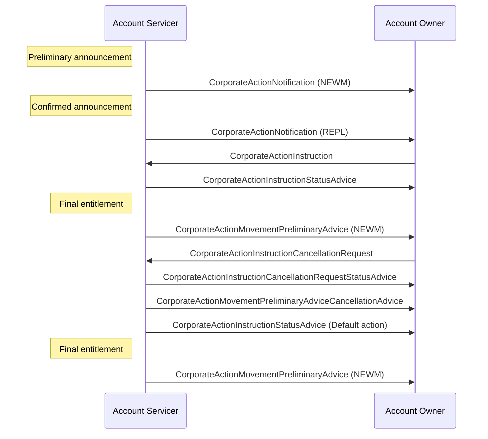

# Election and final entitlement cancellation

## Source evidence

[src-000079](../../../../../../../../evidence/omitted/2628a9d179f54e089e8f29f3.md); BusinessTransactions / Election, Entitlement and Reminder Scenarios / Election and Final Entitlement Cancellation Scenario; direct-body paragraph P246; word/media/image25.png. Narrative: P244-P250.

[Election and final entitlement cancellation](../../../../../../../../evidence/omitted/85b8d6f917df53f788505c99.md)

## Mermaid reconstruction

## Actors, messages and conditions

Cancellation is conditional on the event permitting it. The request may state whether a new instruction will follow. The servicer reports cancellation status. If no new instruction arrives before its deadline and no standing instruction exists, it reports the default action and may send new final-entitlement preliminary advice. The artwork also shows cancellation of the earlier movement preliminary advice; all ten arrows are preserved.

The source narrative P203-P204 intentionally uses Account Servicer and Account Owner as functional roles to keep these flows generic. Intermediaries can act as servicer in one relationship and owner in another. Decorative building icons are represented by labeled participants. No additional actor or exchange is inferred from the omitted chain.

| Step | Sender | Receiver | Source message label | Source phase label |
| --- | --- | --- | --- | --- |
| 1 | Account Servicer | Account Owner | CorporateActionNotification (NEWM) | Preliminary announcement |
| 2 | Account Servicer | Account Owner | CorporateActionNotification (REPL) | Confirmed announcement |
| 3 | Account Owner | Account Servicer | CorporateActionInstruction |  |
| 4 | Account Servicer | Account Owner | CorporateActionInstructionStatusAdvice |  |
| 5 | Account Servicer | Account Owner | CorporateActionMovementPreliminaryAdvice (NEWM) | Final entitlement |
| 6 | Account Owner | Account Servicer | CorporateActionInstructionCancellationRequest |  |
| 7 | Account Servicer | Account Owner | CorporateActionInstructionCancellationRequestStatusAdvice |  |
| 8 | Account Servicer | Account Owner | CorporateActionMovementPreliminaryAdviceCancellationAdvice |  |
| 9 | Account Servicer | Account Owner | CorporateActionInstructionStatusAdvice (Default action) |  |
| 10 | Account Servicer | Account Owner | CorporateActionMovementPreliminaryAdvice (NEWM) | Final entitlement |

[Reusable flow and complete surrounding source narrative](../../flows/flow-src-000079-p243-election-and-final-entitlement-cancellation-scenario.md).

[Account Servicer](../../../../../../../../shared/reference/participants/participant-src-000079-account-servicer.md); [Account Owner](../../../../../../../../shared/reference/participants/participant-src-000079-account-owner.md).

## Review evidence

Opened the unchanged full-size original and rendered PNG. Verified both actor labels, all 10 message arrows and labels, 2 Account Owner-to-Account Servicer arrows, remaining arrows in the reverse direction, and all source phase/qualifier notes. Decorative building icons replaced by labeled participants; no source semantics dropped. Parse/render passed with Mermaid 12.3.0 and Chromium 156.0.8078.81. Visual comparison performed 2026-11-09 Europe/Warsaw; render report UTC date is 2026-11-08.

[Visually checked reconstruction](../../../../../../../../evidence/omitted/b5182d3a89f7924e68854b02.md).
