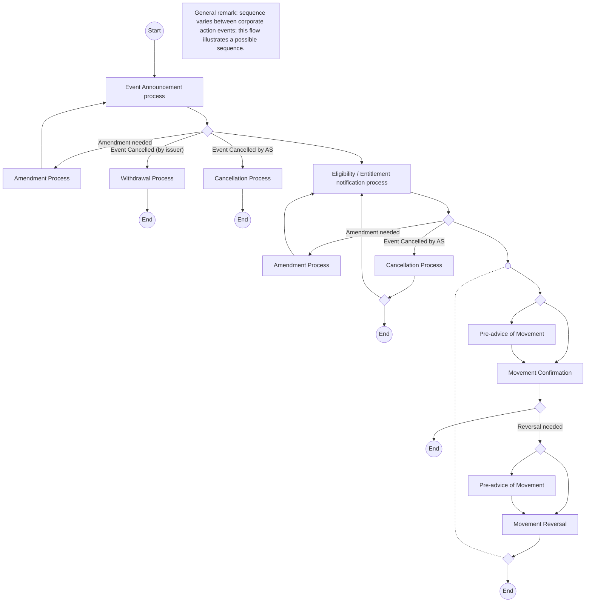

# Mandatory reorganisation without options

[src-000079](../../../../../../../../evidence/omitted/2628a9d179f54e089e8f29f3.md); Description of BusinessActivities / Mandatory reorganisation without options; P172; word/media/image10.png. [Unchanged original](../../../../../../../../evidence/omitted/4a690ad3684830616e0c4a76.md).

[Source preview](../../../../../../../../evidence/omitted/4a690ad3684830616e0c4a76.md)

## Mermaid reconstruction

## Process and participant semantics

This high-level process view is scoped by P171/P174 to REOR/MAND and DISN/MAND. It contains event announcement/amendment, issuer withdrawal, account-servicer cancellation, eligibility/entitlement, optional preliminary advice, confirmation and reversal paths.  Every unlabeled source diamond remains an unlabeled diamond; no unstated guard is supplied. The small blank junction circle is a derived routing aid for the source line junction, not a new business activity. The general source note says event sequences can vary and this is only a possible sequence. The source does not draw participant lanes here; responsible roles must be retrieved from the named process references, not inferred from box position.

## Unresolved source notation

The source dashed connector between the pre-confirmation region and final post-reversal merge has no clearly readable arrowhead in the supplied PNG. It is reconstructed as an undirected dashed connection; no reverse loop or extra execution order is inferred.

[Reusable flow and surrounding source narrative](../../flows/flow-src-000079-p170-mandatory-reorganisation-without-options.md).

## Review evidence

Opened full original PNG and rendered diagram. Compared all named process nodes, amendment loops, issuer-withdrawal and account-servicer cancellation branches, confirmation, optional preliminary advice, reversal branches and source endpoints. The dashed connector endpoints are retained but arrowhead orientation remains unresolved; visual review is partial under issue-000024. Parse/render passed with Mermaid 12.3.0 and Chromium 156.0.8078.81. Visual comparison performed 2026-11-09 Europe/Warsaw (render report UTC date 2026-11-08). No overall reviewed status is claimed.

[Rendered reconstruction](../../../../../../../../evidence/omitted/b8a2deff847b5cf4332a6f12.md).
