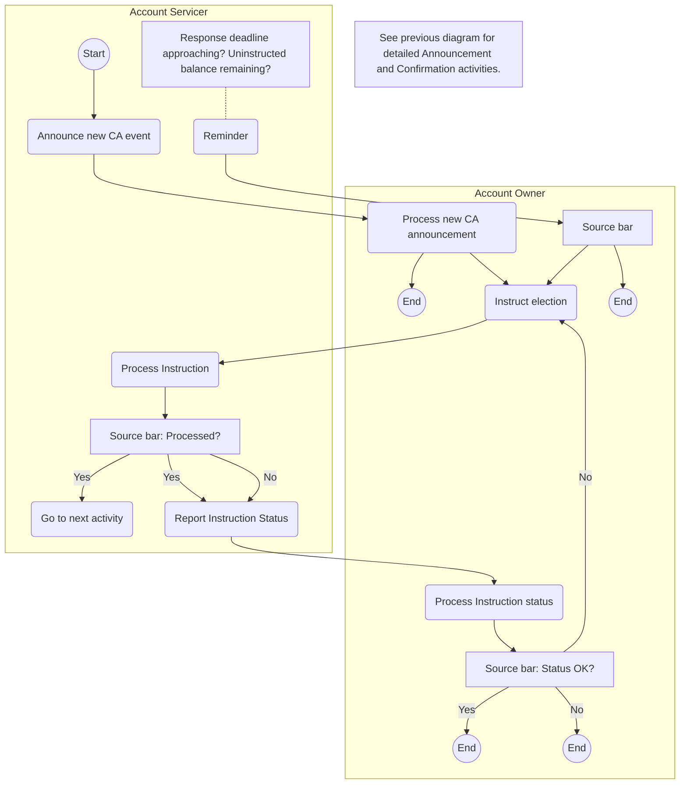

# Elective instruction activities

[src-000079](../../../../../../../../evidence/omitted/2628a9d179f54e089e8f29f3.md); Description of BusinessActivities / Elective instruction activities; P182; word/media/image13.emf. [Unchanged original](../../../../../../../../evidence/omitted/1839ecb33cb71b58051aa762.md).

[Source preview](../../../../../../../../evidence/omitted/6a482d932ac56dd0988f6d05.md)

## Mermaid reconstruction

## Process and participant semantics

The source lanes assign activities to Account Servicer and Account Owner. Named activities, all cross-lane arrows, all source endpoints, and repeated Yes/No branches are preserved. Source bars are explicitly labeled as bars in the reconstruction rather than converted into exclusive decision diamonds. Annotation boxes are retained as source notes, not extra activities or participants. The source note defines omitted context and is reproduced in the diagram.

## Unresolved source notation

Source T20 defines bars as parallel actions, yet this artwork combines bars with Yes/No conditional labels. Every source branch is retained; exclusive-choice and synchronization semantics remain unresolved under issue-000020.

[Reusable flow and surrounding source narrative](../../flows/flow-src-000079-p180-instruction-process-elective-event.md).

## Review evidence

Opened the full source image/EMF preview and rendered diagram. Compared both participant lanes, each named activity, each source bar, repeated conditional labels, all cross-lane directions, loops, endpoints and notes. Drawing reconstruction comparison passes, but source conditional/parallel semantics remain open under issue-000020. Parse/render passed with Mermaid 12.3.0 and Chromium 156.0.8078.81. Visual comparison performed 2026-11-09 Europe/Warsaw (render report UTC date 2026-11-08). No overall reviewed status is claimed.

[Rendered reconstruction](../../../../../../../../evidence/omitted/8cc1f7aac4f38187e8b842fc.md).
