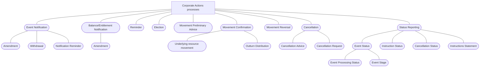

# Corporate Actions business-process hierarchy

## Source evidence

[src-000079](../../../../../../../../evidence/omitted/2628a9d179f54e089e8f29f3.md); direct-body paragraph P144, word/media/image3.png. [Extraction occurrence](../../documents/src-000079/diagrams/fig-0003.md).

[Unchanged original asset](../../../../../../../../evidence/omitted/307f1ec17644fda700fab6ea.md).

[Corporate Actions business-process hierarchy](../../../../../../../../evidence/omitted/307f1ec17644fda700fab6ea.md)

## Mermaid reconstruction

## Meaning and boundaries

The source groups nine high-level processes under Corporate Actions processes. Event Notification has Amendment, Withdrawal, and Notification Reminder; Balance/Entitlement Notification has Amendment; Movement Confirmation has Underlying resource movement and Outturn Distribution; Cancellation has Cancellation Advice and Cancellation Request; Status Reporting has Event Status, Instruction Status, Cancellation Status, and Instructions Statement. Event Status has Event Processing Status and Event Stage. Reminder, Election, Movement Preliminary Advice and Movement Reversal have no further child shown in this artwork.

Connections have no arrowheads in the original. They are preserved as undirected grouping connectors, not message exchanges, sequencing, UML inheritance, or use-case include/extend relationships. Ovals identify business processes here; source P143 explicitly calls this a high-level BusinessProcesses diagram. The source does not provide actors or a system boundary in this hierarchy. Process definitions, triggers, preconditions, postconditions, and responsible roles are preserved separately in T11-T19 and reusable flow pages.

## Review evidence

The unchanged original and Mermaid-rendered PNG were both opened and compared on 2026-11-09 (Europe/Warsaw). All nine top-level processes and all fourteen named child-process nodes, including the two Event Status children, match their source grouping. All connectors are undirected. Source ovals are represented as process nodes without inferred use-case semantics. Parse and render passed with Mermaid 12.3.0 and Chromium 156.0.8078.81. The render report records the UTC date 2026-11-08; local visual review date is 2026-11-09.

[Rendered reconstruction](../../../../../../../../evidence/omitted/d327d99e59b6eec8ff1050d8.md).
