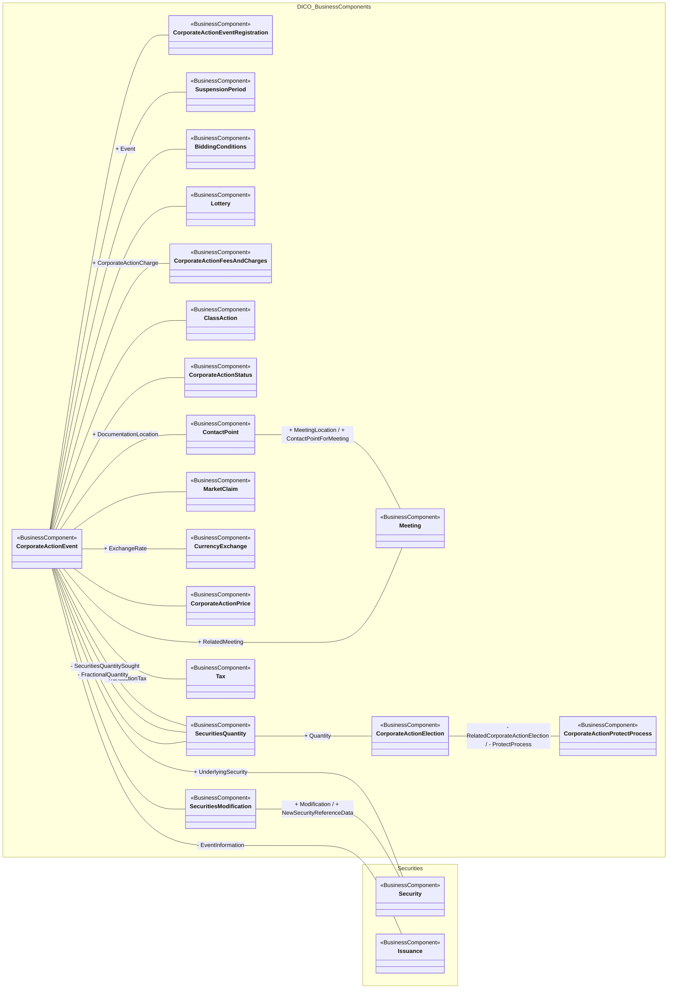

# CorporateActionEvent conceptual context

[src-000081](../../../../../../../../../evidence/omitted/5d05ada13720516836bc5043.md), CorporateActionEvent!A4:T56; xl/drawings/drawing2.xml; anchor 1. Original image SHA-256: 8039d5ad0d76b4846231a7f0a460e754ba7528fd123f344ac002461e5aceeea7.

[Original complete figure](../../../../../../../../../evidence/omitted/bb9c3cff37436003fd7c74e8.md) · [Rendered Mermaid SVG](../../../../../../../../../evidence/omitted/01989cced40c659db1b81f8d.md) · [Rendered Mermaid PNG](../../../../../../../../../evidence/omitted/37ac014c03cf1344d0da97f3.md)

## Source reconstruction

## Entities and relationships

CorporateActionEvent is associated with event registration, suspension/bidding/lottery conditions, fees, issuance, status, documentation, meetings, tax, securities quantities, prices, exchange rate, claims, underlying security, modifications and class actions. Three distinct association lines connect the event and SecuritiesQuantity: SecuritiesQuantitySought, FractionalQuantity and an unlabelled line. Quantity also connects to election, which connects to protect processing. The figure shows no participant swimlane or business-message exchange direction.

All 20 visible node occurrences and 23 relationship lines are retained. No numeric multiplicity is shown in this source view, so none is inferred. Namespaces group the source’s printed “from” package labels for readability; the source did not draw those enclosing package boxes. Association labels retain literal +/− prefixes and combined end names. Their re-layout position is not additional navigability evidence. The native class inheritance marker is reserved for the source’s hollow-triangle generalizations. Source editor/navigation icons are omitted as interface decoration; no business entity or relationship is excluded.

## Complete relationship register

| From node | To node | Source relationship kind | Visible source label(s) | From-end multiplicity | To-end multiplicity |
| --- | --- | --- | --- | --- | --- |
| CorporateActionEvent | CorporateActionEventRegistration | association | (unlabelled in source) | not printed | not printed |
| CorporateActionEvent | SuspensionPeriod | association | (unlabelled in source) | not printed | not printed |
| CorporateActionEvent | BiddingConditions | association | + Event | not printed | not printed |
| CorporateActionEvent | Lottery | association | (unlabelled in source) | not printed | not printed |
| CorporateActionEvent | CorporateActionFeesAndCharges | association | + CorporateActionCharge | not printed | not printed |
| CorporateActionEvent | Issuance | association | - EventInformation | not printed | not printed |
| CorporateActionEvent | CorporateActionStatus | association | (unlabelled in source) | not printed | not printed |
| CorporateActionEvent | ContactPoint | association | + DocumentationLocation | not printed | not printed |
| ContactPoint | Meeting | association | + MeetingLocation / + ContactPointForMeeting | not printed | not printed |
| CorporateActionEvent | Meeting | association | + RelatedMeeting | not printed | not printed |
| CorporateActionEvent | Tax | association | - TransactionTax | not printed | not printed |
| CorporateActionEvent | SecuritiesQuantity | association | - SecuritiesQuantitySought | not printed | not printed |
| CorporateActionEvent | SecuritiesQuantity | association | - FractionalQuantity | not printed | not printed |
| CorporateActionEvent | SecuritiesQuantity | association | (unlabelled in source) | not printed | not printed |
| CorporateActionEvent | CorporateActionPrice | association | (unlabelled in source) | not printed | not printed |
| CorporateActionEvent | CurrencyExchange | association | + ExchangeRate | not printed | not printed |
| CorporateActionEvent | MarketClaim | association | (unlabelled in source) | not printed | not printed |
| CorporateActionEvent | Security | association | + UnderlyingSecurity | not printed | not printed |
| CorporateActionEvent | SecuritiesModification | association | (unlabelled in source) | not printed | not printed |
| CorporateActionEvent | ClassAction | association | (unlabelled in source) | not printed | not printed |
| SecuritiesModification | Security | association | + Modification / + NewSecurityReferenceData | not printed | not printed |
| SecuritiesQuantity | CorporateActionElection | association | + Quantity | not printed | not printed |
| CorporateActionElection | CorporateActionProtectProcess | association | - RelatedCorporateActionElection / - ProtectProcess | not printed | not printed |

## Entity definitions and precise workbook locators

| Visible label | Source package / stereotype | Definition evidence |
| --- | --- | --- |
| CorporateActionEventRegistration | DICO_BusinessComponents / BusinessComponent | [FullBusinessModel!A1136:D1136](../sheets/02-fullbusinessmodel/tbl-0007.md) — Specifies the official date and identification of the event. |
| SuspensionPeriod | DICO_BusinessComponents / BusinessComponent | [FullBusinessModel!A4864:D4864](../sheets/02-fullbusinessmodel/tbl-0026.md) — Period defining the last date for which an action will be accepted and the date on which the suspension will be released and normal processing will resume. |
| BiddingConditions | DICO_BusinessComponents / BusinessComponent | [FullBusinessModel!A403:D403](../sheets/02-fullbusinessmodel/tbl-0004.md) — Specifies the conditions under which securities can be acquired as part of a corporate action. |
| Lottery | DICO_BusinessComponents / BusinessComponent | [FullBusinessModel!A2666:D2666](../sheets/02-fullbusinessmodel/tbl-0015.md) — The parameters required to manage the organisation of a lottery. |
| CorporateActionFeesAndCharges | DICO_BusinessComponents / BusinessComponent | [FullBusinessModel!A1141:D1141](../sheets/02-fullbusinessmodel/tbl-0007.md) — The definition of all the charges related to a corporate action event. |
| ClassAction | DICO_BusinessComponents / BusinessComponent | [FullBusinessModel!A797:D797](../sheets/02-fullbusinessmodel/tbl-0005.md) — Form of lawsuit in which a group of shareholders collectively bring a claim to court, mainly because it would be too expensive for each individual shareholder to launch their own lawsuit. |
| CorporateActionEvent | DICO_BusinessComponents / BusinessComponent | [FullBusinessModel!A1083:D1083](../sheets/02-fullbusinessmodel/tbl-0007.md) — An event determined by a corporation's board of directors, that changes the existing corporate capital structure or financial condition. |
| CorporateActionStatus | DICO_BusinessComponents / BusinessComponent | [FullBusinessModel!A1213:D1213](../sheets/02-fullbusinessmodel/tbl-0008.md) — Status of the corporate action process. |
| SecuritiesModification | DICO_BusinessComponents / BusinessComponent | [FullBusinessModel!A4105:D4105](../sheets/02-fullbusinessmodel/tbl-0022.md) — Modification of the reference data of a security or of the organisation that issued it. |
| MarketClaim | DICO_BusinessComponents / BusinessComponent | [FullBusinessModel!A2741:D2741](../sheets/02-fullbusinessmodel/tbl-0015.md) — Processes that reallocate corporate action proceeds to the entitled party and that compensate financial penalties or indirect costs due to late delivery or payment. |
| CurrencyExchange | DICO_BusinessComponents / BusinessComponent | [FullBusinessModel!A1310:D1310](../sheets/02-fullbusinessmodel/tbl-0008.md) — Information needed to process a currency exchange or conversion. |
| CorporateActionPrice | DICO_BusinessComponents / BusinessComponent | [FullBusinessModel!A1176:D1176](../sheets/02-fullbusinessmodel/tbl-0007.md) — Prices related to a corporate action. |
| SecuritiesQuantity | DICO_BusinessComponents / BusinessComponent | [FullBusinessModel!A4350:D4350](../sheets/02-fullbusinessmodel/tbl-0023.md) — Quantity of a security. |
| Tax | DICO_BusinessComponents / BusinessComponent | [FullBusinessModel!A4968:D4968](../sheets/02-fullbusinessmodel/tbl-0026.md) — Amount of money due to the government or tax authority, according to various pre-defined parameters such as thresholds or income. |
| Meeting | DICO_BusinessComponents / BusinessComponent | [FullBusinessModel!A2755:D2755](../sheets/02-fullbusinessmodel/tbl-0015.md) — Specifies the physical parameters of a general meeting. Several dates and places can be defined for a  meeting. |
| ContactPoint | DICO_BusinessComponents / BusinessComponent | [FullBusinessModel!A994:D994](../sheets/02-fullbusinessmodel/tbl-0006.md) — Number, physical or virtual address, used for communication. |
| CorporateActionElection | DICO_BusinessComponents / BusinessComponent | [FullBusinessModel!A1066:D1066](../sheets/02-fullbusinessmodel/tbl-0007.md) — Decision taken by the account holder regarding the corporate action event. |
| CorporateActionProtectProcess | DICO_BusinessComponents / BusinessComponent | [FullBusinessModel!A1194:D1194](../sheets/02-fullbusinessmodel/tbl-0007.md) — Provides detailed information on protect and cover protect instructions. |
| Security | Securities / BusinessComponent | [FullBusinessModel!A4659:D4659](../sheets/02-fullbusinessmodel/tbl-0025.md) — Financial instruments representing a sum of rights of the investor vis-a-vis the issuer. |
| Issuance | Securities / BusinessComponent | [FullBusinessModel!A2496:D2496](../sheets/02-fullbusinessmodel/tbl-0014.md) — Preparation/bringing to market of a security (also known as primary market or Initial Public Offering (IPO) issuance). |

## Participant and flow navigation

This is a conceptual entity model, not a message exchange diagram. A business component or relationship label is not automatically a functional participant or institution. [Message-set participant references](../../../participants.md) and [Message-set business flows](../../../flows/index.md) provide the independently sourced actor/process context. These references are navigational; source figure associations do not establish message direction.

## Rendering and visual review

2026-11-09: Mermaid 12.3.0 parsed and rendered successfully with Mermaid browser API + Chromium 156.0.8078.81. Visually compared original complete source figure with final rendered PNG, checking every entity occurrence, package/stereotype, association endpoint, arrow type, inheritance direction and literal label. All23/26/14/16 lines respectively reconciled in explicit relationship registers. [Renderer evidence](../../../../../../../../../work/corporate-workbook-models/render-report.json).

