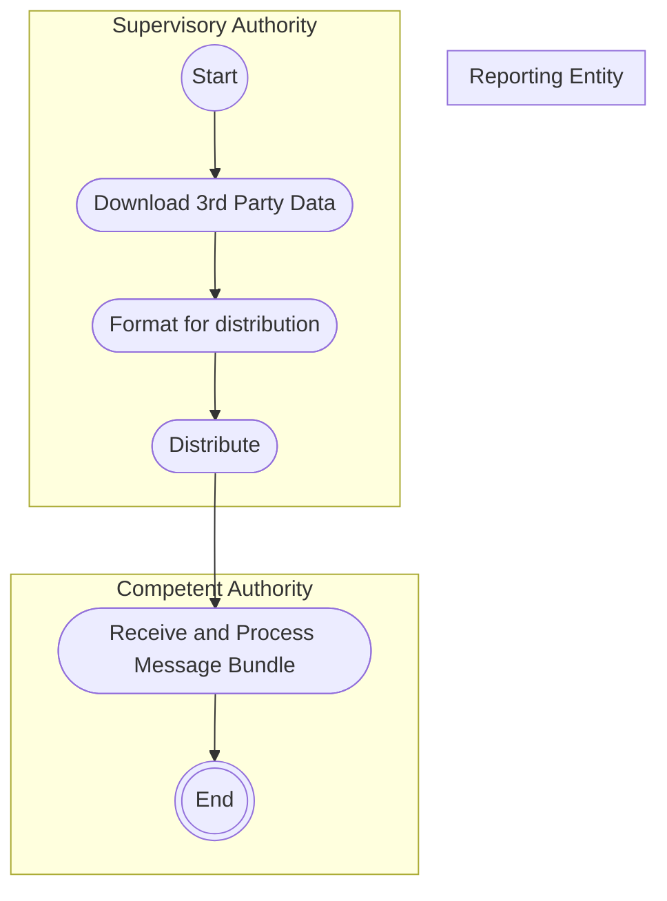

# Reference data distribution

[src-000320](../../../../../../../../evidence/omitted/b0e9dc6419046e4d0523e995.md); direct-body paragraph P147; Description of BusinessActivities / Reference Data Reporting / Reference Data Distribution.

[Original source figure](../../../../../../../../evidence/omitted/0c5ae195f639145d47adaf7f.md) · [Readable original preview](../../../../../../../../evidence/omitted/124d4fbd0cc0b0de27613244.md) · [Reusable business flow](../../flows/flow-src-000320-p146-reference-data-distribution.md)

## Source reconstruction

## Activities, actors and control paths

| Node | Responsible source lane | Literal source label | Source shape |
| --- | --- | --- | --- |
| start | Supervisory Authority | start | start |
| download | Supervisory Authority | Download 3rd Party Data | action |
| format | Supervisory Authority | Format for distribution | action |
| distribute | Supervisory Authority | Distribute | action |
| receive | Competent Authority | Receive and Process Message Bundle | action |
| endCA | Competent Authority | end | end |

| From | To | Source path condition |
| --- | --- | --- |
| start | download | Unlabelled |
| download | format | Unlabelled |
| format | distribute | Unlabelled |
| distribute | receive | Unlabelled |
| receive | endCA | Unlabelled |

## Responsibilities from the activity table

[T24](../../documents/src-000320/tables/tbl-0024.md) preserves every action description and source Initiator value.

## Qualifications

- Mermaid flowchart subgraphs preserve the source swimlanes. Dark bar nodes retain each source control bar and all connected edges; they are not silently flattened into exclusive decisions. Source start/final symbols become labelled circles; blank source decisions remain unlabelled.
- Node IDs in the edge table distinguish otherwise repeated labels. The source original is retained for exact geometry; no additional business path or timing is inferred.
- The Reporting Entity lane is empty in this activity picture. Narrative P199 and sequence figure23 additionally include Public, Reporting Entity and 3rd Party Systems; this activity diagram intentionally presents only the CA distribution-processing path.

## Rendering and visual review

Mermaid 12.3.0 with Mermaid browser API + Chromium 156.0.8078.81 parsed and rendered this diagram. On 2026-11-09 (Europe/Warsaw), the original and final reconstruction were directly compared for labels, actors, lane responsibility, all endpoints/directions, guards, parallel bars and corrective loops. Result: **visible-source fidelity pass**. Source conflicts remain open where listed.

[Rendered SVG](../../../../../../../../evidence/omitted/de86f0cb9ca05ca27faa5e66.md) · [Rendered PNG](../../../../../../../../evidence/omitted/d3cf15cbbfa8e1916ba1fa16.md) · [Hash-bound review evidence](../../../../../../../../tracking/reviews/fitrr-activities.json)

Source notation: [T22 legend](../../documents/src-000320/tables/tbl-0022.md) defines a bar as initiating several actions in parallel. The reconstruction retains these nodes; empty source swimlanes may render as labels rather than a full-height box.
