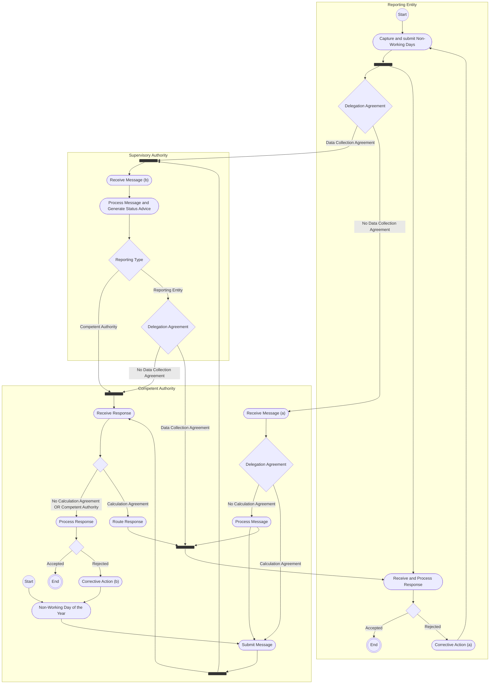

# Non-working days

[src-000320](../../../../../../../../evidence/omitted/b0e9dc6419046e4d0523e995.md); direct-body paragraph P149; Description of BusinessActivities / Reference Data Reporting / Non-Working Days.

[Original source figure](../../../../../../../../evidence/omitted/fc374c1b5a8e9f55a61d499e.md) · [Readable original preview](../../../../../../../../evidence/omitted/ae39ad57ce3034973af9cb29.md) · [Reusable business flow](../../flows/flow-src-000320-p148-non-working-days.md)

## Source reconstruction

## Activities, actors and control paths

| Node | Responsible source lane | Literal source label | Source shape |
| --- | --- | --- | --- |
| startRE | Reporting Entity | start | start |
| capture | Reporting Entity | Capture and submit Non-Working Days | action |
| forkRE | Reporting Entity | Source control bar | bar |
| delegateRE | Reporting Entity | Delegation Agreement | decision |
| responseRE | Reporting Entity | Receive and Process Response | action |
| acceptedRE | Reporting Entity | Unlabelled decision | decision |
| correctRE | Reporting Entity | Corrective Action (a) | action |
| endRE | Reporting Entity | end | end |
| receiveCA | Competent Authority | Receive Message (a) | action |
| delegateCA | Competent Authority | Delegation Agreement | decision |
| processCA | Competent Authority | Process Message | action |
| submitCA | Competent Authority | Submit Message | action |
| startCA | Competent Authority | start | start |
| datesCA | Competent Authority | Non-Working Day of the Year | action |
| correctCA | Competent Authority | Corrective Action (b) | action |
| forkCA | Competent Authority | Source control bar | bar |
| responseCA | Competent Authority | Receive Response | action |
| responseDecision | Competent Authority | Unlabelled decision | decision |
| processResponse | Competent Authority | Process Response | action |
| acceptedCA | Competent Authority | Unlabelled decision | decision |
| endCA | Competent Authority | end | end |
| routeCA | Competent Authority | Route Response | action |
| mergeCA | Competent Authority | Source control bar | bar |
| mergeResponse | Competent Authority | Source control bar | bar |
| mergeSA | Supervisory Authority | Source control bar | bar |
| receiveSA | Supervisory Authority | Receive Message (b) | action |
| processSA | Supervisory Authority | Process Message and Generate Status Advice | action |
| reportingType | Supervisory Authority | Reporting Type | decision |
| delegateSA | Supervisory Authority | Delegation Agreement | decision |

| From | To | Source path condition |
| --- | --- | --- |
| startRE | capture | Unlabelled |
| capture | forkRE | Unlabelled |
| forkRE | delegateRE | Unlabelled |
| forkRE | responseRE | Unlabelled |
| delegateRE | mergeSA | Data Collection Agreement |
| delegateRE | receiveCA | No Data Collection Agreement |
| receiveCA | delegateCA | Unlabelled |
| delegateCA | processCA | No Calculation Agreement |
| delegateCA | submitCA | Calculation Agreement |
| processCA | submitCA | Unlabelled |
| processCA | mergeCA | Unlabelled |
| startCA | datesCA | Unlabelled |
| datesCA | submitCA | Unlabelled |
| submitCA | forkCA | Unlabelled |
| forkCA | mergeSA | Unlabelled |
| forkCA | responseCA | Unlabelled |
| mergeSA | receiveSA | Unlabelled |
| receiveSA | processSA | Unlabelled |
| processSA | reportingType | Unlabelled |
| reportingType | mergeResponse | Competent Authority |
| reportingType | delegateSA | Reporting Entity |
| delegateSA | mergeResponse | No Data Collection Agreement |
| delegateSA | mergeCA | Data Collection Agreement |
| mergeResponse | responseCA | Unlabelled |
| responseCA | responseDecision | Unlabelled |
| responseDecision | processResponse | No Calculation Agreement OR Competent Authority |
| responseDecision | routeCA | Calculation Agreement |
| processResponse | acceptedCA | Unlabelled |
| acceptedCA | endCA | Accepted |
| acceptedCA | correctCA | Rejected |
| correctCA | datesCA | Unlabelled |
| routeCA | mergeCA | Unlabelled |
| mergeCA | responseRE | Unlabelled |
| responseRE | acceptedRE | Unlabelled |
| acceptedRE | endRE | Accepted |
| acceptedRE | correctRE | Rejected |
| correctRE | capture | Unlabelled |

## Responsibilities from the activity table

[T25](../../documents/src-000320/tables/tbl-0025.md) preserves every action description and source Initiator value.

## Qualifications

- Mermaid flowchart subgraphs preserve the source swimlanes. Dark bar nodes retain each source control bar and all connected edges; they are not silently flattened into exclusive decisions. Source start/final symbols become labelled circles; blank source decisions remain unlabelled.
- Node IDs in the edge table distinguish otherwise repeated labels. The source original is retained for exact geometry; no additional business path or timing is inferred.

## Rendering and visual review

Mermaid 12.3.0 with Mermaid browser API + Chromium 156.0.8078.81 parsed and rendered this diagram. On 2026-11-09 (Europe/Warsaw), the original and final reconstruction were directly compared for labels, actors, lane responsibility, all endpoints/directions, guards, parallel bars and corrective loops. Result: **visible-source fidelity pass**. Source conflicts remain open where listed.

[Rendered SVG](../../../../../../../../evidence/omitted/e132abfe62826d12ac7a43b2.md) · [Rendered PNG](../../../../../../../../evidence/omitted/d2c0b13234938da0845d273a.md) · [Hash-bound review evidence](../../../../../../../../tracking/reviews/fitrr-activities.json)

Source notation: [T22 legend](../../documents/src-000320/tables/tbl-0022.md) defines a bar as initiating several actions in parallel. The reconstruction retains these nodes; empty source swimlanes may render as labels rather than a full-height box.
