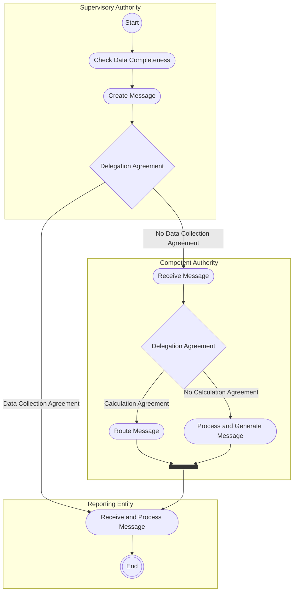

# Missing or incomplete data

[src-000320](../../../../../../../../evidence/omitted/b0e9dc6419046e4d0523e995.md); direct-body paragraph P151; Description of BusinessActivities / Reference Data Reporting / Missing / Incomplete Data Submission.

[Original source figure](../../../../../../../../evidence/omitted/ffef424ddcc1ff8a70125fb8.md) · [Readable original preview](../../../../../../../../evidence/omitted/46d6a3005d500073d0b1b426.md) · [Reusable business flow](../../flows/flow-src-000320-p150-missing-incomplete-data-submission.md)

## Source reconstruction

## Activities, actors and control paths

| Node | Responsible source lane | Literal source label | Source shape |
| --- | --- | --- | --- |
| start | Supervisory Authority | start | start |
| check | Supervisory Authority | Check Data Completeness | action |
| create | Supervisory Authority | Create Message | action |
| delegateSA | Supervisory Authority | Delegation Agreement | decision |
| receiveCA | Competent Authority | Receive Message | action |
| delegateCA | Competent Authority | Delegation Agreement | decision |
| route | Competent Authority | Route Message | action |
| process | Competent Authority | Process and Generate Message | action |
| merge | Competent Authority | Source control bar | bar |
| receiveRE | Reporting Entity | Receive and Process Message | action |
| endRE | Reporting Entity | end | end |

| From | To | Source path condition |
| --- | --- | --- |
| start | check | Unlabelled |
| check | create | Unlabelled |
| create | delegateSA | Unlabelled |
| delegateSA | receiveRE | Data Collection Agreement |
| delegateSA | receiveCA | No Data Collection Agreement |
| receiveCA | delegateCA | Unlabelled |
| delegateCA | route | Calculation Agreement |
| delegateCA | process | No Calculation Agreement |
| route | merge | Unlabelled |
| process | merge | Unlabelled |
| merge | receiveRE | Unlabelled |
| receiveRE | endRE | Unlabelled |

## Responsibilities from the activity table

[T26](../../documents/src-000320/tables/tbl-0026.md) preserves every action description and source Initiator value.

## Qualifications

- Mermaid flowchart subgraphs preserve the source swimlanes. Dark bar nodes retain each source control bar and all connected edges; they are not silently flattened into exclusive decisions. Source start/final symbols become labelled circles; blank source decisions remain unlabelled.
- Node IDs in the edge table distinguish otherwise repeated labels. The source original is retained for exact geometry; no additional business path or timing is inferred.
- T26 Receive Message row prints initiator SA, but its description says CA and this activity is in the Competent Authority lane. Both claims are retained (issue-000036).

## Rendering and visual review

Mermaid 12.3.0 with Mermaid browser API + Chromium 156.0.8078.81 parsed and rendered this diagram. On 2026-11-09 (Europe/Warsaw), the original and final reconstruction were directly compared for labels, actors, lane responsibility, all endpoints/directions, guards, parallel bars and corrective loops. Result: **visible-source fidelity pass**. Source conflicts remain open where listed.

[Rendered SVG](../../../../../../../../evidence/omitted/83ca4ae066b2f3ac3ef60b65.md) · [Rendered PNG](../../../../../../../../evidence/omitted/d156b852bee92d3ad4263f14.md) · [Hash-bound review evidence](../../../../../../../../tracking/reviews/fitrr-activities.json)

Source notation: [T22 legend](../../documents/src-000320/tables/tbl-0022.md) defines a bar as initiating several actions in parallel. The reconstruction retains these nodes; empty source swimlanes may render as labels rather than a full-height box.
