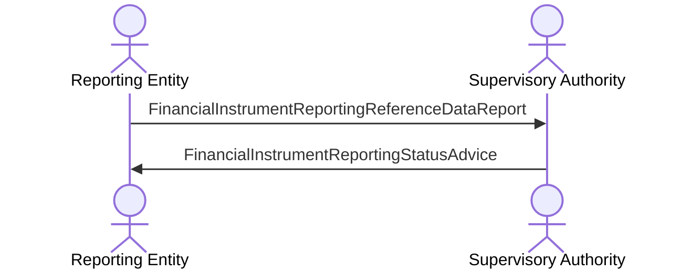

# Reference data — direct reporting

[src-000320](../../../../../../../../evidence/omitted/b0e9dc6419046e4d0523e995.md); direct-body paragraph P177; BusinessTransactions / Reference Data Reporting BusinessTransaction / Direct Reporting.

[Original image](../../../../../../../../evidence/omitted/e8e79c408f6f47a8a1b73105.md) · [Readable original preview](../../../../../../../../evidence/omitted/4d84c4333a58a451cfa33ffe.md) · [Flow, conditions and narrative responsibilities](../../flows/flow-src-000320-p175-direct-reporting.md)

## Source reconstruction

## Actors and relationships

- [Reporting Entity](../../../../../../../../shared/reference/participants/participant-src-000320-reporting-entity.md)
- [Supervisory Authority](../../../../../../../../shared/reference/participants/participant-src-000320-supervisory-authority.md)

| Order | Sender | Receiver | Literal source message / exchange | Source condition or fragment |
| --- | --- | --- | --- | --- |
| 1 | Reporting Entity | Supervisory Authority | FinancialInstrumentReportingReferenceDataReport | Outside conditional frame |
| 2 | Supervisory Authority | Reporting Entity | FinancialInstrumentReportingStatusAdvice | Outside conditional frame |

The source activation bars are execution markers without specified duration. Vertical message ordering is retained; synchronous versus asynchronous transport behavior is not inferred. OR-labelled message alternatives remain alternatives, not two required transmissions.

## Qualifications

No source discrepancy was identified in this picture transcription. Wider source and business review remains separate.

## Rendering and visual review

Mermaid 12.3.0 with Mermaid browser API + Chromium 156.0.8078.81 parsed and rendered this reconstruction. The original and rendered PNG were directly compared on 2026-11-09 (Europe/Warsaw), checking labels, endpoints, order, branches and repeated exchanges. Result: **pass**.

[Rendered SVG](../../../../../../../../evidence/omitted/d826c1cf08f81acf968c8bba.md) · [Rendered PNG](../../../../../../../../evidence/omitted/f388686292ac993b45f889a4.md) · [Hash-bound visual-review evidence](../../../../../../../../tracking/reviews/fitrr-sequences.json)

This review does not resolve conflicting source statements or native hidden-content coverage.
