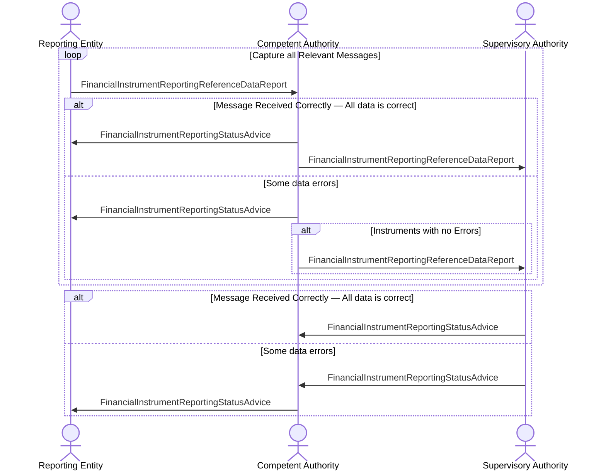

# Reference data — indirect reporting

[src-000320](../../../../../../../../evidence/omitted/b0e9dc6419046e4d0523e995.md); direct-body paragraph P185; BusinessTransactions / Reference Data Reporting BusinessTransaction / In-Direct Reporting.

[Original image](../../../../../../../../evidence/omitted/7683324a5fcdc820d5112990.md) · [Readable original preview](../../../../../../../../evidence/omitted/b1c3c9c1f7392c326568451d.md) · [Flow, conditions and narrative responsibilities](../../flows/flow-src-000320-p183-in-direct-reporting.md)

## Source reconstruction

## Actors and relationships

- [Reporting Entity](../../../../../../../../shared/reference/participants/participant-src-000320-reporting-entity.md)
- [Competent Authority](../../../../../../../../shared/reference/participants/participant-src-000320-competent-authority.md)
- [Supervisory Authority](../../../../../../../../shared/reference/participants/participant-src-000320-supervisory-authority.md)

| Order | Sender | Receiver | Literal source message / exchange | Source condition or fragment |
| --- | --- | --- | --- | --- |
| 1 | Reporting Entity | Competent Authority | FinancialInstrumentReportingReferenceDataReport | Capture all Relevant Messages |
| 2 | Competent Authority | Reporting Entity | FinancialInstrumentReportingStatusAdvice | Capture all Relevant Messages / Message Received Correctly — All data is correct |
| 3 | Competent Authority | Supervisory Authority | FinancialInstrumentReportingReferenceDataReport | Capture all Relevant Messages / Message Received Correctly — All data is correct |
| 4 | Competent Authority | Reporting Entity | FinancialInstrumentReportingStatusAdvice | Capture all Relevant Messages / Some data errors |
| 5 | Competent Authority | Supervisory Authority | FinancialInstrumentReportingReferenceDataReport | Capture all Relevant Messages / Some data errors / Instruments with no Errors |
| 6 | Supervisory Authority | Competent Authority | FinancialInstrumentReportingStatusAdvice | Message Received Correctly — All data is correct |
| 7 | Supervisory Authority | Competent Authority | FinancialInstrumentReportingStatusAdvice | Some data errors |
| 8 | Competent Authority | Reporting Entity | FinancialInstrumentReportingStatusAdvice | Some data errors |

The source activation bars are execution markers without specified duration. Vertical message ordering is retained; synchronous versus asynchronous transport behavior is not inferred. OR-labelled message alternatives remain alternatives, not two required transmissions.

## Qualifications

- The source loop/first alternative covers the Reporting Entity and Competent Authority lifelines while report arrows and the inner alternative cross that frame boundary to the Supervisory Authority. Mermaid expands these frames to the participating lifelines. Conditions, all arrows, order and the crossing-frame feature are retained in text; frame geometry is not identical.

## Rendering and visual review

Mermaid 12.3.0 with Mermaid browser API + Chromium 156.0.8078.81 parsed and rendered this reconstruction. The original and rendered PNG were directly compared on 2026-11-09 (Europe/Warsaw), checking labels, endpoints, order, branches and repeated exchanges. Result: **pass-with-documented-notation-limitations**.

[Rendered SVG](../../../../../../../../evidence/omitted/394a34dc130106b867444829.md) · [Rendered PNG](../../../../../../../../evidence/omitted/9e569098608e85a4d8e02fda.md) · [Hash-bound visual-review evidence](../../../../../../../../tracking/reviews/fitrr-sequences.json)

This review does not resolve conflicting source statements or native hidden-content coverage.
