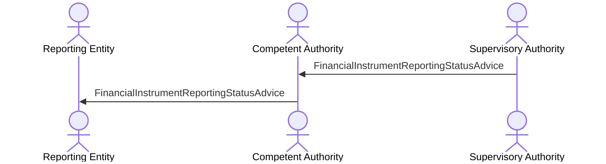

# Incomplete reference data — indirect reminder

[src-000320](../../../../../../../../evidence/omitted/b0e9dc6419046e4d0523e995.md); direct-body paragraph P208; BusinessTransactions / Incomplete Data BusinessTransaction / Proxy and In-Direct Reporting.

[Original image](../../../../../../../../evidence/omitted/6033c77b3f53c748558e261f.md) · [Readable original preview](../../../../../../../../evidence/omitted/91110d72d35a87fc40951480.md) · [Flow, conditions and narrative responsibilities](../../flows/flow-src-000320-p206-proxy-and-in-direct-reporting.md)

## Source reconstruction

## Actors and relationships

- [Reporting Entity](../../../../../../../../shared/reference/participants/participant-src-000320-reporting-entity.md)
- [Competent Authority](../../../../../../../../shared/reference/participants/participant-src-000320-competent-authority.md)
- [Supervisory Authority](../../../../../../../../shared/reference/participants/participant-src-000320-supervisory-authority.md)

| Order | Sender | Receiver | Literal source message / exchange | Source condition or fragment |
| --- | --- | --- | --- | --- |
| 1 | Supervisory Authority | Competent Authority | FinancialInstrumentReportingStatusAdvice | Outside conditional frame |
| 2 | Competent Authority | Reporting Entity | FinancialInstrumentReportingStatusAdvice | Outside conditional frame |

The source activation bars are execution markers without specified duration. Vertical message ordering is retained; synchronous versus asynchronous transport behavior is not inferred. OR-labelled message alternatives remain alternatives, not two required transmissions.

## Qualifications

No source discrepancy was identified in this picture transcription. Wider source and business review remains separate.

## Rendering and visual review

Mermaid 12.3.0 with Mermaid browser API + Chromium 156.0.8078.81 parsed and rendered this reconstruction. The original and rendered PNG were directly compared on 2026-11-09 (Europe/Warsaw), checking labels, endpoints, order, branches and repeated exchanges. Result: **pass**.

[Rendered SVG](../../../../../../../../evidence/omitted/5bc3f16a1573e166854c1a3f.md) · [Rendered PNG](../../../../../../../../evidence/omitted/2bb907b5866e5f4c8f4c323b.md) · [Hash-bound visual-review evidence](../../../../../../../../tracking/reviews/fitrr-sequences.json)

This review does not resolve conflicting source statements or native hidden-content coverage.
