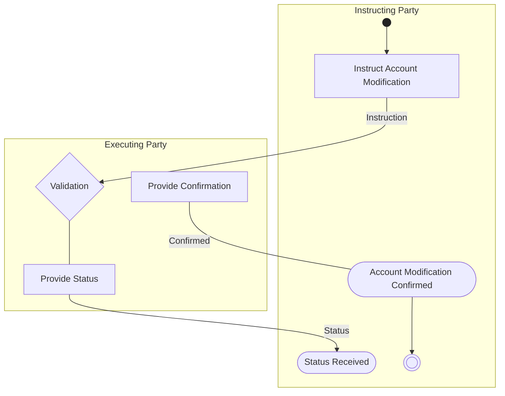

# Account Modification Flow

[src-000095](../../../../../../../../evidence/omitted/ffbc05daa043e55c6bd0cc1a.md); direct-body paragraph P208; Description of BusinessActivities / Account Administration / Account Modification.

[Original source figure](../../../../../../../../evidence/omitted/1d06da5aad391890fb1b54c7.md) · [Readable original preview](../../../../../../../../evidence/omitted/1d06da5aad391890fb1b54c7.md) · [Complete Word-rendered page 27](../../../../../../../../evidence/omitted/66c49117fae225268b04766c.md)

## Source reconstruction

## Activities and source connectors

| Node | Responsible lane | Literal label | Source shape |
| --- | --- | --- | --- |
| start | Instructing Party |  | start |
| instruct | Instructing Party | Instruct Account Modification | action |
| validation | Executing Party | Validation | decision |
| provideStatus | Executing Party | Provide Status | action |
| status | Instructing Party | Status Received | receive |
| provideConfirm | Executing Party | Provide Confirmation | action |
| confirmed | Instructing Party | Account Modification Confirmed | receive |
| end | Instructing Party |  | end |

| From / endpoint 1 | To / endpoint 2 | Label | Connector |
| --- | --- | --- | --- |
| start | instruct |  | arrow |
| instruct | validation | Instruction | arrow |
| validation | provideStatus |  | plain line |
| provideStatus | status | Status | arrow |
| provideConfirm | confirmed | Confirmed | plain line |
| confirmed | end |  | arrow |

[Reusable flow with source-defined conditions and responsibilities](../../flows/flow-src-000095-p207-account-modification.md)

## Participants

- [participant-src-000095-instructing-party](../../../../../../../../shared/reference/participants/participant-src-000095-instructing-party.md)
- [participant-src-000095-executing-party](../../../../../../../../shared/reference/participants/participant-src-000095-executing-party.md)
- [participant-src-000095-executing-party-registering-party](../../../../../../../../shared/reference/participants/participant-src-000095-executing-party-registering-party.md)

## Qualifications

- The source draws no connector between Provide Status and Provide Confirmation. T38 Status Received text literally says account opening instruction despite the account-modification context; preserve that wording in the source table.
- Unlabelled plain source connectors are retained as undirected lines; business direction established by the activity table is described separately. Blank start/end and control symbols remain blank. Mermaid swimlanes preserve responsibility labels but not the exact source geometry.
- Mermaid final-state glyphs use an unfilled double circle instead of the source black-centred bullseye; final-state meaning and every endpoint are preserved, and originals retain exact glyph geometry.

## Rendering and visual review

Mermaid 12.3.0 parsed and rendered successfully on 2026-11-09 with Mermaid browser API + Chromium 156.0.8078.81. [Rendered SVG](../../../../../../../../evidence/omitted/2fe2d1564d4e6390acc31f95.md) · [Rendered PNG](../../../../../../../../evidence/omitted/b087f451e0b6790432cd4f74.md).

Original extracted picture and complete Word-rendered source page compared with rendered Mermaid PNG; checked actor occurrences, source labels, endpoints, arrowheads/plain lines, lane/control boundaries and alternatives. Complete-page composition checked in contact sheets; original pictures inspected at readable size. Review date: 2026-11-09. Source page 27.

Source inconsistency remains open: issue-000041. Literal reconstruction does not resolve that evidence conflict.
