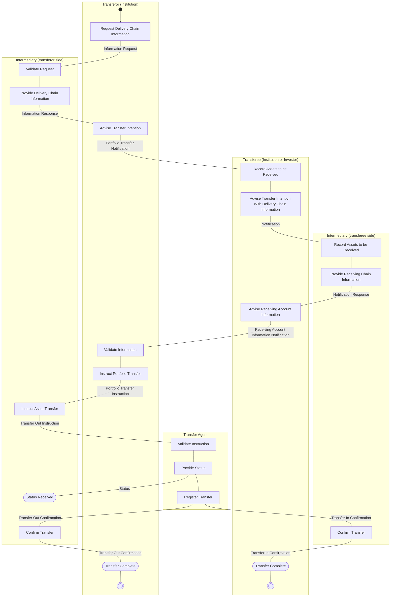

# Transfer — Single Leg (Transferor instructing)

[src-000095](../../../../../../../../evidence/omitted/ffbc05daa043e55c6bd0cc1a.md); direct-body paragraph P229; Description of BusinessActivities /  Portfolio and Stock Transfers (Single Leg).

[Original source figure](../../../../../../../../evidence/omitted/e95762372e35ac9f36db405f.md) · [Readable original preview](../../../../../../../../evidence/omitted/e95762372e35ac9f36db405f.md) · [Complete Word-rendered page 36](../../../../../../../../evidence/omitted/6074ddb582c446914a50d769.md)

## Source reconstruction

## Activities and source connectors

| Node | Responsible lane | Literal label | Source shape |
| --- | --- | --- | --- |
| start | Transferor (Institution) |  | start |
| request | Transferor (Institution) | Request Delivery Chain Information | action |
| validateM | Intermediary (transferor side) | Validate Request | action |
| provideM | Intermediary (transferor side) | Provide Delivery Chain Information | action |
| advise | Transferor (Institution) | Advise Transfer Intention | action |
| recordT | Transferee (Institution or Investor) | Record Assets to be Received | action |
| adviseT | Transferee (Institution or Investor) | Advise Transfer Intention With Delivery Chain Information | action |
| recordN | Intermediary (transferee side) | Record Assets to be Received | action |
| provideN | Intermediary (transferee side) | Provide Receiving Chain Information | action |
| adviseAccount | Transferee (Institution or Investor) | Advise Receiving Account Information | action |
| validateO | Transferor (Institution) | Validate Information | action |
| instructO | Transferor (Institution) | Instruct Portfolio Transfer | action |
| instructM | Intermediary (transferor side) | Instruct Asset Transfer | action |
| validateA | Transfer Agent | Validate Instruction | action |
| provideA | Transfer Agent | Provide Status | action |
| statusM | Intermediary (transferor side) | Status Received | receive |
| register | Transfer Agent | Register Transfer | action |
| confirmM | Intermediary (transferor side) | Confirm Transfer | action |
| confirmN | Intermediary (transferee side) | Confirm Transfer | action |
| completeO | Transferor (Institution) | Transfer Complete | receive |
| completeT | Transferee (Institution or Investor) | Transfer Complete | receive |
| endO | Transferor (Institution) |  | end |
| endT | Transferee (Institution or Investor) |  | end |

| From / endpoint 1 | To / endpoint 2 | Label | Connector |
| --- | --- | --- | --- |
| start | request |  | arrow |
| request | validateM | Information Request | plain line |
| validateM | provideM |  | plain line |
| provideM | advise | Information Response | plain line |
| advise | recordT | Portfolio Transfer Notification | plain line |
| recordT | adviseT |  | plain line |
| adviseT | recordN | Notification | plain line |
| recordN | provideN |  | plain line |
| provideN | adviseAccount | Notification Response | plain line |
| adviseAccount | validateO | Receiving Account Information Notification | plain line |
| validateO | instructO |  | plain line |
| instructO | instructM | Portfolio Transfer Instruction | plain line |
| instructM | validateA | Transfer Out Instruction | plain line |
| validateA | provideA |  | plain line |
| provideA | statusM | Status | plain line |
| provideA | register |  | plain line |
| register | confirmM | Transfer Out Confirmation | plain line |
| register | confirmN | Transfer In Confirmation | plain line |
| confirmM | completeO | Transfer Out Confirmation | plain line |
| confirmN | completeT | Transfer In Confirmation | plain line |
| completeO | endO |  | plain line |
| completeT | endT |  | plain line |

[Reusable flow with source-defined conditions and responsibilities](../../flows/flow-src-000095-p226-portfolio-and-stock-transfers-single-leg.md)

## Participants

- [participant-src-000095-transferor](../../../../../../../../shared/reference/participants/participant-src-000095-transferor.md)
- [participant-src-000095-transferee](../../../../../../../../shared/reference/participants/participant-src-000095-transferee.md)
- [participant-src-000095-intermediary](../../../../../../../../shared/reference/participants/participant-src-000095-intermediary.md)
- [participant-src-000095-transfer-agent](../../../../../../../../shared/reference/participants/participant-src-000095-transfer-agent.md)

## Qualifications

- The source has two horizontal phases: Exchange of Information through Validate Information; Portfolio & Asset Transfer from Instruct Portfolio Transfer onward. This phase split is preserved in text to avoid confusing the two distinct Intermediary lanes. Status is not required if transfer is registered immediately. Plain source lines do not become inferred arrowheads.
- Unlabelled plain source connectors are retained as undirected lines; business direction established by the activity table is described separately. Blank start/end and control symbols remain blank. Mermaid swimlanes preserve responsibility labels but not the exact source geometry.
- Mermaid final-state glyphs use an unfilled double circle instead of the source black-centred bullseye; final-state meaning and every endpoint are preserved, and originals retain exact glyph geometry.

## Rendering and visual review

Mermaid 12.3.0 parsed and rendered successfully on 2026-11-09 with Mermaid browser API + Chromium 156.0.8078.81. [Rendered SVG](../../../../../../../../evidence/omitted/d3f3d4afc92cfd4d3199ed01.md) · [Rendered PNG](../../../../../../../../evidence/omitted/b43b42f4fc9be3897fda4f68.md).

Original extracted picture and complete Word-rendered source page compared with rendered Mermaid PNG; checked actor occurrences, source labels, endpoints, arrowheads/plain lines, lane/control boundaries and alternatives. Complete-page composition checked in contact sheets; original pictures inspected at readable size. Review date: 2026-11-09. Source page 36.

The recorded review covers this bounded figure and its cited source context.
