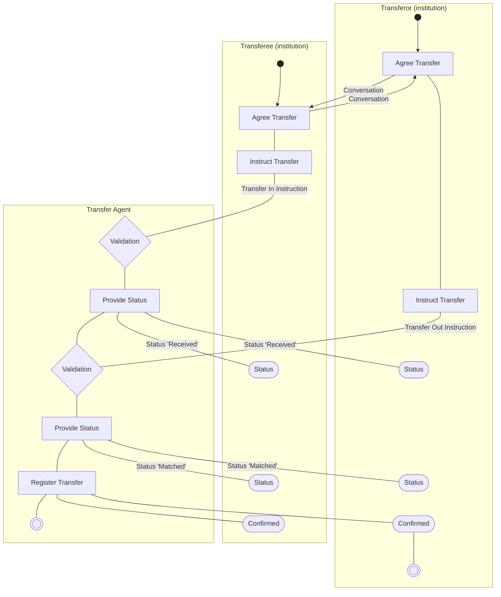

# Transfer Flow — Double Leg (institution to institution)

[src-000095](../../../../../../../../evidence/omitted/ffbc05daa043e55c6bd0cc1a.md); direct-body paragraph P233; Description of BusinessActivities / Portfolio and Stock Transfers (Double/Matched Leg).

[Original source figure](../../../../../../../../evidence/omitted/597a184779598e2d1a274f93.md) · [Readable original preview](../../../../../../../../evidence/omitted/597a184779598e2d1a274f93.md) · [Complete Word-rendered page 38](../../../../../../../../evidence/omitted/6cf6c44c98a66fff4f55202f.md)

## Source reconstruction

## Activities and source connectors

| Node | Responsible lane | Literal label | Source shape |
| --- | --- | --- | --- |
| startO | Transferor (institution) |  | start |
| startT | Transferee (institution) |  | start |
| agreeO | Transferor (institution) | Agree Transfer | action |
| agreeT | Transferee (institution) | Agree Transfer | action |
| instructT | Transferee (institution) | Instruct Transfer | action |
| validateIn | Transfer Agent | Validation | decision |
| statusIn | Transfer Agent | Provide Status | action |
| receivedT | Transferee (institution) | Status | receive |
| receivedO | Transferor (institution) | Status | receive |
| instructO | Transferor (institution) | Instruct Transfer | action |
| validateOut | Transfer Agent | Validation | decision |
| statusOut | Transfer Agent | Provide Status | action |
| matchedT | Transferee (institution) | Status | receive |
| matchedO | Transferor (institution) | Status | receive |
| register | Transfer Agent | Register Transfer | action |
| confirmedT | Transferee (institution) | Confirmed | receive |
| confirmedO | Transferor (institution) | Confirmed | receive |
| endO | Transferor (institution) |  | end |
| endA | Transfer Agent |  | end |

| From / endpoint 1 | To / endpoint 2 | Label | Connector |
| --- | --- | --- | --- |
| startO | agreeO |  | arrow |
| startT | agreeT |  | arrow |
| agreeO | agreeT | Conversation | arrow |
| agreeT | agreeO | Conversation | arrow |
| agreeT | instructT |  | plain line |
| agreeO | instructO |  | plain line |
| instructT | validateIn | Transfer In Instruction | plain line |
| validateIn | statusIn |  | plain line |
| statusIn | receivedT | Status 'Received' | plain line |
| statusIn | receivedO | Status 'Received' | plain line |
| statusIn | validateOut |  | plain line |
| instructO | validateOut | Transfer Out Instruction | plain line |
| validateOut | statusOut |  | plain line |
| statusOut | matchedT | Status 'Matched' | plain line |
| statusOut | matchedO | Status 'Matched' | plain line |
| statusOut | register |  | plain line |
| register | confirmedT |  | plain line |
| register | confirmedO |  | plain line |
| confirmedO | endO |  | plain line |
| register | endA |  | plain line |

[Reusable flow with source-defined conditions and responsibilities](../../flows/flow-src-000095-p230-portfolio-and-stock-transfers-double-matched-leg.md)

## Participants

- [participant-src-000095-transferor](../../../../../../../../shared/reference/participants/participant-src-000095-transferor.md)
- [participant-src-000095-transferee](../../../../../../../../shared/reference/participants/participant-src-000095-transferee.md)
- [participant-src-000095-transfer-agent](../../../../../../../../shared/reference/participants/participant-src-000095-transfer-agent.md)

## Qualifications

- The two Agree Transfer actions and their bidirectional Conversation are explicitly Out of Scope. Received status is not required if transfer is registered immediately. Only transferor and transfer-agent final symbols are drawn; no transferee final node is invented. Plain connectors are retained without inferred arrowheads.
- Unlabelled plain source connectors are retained as undirected lines; business direction established by the activity table is described separately. Blank start/end and control symbols remain blank. Mermaid swimlanes preserve responsibility labels but not the exact source geometry.
- Mermaid final-state glyphs use an unfilled double circle instead of the source black-centred bullseye; final-state meaning and every endpoint are preserved, and originals retain exact glyph geometry.

## Rendering and visual review

Mermaid 12.3.0 parsed and rendered successfully on 2026-11-09 with Mermaid browser API + Chromium 156.0.8078.81. [Rendered SVG](../../../../../../../../evidence/omitted/19883abbc14556af59c77614.md) · [Rendered PNG](../../../../../../../../evidence/omitted/17657de68ed8426ae83647ea.md).

Original extracted picture and complete Word-rendered source page compared with rendered Mermaid PNG; checked actor occurrences, source labels, endpoints, arrowheads/plain lines, lane/control boundaries and alternatives. Complete-page composition checked in contact sheets; original pictures inspected at readable size. Review date: 2026-11-09. Source page 38.

The recorded review covers this bounded figure and its cited source context.
