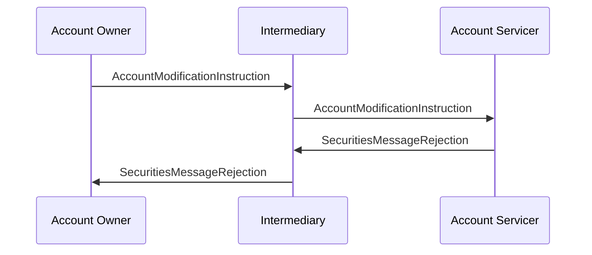

# Account Management / Account Modification / Rejection - Intermediary — figure 29

[src-000095](../../../../../../../../evidence/omitted/ffbc05daa043e55c6bd0cc1a.md); direct-body paragraph P278; Word file/printed page 44.

[Original figure](../../../../../../../../evidence/omitted/c079fb3c6948c23367fe15ca.md) · [Complete rendered page](../../../../../../../../evidence/omitted/223f0bd8ec28bd17019abd76.md) · [Reusable flow](../../flows/flow-src-000095-p274-rejection-intermediary.md)

## Source reconstruction

## Participant occurrences

| Occurrence | Literal label | Scoped participant |
| --- | --- | --- |
| O | Account Owner | [account-owner](../../../../../../../../shared/reference/participants/participant-src-000095-account-owner.md) |
| M | Intermediary | [intermediary](../../../../../../../../shared/reference/participants/participant-src-000095-intermediary.md) |
| S | Account Servicer | [account-servicer](../../../../../../../../shared/reference/participants/participant-src-000095-account-servicer.md) |

## Ordered exchanges

| Step | Sender | Receiver | Literal message label |
| --- | --- | --- | --- |
| 1 | Account Owner | Intermediary | AccountModificationInstruction |
| 2 | Intermediary | Account Servicer | AccountModificationInstruction |
| 3 | Account Servicer | Intermediary | SecuritiesMessageRejection |
| 4 | Intermediary | Account Owner | SecuritiesMessageRejection |

## Source qualifications and conditions

- P277: no SLA or unrecognised linked reference; rejection forwarded.
- Source bank icons denote named participants, not institutional identity of a functional role. Repeated instructing-party occurrences are distinct parties using the same role definition.
- Arrow direction and order follow the literal picture. Mermaid uses standard solid arrowheads rather than source open-head geometry; no additional synchrony, timing or network guarantee is inferred.
- Part1 message names/families do not establish exact versions; use maintained Part2/schema references.

## Rendering and visual review

Mermaid 12.3.0 parsed and rendered on 2026-11-09 with Mermaid browser API + Chromium 156.0.8078.81. [Rendered SVG](../../../../../../../../evidence/omitted/fe238ebcfaa23ae96b44c91d.md) · [Rendered PNG](../../../../../../../../evidence/omitted/0beb71120473d3bf0bbca3ee.md).

Every original figure inspected and compared directly with final rendered Mermaid PNG for participant occurrence, arrow direction, message label/code and order. Complete Word-page composition separately inspected in contact sheets for pages40–70; pages65–70 also inspected individually.

This bounded source reconstruction passed its recorded comparison.
