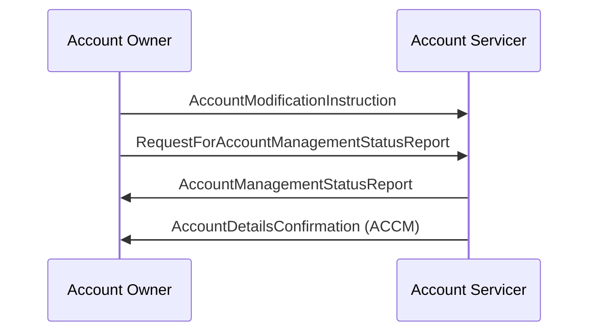

# Account Management / Status of Account Modification – Direct — figure 31

[src-000095](../../../../../../../../evidence/omitted/ffbc05daa043e55c6bd0cc1a.md); direct-body paragraph P289; Word file/printed page 46.

[Original figure](../../../../../../../../evidence/omitted/0cf9dc038616f5b0c76713cc.md) · [Complete rendered page](../../../../../../../../evidence/omitted/c5cfb14a7d9ca5290efd4d40.md) · [Reusable flow](../../flows/flow-src-000095-p284-status-of-account-modification-direct.md)

## Source reconstruction

## Participant occurrences

| Occurrence | Literal label | Scoped participant |
| --- | --- | --- |
| O | Account Owner | [account-owner](../../../../../../../../shared/reference/participants/participant-src-000095-account-owner.md) |
| S | Account Servicer | [account-servicer](../../../../../../../../shared/reference/participants/participant-src-000095-account-servicer.md) |

## Ordered exchanges

| Step | Sender | Receiver | Literal message label |
| --- | --- | --- | --- |
| 1 | Account Owner | Account Servicer | AccountModificationInstruction |
| 2 | Account Owner | Account Servicer | RequestForAccountManagementStatusReport |
| 3 | Account Servicer | Account Owner | AccountManagementStatusReport |
| 4 | Account Servicer | Account Owner | AccountDetailsConfirmation (ACCM) |

## Source qualifications and conditions

- Source bank icons denote named participants, not institutional identity of a functional role. Repeated instructing-party occurrences are distinct parties using the same role definition.
- Arrow direction and order follow the literal picture. Mermaid uses standard solid arrowheads rather than source open-head geometry; no additional synchrony, timing or network guarantee is inferred.
- Part1 message names/families do not establish exact versions; use maintained Part2/schema references.

## Rendering and visual review

Mermaid 12.3.0 parsed and rendered on 2026-11-09 with Mermaid browser API + Chromium 156.0.8078.81. [Rendered SVG](../../../../../../../../evidence/omitted/909b8b94798df2090ee3c947.md) · [Rendered PNG](../../../../../../../../evidence/omitted/e87ffe43dfa4e6e64acec680.md).

Every original figure inspected and compared directly with final rendered Mermaid PNG for participant occurrence, arrow direction, message label/code and order. Complete Word-page composition separately inspected in contact sheets for pages40–70; pages65–70 also inspected individually.

This bounded source reconstruction passed its recorded comparison.
