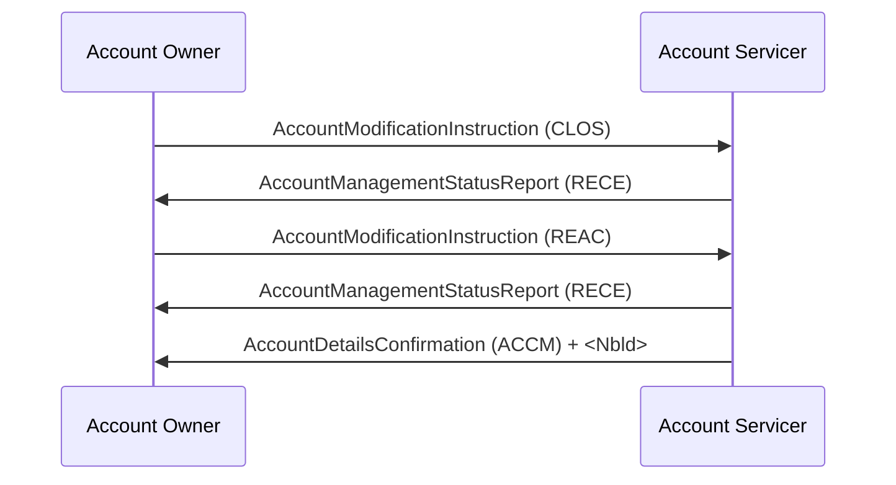

# Account Management / Account Closure and Reactivation - Direct — figure 37

[src-000095](../../../../../../../../evidence/omitted/ffbc05daa043e55c6bd0cc1a.md); direct-body paragraph P314; Word file/printed page 49.

[Original figure](../../../../../../../../evidence/omitted/264f9ab8b525a97e2f2fba5b.md) · [Complete rendered page](../../../../../../../../evidence/omitted/1f79d9846e40db1e6f334342.md) · [Reusable flow](../../flows/flow-src-000095-p311-account-closure-and-reactivation-direct.md)

## Source reconstruction

## Participant occurrences

| Occurrence | Literal label | Scoped participant |
| --- | --- | --- |
| O | Account Owner | [account-owner](../../../../../../../../shared/reference/participants/participant-src-000095-account-owner.md) |
| S | Account Servicer | [account-servicer](../../../../../../../../shared/reference/participants/participant-src-000095-account-servicer.md) |

## Ordered exchanges

| Step | Sender | Receiver | Literal message label |
| --- | --- | --- | --- |
| 1 | Account Owner | Account Servicer | AccountModificationInstruction (CLOS) |
| 2 | Account Servicer | Account Owner | AccountManagementStatusReport (RECE) |
| 3 | Account Owner | Account Servicer | AccountModificationInstruction (REAC) |
| 4 | Account Servicer | Account Owner | AccountManagementStatusReport (RECE) |
| 5 | Account Servicer | Account Owner | AccountDetailsConfirmation (ACCM) + &lt;Nbld&gt; |

## Source qualifications and conditions

- P312–313: CLOS then REAC; final ACCM confirms InvestmentAccount/AccountStatus/Enabled.
- Source bank icons denote named participants, not institutional identity of a functional role. Repeated instructing-party occurrences are distinct parties using the same role definition.
- Arrow direction and order follow the literal picture. Mermaid uses standard solid arrowheads rather than source open-head geometry; no additional synchrony, timing or network guarantee is inferred.
- Part1 message names/families do not establish exact versions; use maintained Part2/schema references.

## Rendering and visual review

Mermaid 12.3.0 parsed and rendered on 2026-11-09 with Mermaid browser API + Chromium 156.0.8078.81. [Rendered SVG](../../../../../../../../evidence/omitted/0369d04569d297a4199d2288.md) · [Rendered PNG](../../../../../../../../evidence/omitted/a18f5ab6710ca20013165d3f.md).

Every original figure inspected and compared directly with final rendered Mermaid PNG for participant occurrence, arrow direction, message label/code and order. Complete Word-page composition separately inspected in contact sheets for pages40–70; pages65–70 also inspected individually.

This bounded source reconstruction passed its recorded comparison.
