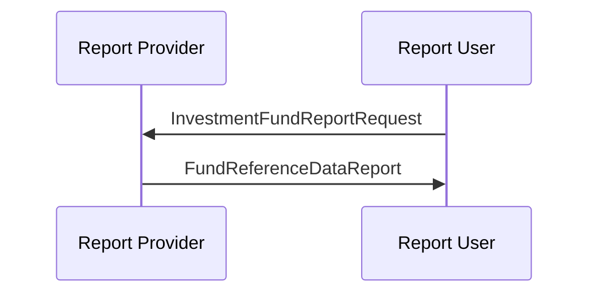

# Fund Reference Data Reporting / Fund Reference Data Report – Solicited (requested) — figure 44

[src-000095](../../../../../../../../evidence/omitted/ffbc05daa043e55c6bd0cc1a.md); direct-body paragraph P355; Word file/printed page 53.

[Original figure](../../../../../../../../evidence/omitted/8bd7e62c95bcf62152871592.md) · [Complete rendered page](../../../../../../../../evidence/omitted/0b280e47cd1df9e1bef7c06b.md) · [Reusable flow](../../flows/flow-src-000095-p351-fund-reference-data-report-solicited-requested.md)

## Source reconstruction

## Participant occurrences

| Occurrence | Literal label | Scoped participant |
| --- | --- | --- |
| P | Report Provider | [reporting-party](../../../../../../../../shared/reference/participants/participant-src-000095-reporting-party.md) |
| U | Report User | [requesting-party](../../../../../../../../shared/reference/participants/participant-src-000095-requesting-party.md) |

## Ordered exchanges

| Step | Sender | Receiver | Literal message label |
| --- | --- | --- | --- |
| 1 | Report User | Report Provider | InvestmentFundReportRequest |
| 2 | Report Provider | Report User | FundReferenceDataReport |

## Source qualifications and conditions

- P352–354: request is for reference data for a specific instrument.
- Source bank icons denote named participants, not institutional identity of a functional role. Repeated instructing-party occurrences are distinct parties using the same role definition.
- Arrow direction and order follow the literal picture. Mermaid uses standard solid arrowheads rather than source open-head geometry; no additional synchrony, timing or network guarantee is inferred.
- Part1 message names/families do not establish exact versions; use maintained Part2/schema references.

## Rendering and visual review

Mermaid 12.3.0 parsed and rendered on 2026-11-09 with Mermaid browser API + Chromium 156.0.8078.81. [Rendered SVG](../../../../../../../../evidence/omitted/c0587c1131eb22538d48cd3c.md) · [Rendered PNG](../../../../../../../../evidence/omitted/56ea4ede7098ac465dd480fb.md).

Every original figure inspected and compared directly with final rendered Mermaid PNG for participant occurrence, arrow direction, message label/code and order. Complete Word-page composition separately inspected in contact sheets for pages40–70; pages65–70 also inspected individually.

This bounded source reconstruction passed its recorded comparison.
