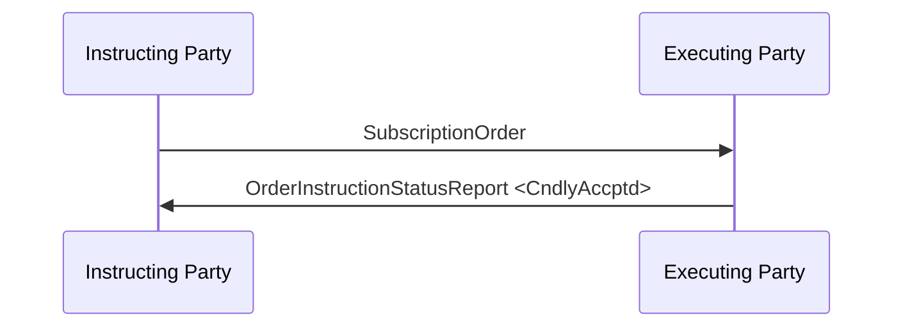

# Order Instruction Status Reporting / Subscription / Direct — figure 58

[src-000095](../../../../../../../../evidence/omitted/ffbc05daa043e55c6bd0cc1a.md); direct-body paragraph P428; Word file/printed page 60.

[Original figure](../../../../../../../../evidence/omitted/1902a0aa4000530b354585f0.md) · [Complete rendered page](../../../../../../../../evidence/omitted/44d5961d048b35303d8e1571.md) · [Reusable flow](../../flows/flow-src-000095-p425-direct.md)

## Source reconstruction

## Participant occurrences

| Occurrence | Literal label | Scoped participant |
| --- | --- | --- |
| I | Instructing Party | [instructing-party](../../../../../../../../shared/reference/participants/participant-src-000095-instructing-party.md) |
| E | Executing Party | [executing-party](../../../../../../../../shared/reference/participants/participant-src-000095-executing-party.md) |

## Ordered exchanges

| Step | Sender | Receiver | Literal message label |
| --- | --- | --- | --- |
| 1 | Instructing Party | Executing Party | SubscriptionOrder |
| 2 | Executing Party | Instructing Party | OrderInstructionStatusReport &lt;CndlyAccptd&gt; |

## Source qualifications and conditions

- P427: conditional acceptance awaits enough cash to execute the subscription.
- Source bank icons denote named participants, not institutional identity of a functional role. Repeated instructing-party occurrences are distinct parties using the same role definition.
- Arrow direction and order follow the literal picture. Mermaid uses standard solid arrowheads rather than source open-head geometry; no additional synchrony, timing or network guarantee is inferred.
- Part1 message names/families do not establish exact versions; use maintained Part2/schema references.

## Rendering and visual review

Mermaid 12.3.0 parsed and rendered on 2026-11-09 with Mermaid browser API + Chromium 156.0.8078.81. [Rendered SVG](../../../../../../../../evidence/omitted/0c16a93d55500ba7aee573fa.md) · [Rendered PNG](../../../../../../../../evidence/omitted/cb023a413f0f81007f58d8eb.md).

Every original figure inspected and compared directly with final rendered Mermaid PNG for participant occurrence, arrow direction, message label/code and order. Complete Word-page composition separately inspected in contact sheets for pages40–70; pages65–70 also inspected individually.

This bounded source reconstruction passed its recorded comparison.
