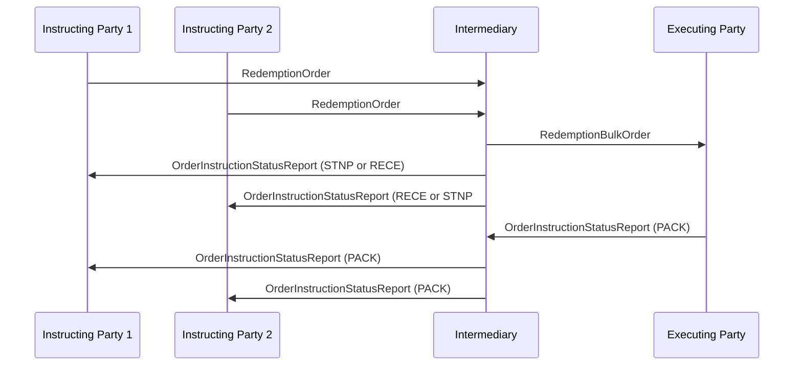

# Order Instruction Status Reporting / Redemption / Bulk — figure 63

[src-000095](../../../../../../../../evidence/omitted/ffbc05daa043e55c6bd0cc1a.md); direct-body paragraph P463; Word file/printed page 64.

[Original figure](../../../../../../../../evidence/omitted/2f019f02caa20a78532f1eb0.md) · [Complete rendered page](../../../../../../../../evidence/omitted/e94f5c1100c4dfd012362eed.md) · [Reusable flow](../../flows/flow-src-000095-p456-bulk.md)

## Source reconstruction

## Participant occurrences

| Occurrence | Literal label | Scoped participant |
| --- | --- | --- |
| I1 | Instructing Party 1 | [instructing-party](../../../../../../../../shared/reference/participants/participant-src-000095-instructing-party.md) |
| I2 | Instructing Party 2 | [instructing-party](../../../../../../../../shared/reference/participants/participant-src-000095-instructing-party.md) |
| M | Intermediary | [intermediary](../../../../../../../../shared/reference/participants/participant-src-000095-intermediary.md) |
| E | Executing Party | [executing-party](../../../../../../../../shared/reference/participants/participant-src-000095-executing-party.md) |

## Ordered exchanges

| Step | Sender | Receiver | Literal message label |
| --- | --- | --- | --- |
| 1 | Instructing Party 1 | Intermediary | RedemptionOrder |
| 2 | Instructing Party 2 | Intermediary | RedemptionOrder |
| 3 | Intermediary | Executing Party | RedemptionBulkOrder |
| 4 | Intermediary | Instructing Party 1 | OrderInstructionStatusReport (STNP or RECE) |
| 5 | Intermediary | Instructing Party 2 | OrderInstructionStatusReport (RECE or STNP |
| 6 | Executing Party | Intermediary | OrderInstructionStatusReport (PACK) |
| 7 | Intermediary | Instructing Party 1 | OrderInstructionStatusReport (PACK) |
| 8 | Intermediary | Instructing Party 2 | OrderInstructionStatusReport (PACK) |

## Source qualifications and conditions

- Source bank icons denote named participants, not institutional identity of a functional role. Repeated instructing-party occurrences are distinct parties using the same role definition.
- Arrow direction and order follow the literal picture. Mermaid uses standard solid arrowheads rather than source open-head geometry; no additional synchrony, timing or network guarantee is inferred.
- Part1 message names/families do not establish exact versions; use maintained Part2/schema references.

## Rendering and visual review

Mermaid 12.3.0 parsed and rendered on 2026-11-09 with Mermaid browser API + Chromium 156.0.8078.81. [Rendered SVG](../../../../../../../../evidence/omitted/92a0db4e2438b974105894c4.md) · [Rendered PNG](../../../../../../../../evidence/omitted/6397264914d7d4fd08248159.md).

Every original figure inspected and compared directly with final rendered Mermaid PNG for participant occurrence, arrow direction, message label/code and order. Complete Word-page composition separately inspected in contact sheets for pages40–70; pages65–70 also inspected individually.

This bounded source reconstruction passed its recorded comparison.

The source label “(RECE or STNP” has no closing parenthesis; preserved literally.
